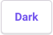

# Using This Resource

This page explains how to find your way around these guides and outlines some of the common features you will encounter.

{: .tip }
You can change how these guides look and sound: text size, font, spacing, colours, and reading pages aloud. See [Display preferences](#display-preferences).

**On this page:**

- [Display preferences](#display-preferences)
- [Light and dark mode](#light-and-dark-mode)
- [Navigation](#navigation)
- [Collapsed sections](#collapsed-sections)
- [Search](#search)
- [Links and videos](#links-and-videos)
- [Keeping up to date](#keeping-up-to-date)

## Display preferences

Display preferences let you set up every page to suit the way you read. Your choices apply to every guide and are remembered the next time you visit.

1. Select **Show preferences** at the top of the page. On smaller screens, open the **Menu** first.
   
   <!-- Screenshot idea: the preferences panel open below the header on a wide screen, showing the grid of settings (text size, text style, spacing, contrast). Crop to the header and panel. -->
2. Change any of the settings. The page changes as you go, so you can see the result right away.
3. Select **Hide preferences** to close the panel.

To undo all your changes, open the panel and select **Reset**.

The settings are:

- **Text size**: make all text larger or smaller.
- **Text style**: change the font, including fonts designed for easier reading, such as Atkinson Hyperlegible and OpenDyslexic.
- **Line spacing**, **Letter spacing** and **Word spacing**: add space between lines, letters or words.
- **Contrast**: choose text and background colours, such as dark brown on sand, black on yellow, or yellow on black.
- **Enhance inputs**: make links, buttons and form fields larger and easier to see.
- **Text-to-speech**: adds a **Read this page aloud** button to the top of each page. When you select text, a small play button also appears beside it to read just that text. It uses the voices built into your browser.
  

{: .note }
Your preferences are saved in your browser, so they only apply on this device and browser. Clearing your browser’s cookies resets them.

The preferences panel is built with the [Preferences Framework](https://fluidproject.org/projects) from the Fluid Project at OCAD University’s Inclusive Design Research Centre. For more ways to have text read aloud, see [Text to Speech Tools](../guides/text-to-speech-tools.md).

## Light and dark mode

Select **Dark** at the top of the page to switch to light text on a dark background. The button then changes to **Light**; select it to switch back. On smaller screens, open the **Menu** first. Your choice is remembered in this browser.

If you have also chosen a **Contrast** colour in Display preferences, the contrast colours are used instead.

## Navigation

On each page, pressing <kbd>Tab</kbd> once moves focus to the **Skip to main content** link. Selecting that link moves keyboard focus directly to the beginning of the page’s main content.

The menu on the left lists every guide. On smaller screens, open it with the **Menu** button at the top of the page. The [home page](../index.md) also lists the guides, grouped by what you want to do.

Most longer pages begin with an “On this page” list of links to specific parts of the page. Select a link to skip to that part of the page.

Once you scroll down, two buttons appear in the bottom-right corner of the page:

- **On this page** opens that same list of links, so you can jump to another part of the page without scrolling back up. Select a link, or press <kbd>Esc</kbd> to close the list. It only appears on pages that have an “On this page” list.
  
- **Back to top** moves you back to the top of the page.
  

On short screens, or when the page is zoomed in, these buttons appear at the end of the page instead.

## Collapsed sections

Many pages group instructions into collapsed sections, one for each tool or topic, to keep pages short. Select a section’s title to expand or collapse it. With a keyboard, move focus to the title and press <kbd>Enter</kbd>. Screen readers announce whether each section is expanded or collapsed.

## Search

Use the **Search** box at the top of each page to search all the guides. Results appear as you type. To move to the search box from anywhere on the page, press <kbd>Ctrl</kbd> + <kbd>K</kbd> (Windows) or <kbd>Command</kbd> + <kbd>K</kbd> (macOS).

## Links and videos

Links to other websites open in a new tab. Most guides include links to the official help pages for each tool. Internal navigation, such as moving between guides or tools, remains in the current tab.

Some guides link to demonstration videos on YouTube and other sites. These videos are made by other organizations, so we can’t guarantee their captions. To turn captions on, see [YouTube in Closed Captions](../guides/closed-captions.md#youtube).

## Keeping up to date

{: .warning .mt-6 }
> Software and settings change often, so a screenshot or menu name may not exactly match what you see. If something is out of date or doesn’t work, contact [assistivetech@langara.ca](mailto:assistivetech@langara.ca).

