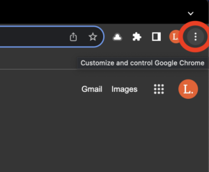
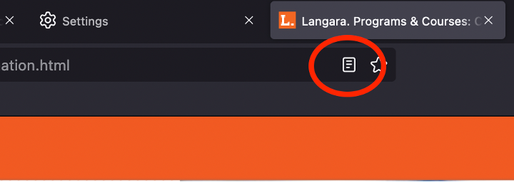
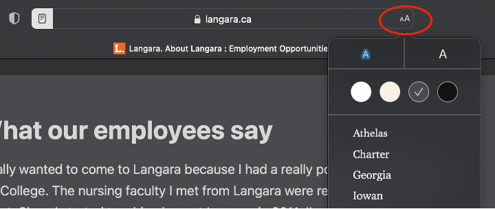

# Browsers

 <!-- review-alt -->

Browsers aren’t assistive technology as such, but they have settings and tools that can make the web easier to use. These guides are for the desktop versions (Windows and macOS); the mobile versions have some similar features.

{: .tip }
For Chrome and Edge, try the [UI Options Plus (UIO+)](https://chromewebstore.google.com/detail/ui-options-plus-uio%2B/okenndailhmikjjfcnmolpaefecbpaek) extension. It lets you quickly change zoom, contrast, line, letter, and word spacing, and more, all in one place (see [UI Options Plus](#ui-options-plus) below).

**On this page:**

- [Chrome](#chrome)
- [Edge](#edge)
- [Firefox](#firefox)
- [Safari](#safari)

## Chrome

 <!-- review-alt -->

Chrome is the most widely used browser and works well with most assistive technology.

To find settings and tools, select **Customize and control Google Chrome** (three vertical dots near the top right) or press <kbd>Alt</kbd> + <kbd>F</kbd>.
 <!-- review-alt -->

Page Zoom

- Zoom in: <kbd>Ctrl</kbd> (<kbd>Command</kbd> on macOS) + <kbd>=</kbd>
- Zoom out: <kbd>Ctrl</kbd> + <kbd>-</kbd>
- Reset to actual size: <kbd>Ctrl</kbd> + <kbd>0</kbd>

The zoom settings can also be accessed from the **View** menu on the toolbar (macOS) or under **More** on Windows.

Chrome remembers the zoom level for each website: the next time you visit, the site opens at the same zoom. To clear the zoom levels Chrome has saved:

1. Select **More > Settings**.
2. Click **Privacy and security > Site settings**.
3. Click **Additional content settings > Zoom levels**.
4. Click **X (Remove zoom level)** beside a site to set it back to the default.

Default Fonts

1. Select **More > Settings**.
2. Select **Appearance**.
3. **Font size** sets the default text size, and **Page zoom** sets the default zoom for all sites.
4. **Customize fonts** has more options:
   1. Minimum font size
   2. Default fonts

[Change text, image and video sizes (zoom) – Google Chrome Help](https://support.google.com/chrome/answer/96810?co=GENIE.Platform%3DDesktop&hl=en)

Live Caption

Chrome can automatically caption audio and video playing in the browser. To turn it on, select **More > Settings > Accessibility** and turn on **Live Caption**.

See [Chrome in Closed Captions](closed-captions.md#chrome) for details, and for other captioning tools.

Reading Mode

Chrome’s **Reading mode** shows a simplified version of a page, with your choice of font, size, spacing, and colours, and can read it aloud. Right-click on the page and select **Open in reading mode**.

See [Chrome in Text to Speech Tools](text-to-speech-tools.md#chrome) for step-by-step instructions.

Get Image Descriptions

If you use a screen reader, Chrome can describe images that have no alt text. See [Get image descriptions on Chrome – Google Chrome Help](https://support.google.com/chrome/answer/9311597) to turn this on. The descriptions are generated automatically and may not be accurate.

Highlight Focused Elements

When you navigate with a keyboard, Chrome can briefly highlight the link, menu, or button that has focus. To turn this on:

1. Go to **Settings**.
2. Select **Accessibility**.
3. Turn on **Show a quick highlight on the focused object**.

Caret Browsing

Press <kbd>F7</kbd> to turn on caret browsing, which lets you move a text cursor around the page with the keyboard and select text.

[Chrome keyboard shortcuts – Google Chrome Help](https://support.google.com/chrome/answer/157179?co=GENIE.Platform%3DDesktop&hl=en)

UI Options Plus

[UI Options Plus](https://chromewebstore.google.com/detail/ui-options-plus-uio%2B/okenndailhmikjjfcnmolpaefecbpaek) is a Chrome extension (it also works in Edge) with many display settings in one panel. Use the scrollbar or the left and right arrows to move between tools:

- Zoom – uses Chrome browser zoom up to 500%.
- Letter spacing – up to 2x website default.
- Word spacing – up to 4x website default.
- Line spacing – up to 3x website default.
- Syllables – puts a dot between the syllables of words.
- Contrast – several combinations of background and text colours.
- Right-click to select – right-click any part of a block of text to select all of it.
  - This makes it easier to copy text or have it read aloud.
- Selection highlight – changes the colour of selected text.
- Text-to-speech – reads selected text aloud when you click **Play**.
- Reading mode – simplifies the page and removes distractions like ads and sidebars (this can break the layout of some pages).
- Table of contents – builds a table of contents from the page’s headings.
- Enhance inputs – makes link and button text larger, bold, and underlined.

Change a setting with the left and right arrows, by typing a number, or with its on/off switch.

To reset all customizations to default, right-click the extension icon and choose **Reset**.

Links

- [Accessibility on Chrome – Google Chrome Help](https://support.google.com/chrome/topic/7437725)
- [Chrome keyboard shortcuts – Google Chrome Help](https://support.google.com/chrome/answer/157179?co=GENIE.Platform%3DDesktop&hl=en)
- [Use Chrome with accessibility extensions – Google Chrome Help](https://support.google.com/chrome/answer/7040464)
- [Google Accessibility for customers and partners](https://www.google.com/accessibility/customers-partners/) (accessibility conformance reports for Google products)
- [8 great Chrome accessibility extensions – Educators’ Technology](https://www.educatorstechnology.com/2021/10/8-great-chrome-accessibility-extensions.html) (2021)

## Edge

 <!-- review-alt -->

Edge is the default browser in Windows. It is built on the same engine as Chrome, so many features and settings are the same, and Chrome extensions work in Edge.

To find settings and tools, select **Settings and more** on the toolbar or press <kbd>Alt</kbd> + <kbd>F</kbd>.

Page Zoom

- To zoom in: Press <kbd>Ctrl</kbd> (<kbd>Command</kbd> on macOS) + <kbd>=</kbd>
- To zoom out: Press <kbd>Ctrl</kbd> + <kbd>-</kbd>
- To reset to actual size: Press <kbd>Ctrl</kbd> + <kbd>0</kbd>

Additionally, open the **Settings and more** button and click the **+** or **–** on the **Zoom** line of the menu.

Default Fonts

1. Navigate to **Settings**.
2. Select **Appearance** from the sidebar.
3. Navigate to **Zoom**.
   1. Select the **Page zoom** dropdown to set the default zoom percentage.
4. Navigate to **Fonts**.
   1. Select the **Font size** dropdown to change the default font size.
   2. Select **Customize fonts** for additional options.

Read Aloud

Edge has two reading tools. **Read aloud** reads the page aloud, and **Immersive Reader** is a distraction-free view of the page that can also read it aloud.

To start **Read aloud**, select text, or right-click where you want it to start, and select **Read aloud**. Or press <kbd>Ctrl</kbd> + <kbd>Shift</kbd> + <kbd>U</kbd>. A toolbar at the top of the window lets you pause, skip ahead or back, and change the voice and speed.

Immersive Reader isn’t available on every page. When it is, an icon of an open book with a speaker appears in the address bar. Click the icon or press <kbd>F9</kbd>. Its toolbar has options for text size and spacing, font, and page colour themes, plus grammar, focus, and pronunciation tools.

[Use Immersive Reader in Microsoft Edge – Microsoft Support](https://support.microsoft.com/en-us/topic/use-immersive-reader-in-microsoft-edge-78a7a17d-52e1-47ee-b0ac-eff8539015e1)

See [Text to Speech Tools](text-to-speech-tools.md#edge) for step-by-step instructions with screenshots.

Keyboard Navigation

Caret browsing lets you move a text cursor around web pages with the keyboard and select text to copy. Press <kbd>F7</kbd> to turn it on or off, or:

1. Open **Settings**.
2. Select **Accessibility**.
3. Under **Keyboard**, turn on **Navigate pages with a text cursor**.

Links

- [Accessibility features in Microsoft Edge – Microsoft Support](https://support.microsoft.com/en-us/microsoft-edge/accessibility-features-in-microsoft-edge-4c696192-338e-9465-b2cd-bd9b698ad19a)
- [Keyboard shortcuts in Microsoft Edge – Microsoft Support](https://support.microsoft.com/en-us/microsoft-edge/keyboard-shortcuts-in-microsoft-edge-50d3edab-30d9-c7e4-21ce-37fe2713cfad)

## Firefox

 <!-- review-alt -->

Firefox isn’t built on the same engine as Chrome and Edge, so its extensions, settings, and some keyboard shortcuts are different. It is still a popular browser, very customizable, with many excellent features, including built-in text to speech.

Page Zoom

- To zoom in: <kbd>Ctrl</kbd> (<kbd>Command</kbd> on macOS) + <kbd>=</kbd>
- To zoom out: <kbd>Ctrl</kbd> + <kbd>-</kbd>
- To reset to actual size: <kbd>Ctrl</kbd> + <kbd>0</kbd>, or click the zoom percentage icon in the address bar

Or, hold <kbd>Ctrl</kbd> (<kbd>Command</kbd> on macOS) and scroll up (with the mouse wheel or two fingers on a trackpad) to zoom in and scroll down to zoom out.

Firefox can also zoom only the text (select **View > Zoom > Zoom Text Only**, then use the same shortcuts). This may break the layout of some pages.

To set the zoom for all pages, go to **Settings > General** and, under **Language and Appearance**, choose a **Default zoom**.

[Font size and zoom – Firefox Help](https://support.mozilla.org/en-US/kb/font-size-and-zoom-increase-size-of-web-pages)

Default Fonts

To set a minimum font size:

1. Go to **Settings** and find the **Language and Appearance** section.
2. Under Fonts and Colours, select the **Advanced…** button.
3. In the **Minimum Font Size** drop-down, select the minimum size in pixels for text.
4. Uncheck **Allow pages to choose their own fonts, instead of their selections above**.
5. Click **OK**.

Read more about [Firefox minimum text size options](https://support.mozilla.org/en-US/kb/font-size-and-zoom-increase-size-of-web-pages#w_set-a-minimum-text-size).

To override page font styles:

1. Open **Settings**.
2. Under **Language and Appearance > Fonts and Colours**, select **Advanced**.
3. Set the various fonts you would like to use.
4. Uncheck **Allow pages to choose their own fonts, instead of their selections above**.
5. Click **OK**.

[Firefox guide for overriding page fonts](https://support.mozilla.org/en-US/kb/accessibility-features-firefox-make-firefox-and-we#w_overriding-page-fonts)

Default Colours

Firefox lets you choose your own colours for text, backgrounds, and links.

1. Go to **Settings**.
2. Under **Language and Appearance**, select the **Colours** button.
3. Choose your colours, then set **Override the colours specified by the page with your selections above** to **Always**.

More information on overriding [page colours](https://support.mozilla.org/en-US/kb/accessibility-features-firefox-make-firefox-and-we#w_overriding-page-colors).

Reader View

Firefox’s Reader View strips many pages down to the text and main images, and lets you change the background colour, font, text size, alignment, and spacing. When Reader View is available, a page icon appears in the address bar.
 <!-- review-alt -->

Select the icon, or press <kbd>F9</kbd> or <kbd>Ctrl</kbd> + <kbd>Alt</kbd> + <kbd>R</kbd> (<kbd>Command</kbd> + <kbd>Option</kbd> + <kbd>R</kbd> on macOS).

A toolbar on the simplified page has options to change its appearance and to have it read aloud. See [Firefox in Text to Speech Tools](text-to-speech-tools.md#firefox).

[Firefox Reader View for clutter-free web pages – Firefox Help](https://support.mozilla.org/en-US/kb/firefox-reader-view-clutter-free-web-pages)

Page Viewing

To see a page without its styles (just the text, links, and images), select **View > Page Style > No Style**.

Keyboard Navigation

As in other browsers, press <kbd>Tab</kbd> to move between links, buttons, menus, and other controls, and <kbd>Shift</kbd> + <kbd>Tab</kbd> to move back.

Press <kbd>F7</kbd> to turn caret browsing on or off. It lets you move a text cursor through a web page and select text, as in a text editor.

[Accessibility features in Firefox – Firefox Help](https://support.mozilla.org/en-US/kb/accessibility-features-firefox-make-firefox-and-we)

Search

To search within a web page, press <kbd>Ctrl</kbd> (<kbd>Command</kbd> on macOS) + <kbd>F</kbd>. For a quick search with fewer options, press <kbd>/</kbd>. Press <kbd>&#39;</kbd> (apostrophe) to search only the links on the page, which is a quick way to jump to a section.

Press <kbd>Escape</kbd> to close the search tool.

Eye Dropper

Windows:

1. Select **Open Application Menu**.
2. Open **More tools**.
3. Select **Eyedropper**.

macOS:

1. Select **Tools**.
2. Choose **Eyedropper**.

Click a colour in the magnified view that appears. Its hex colour code is copied to the clipboard, ready to paste into another app.

Copy Text from Image (macOS only)

1. Right-click on an image.
2. Select **Copy Text from Image**.
3. A pop-up containing the image’s text appears.
   1. The complete text is automatically copied to the clipboard.
   2. To copy only part of it, select that text and press <kbd>Command</kbd> + <kbd>C</kbd>.
4. Click **Close** or press <kbd>Escape</kbd>.

See [Optical Character Recognition](optical-character-recognition.md) for other ways to copy text from images.

Known Issues

- Because Firefox isn’t built on the same engine as Chrome, some web pages and features may behave differently.
- Some extensions are only made for Chrome and aren’t available for Firefox.

Links

- [Accessibility features in Firefox – Firefox Help](https://support.mozilla.org/en-US/kb/accessibility-features-firefox-make-firefox-and-we)
- [Mouse shortcuts in Firefox – Firefox Help](https://support.mozilla.org/en-US/kb/mouse-shortcuts-perform-common-tasks) (zoom, go back and forward, work with tabs)

## Safari

 <!-- review-alt -->

Safari is the built-in web browser on macOS, iOS, and iPadOS. It has fewer extensions than Chrome, but some features of its own.

Select **Safari > Settings** in the menu bar (**Preferences** in older versions), or press <kbd>Command</kbd> + <kbd>,</kbd>, to open Safari’s settings.

Page Zoom

- To zoom in: <kbd>Command</kbd> + <kbd>=</kbd>
- To zoom out: <kbd>Command</kbd> + <kbd>-</kbd>
- To reset to actual size: <kbd>Command</kbd> + <kbd>0</kbd>

Safari can also [zoom text only](https://support.apple.com/en-ca/guide/safari/ibrw1068/mac), but this often breaks the layout of web pages.

Minimum Font Size

1. Select **Safari > Settings…**
2. Select the **Advanced** tab.
3. Check **Never use font sizes smaller than** and choose a size.

Set defaults for current site

1. Select **Safari** from the menu bar.
2. Select **Settings for \[current website\]**.
3. Choose **Use Reader when available** and set the zoom for that site with **Page Zoom**.

You can change or remove these settings later in **Safari > Settings > Websites**.

To set defaults for all websites:

1. Select **Safari** in the menu bar.
2. Select **Settings**.
3. Go to the **Websites** tab.
4. Select **Page Zoom** in the sidebar.
5. At the bottom right, choose a zoom percentage beside **When visiting other websites**.
6. To always use Reader when it’s available, select **Reader** in the sidebar and choose **On** beside **When visiting other websites**.

[Customize settings for each website in Safari on Mac – Apple Support (CA)](https://support.apple.com/en-ca/guide/safari/ibrw7f78f7fe/mac)

Reader View

Safari’s **Reader** shows many articles in a simpler, easier-to-read view.

Select **Show Reader** in the address bar (in newer versions of Safari, it’s in the page menu at the left of the address bar), or press <kbd>Command</kbd> + <kbd>Shift</kbd> + <kbd>R</kbd>.

To change the font, text size, and background colour, use the **Aa** button.
 <!-- review-alt -->

[Hide distractions when reading articles in Safari on Mac – Apple Support (CA)](https://support.apple.com/en-ca/guide/safari/sfri32632/mac)

Text to Speech

Highlight text and select **Edit > Speech > Start Speaking**, or right-click and select **Speech > Start Speaking**.

You can also choose **Start Speaking** without highlighting anything, but on some web pages it may start reading at odd points.

Select **Edit > Speech > Stop Speaking** to stop.

Change the voice in **System Settings > Accessibility > Read & Speak** (**Spoken Content** in older versions of macOS). See [Safari in Text to Speech Tools](text-to-speech-tools.md#safari).

Keyboard Navigation

First, turn on keyboard navigation in macOS:

1. Go to **System Settings > Keyboard**.
2. Turn on **Keyboard navigation**.

Then, in Safari:

1. Select **Safari > Settings** in the menu bar.
2. Go to the **Advanced** tab.
3. Under **Accessibility**, check **Press Tab to highlight each item on a webpage**.

Useful shortcuts:

- Reload current page: <kbd>Command</kbd> + <kbd>R</kbd>
- Move focus to address bar: <kbd>Command</kbd> + <kbd>L</kbd>
- Move back one page: <kbd>Command</kbd> + <kbd>[</kbd>
- Move forward one page: <kbd>Command</kbd> + <kbd>]</kbd>
- Move down the page vertically: <kbd>Space</kbd>
- Move up the page: <kbd>Shift</kbd> + <kbd>Space</kbd>

Links

- [Accessibility – Apple (CA)](https://www.apple.com/ca/accessibility)
- [Safari User Guide for Mac – Apple Support (CA)](https://support.apple.com/en-ca/guide/safari/mh35884/mac)
- [Keyboard shortcuts and gestures in Safari on Mac – Apple Support (CA)](https://support.apple.com/en-ca/guide/safari/cpsh003/mac)

---

*Assistive Technology User Guides* by Luke McKnight is licensed under a [Creative Commons Attribution-NonCommercial-ShareAlike 4.0 International License](https://creativecommons.org/licenses/by-nc-sa/4.0/).
