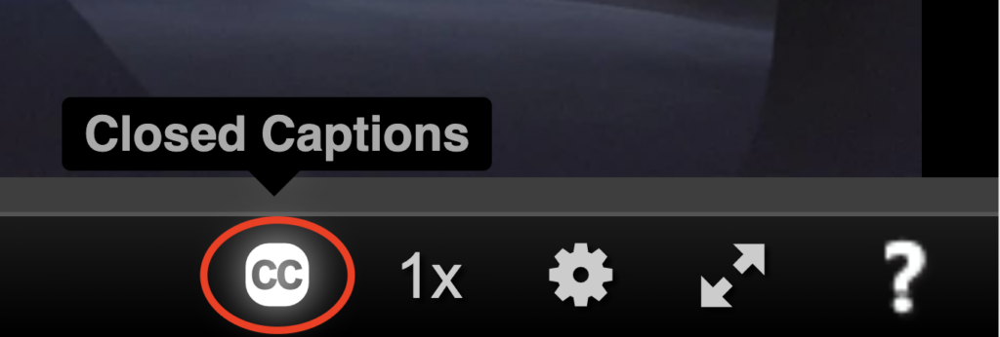
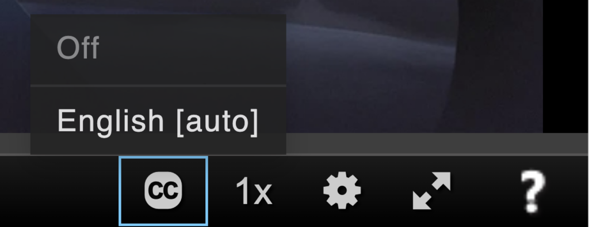
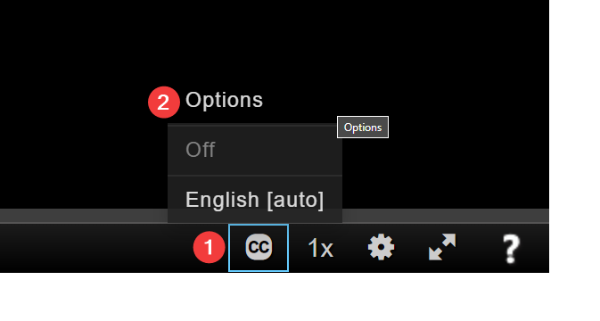
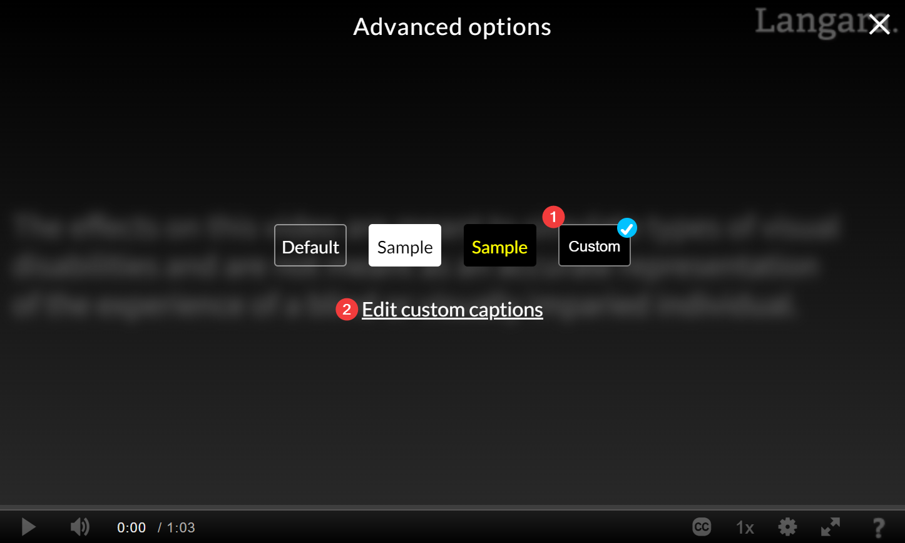
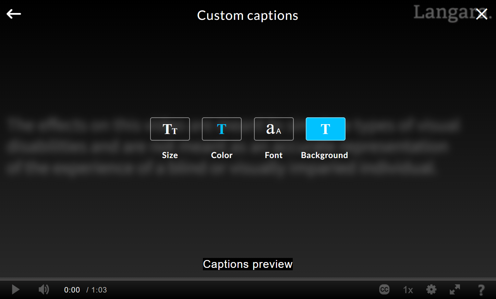
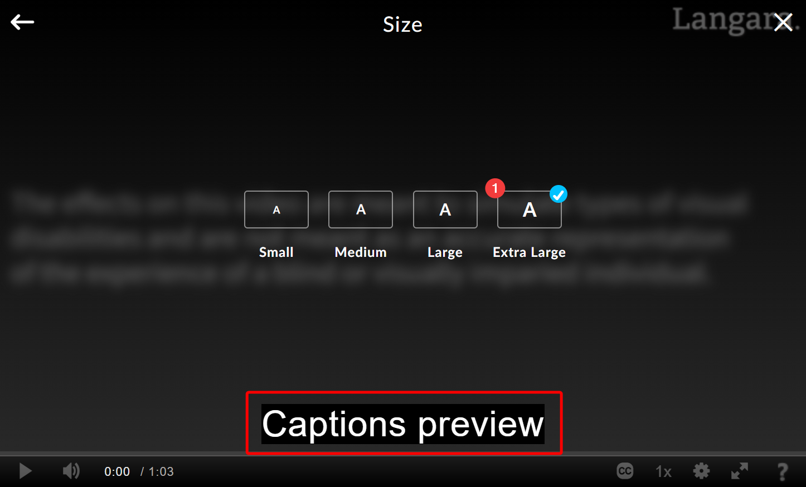
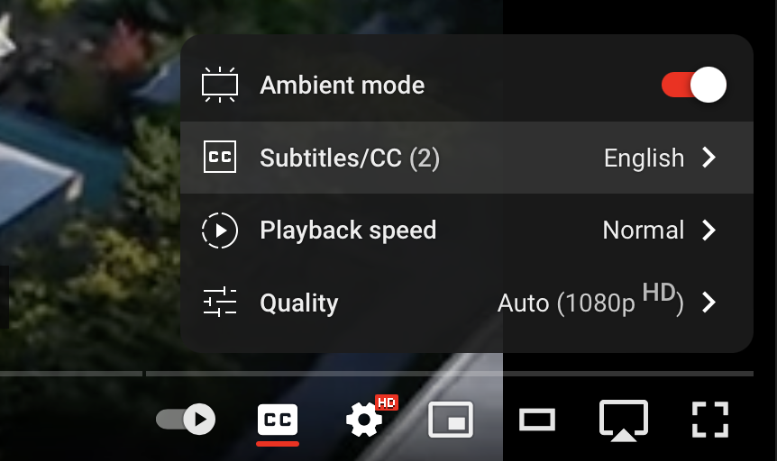
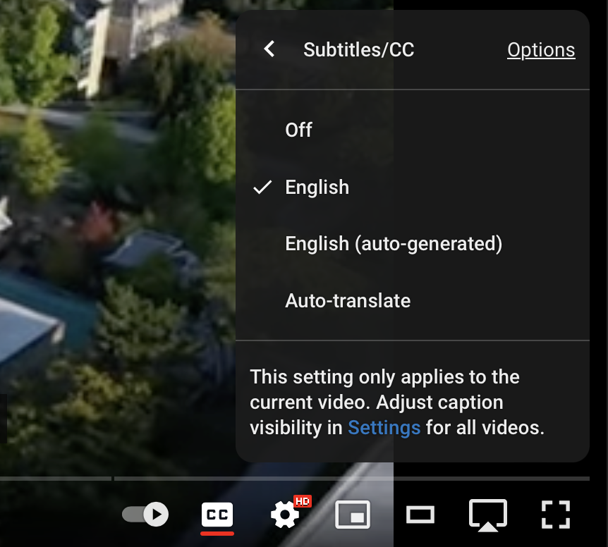
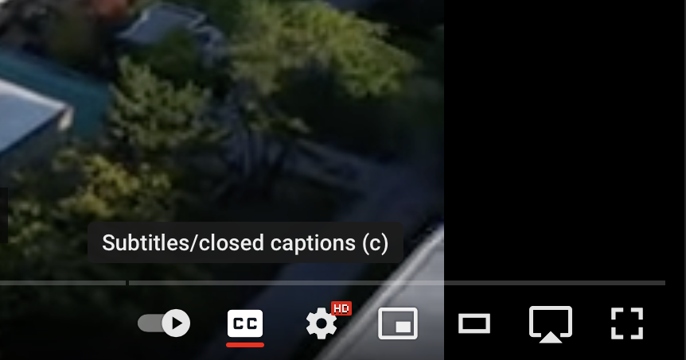

# Closed Captions

This page covers ways to turn on captions in video players, meeting apps, browsers, and devices, including automatic live captions for audio that isn’t captioned. Making sure videos have accurate captions is the responsibility of whoever owns the content.

**On this page:**

- [Kaltura](#kaltura)
- [YouTube](#youtube)
- [Zoom](#zoom)
- [Teams](#teams)
- [Windows](#windows)
- [Android](#android)
- [Chrome](#chrome)
- [iOS](#ios)
- [macOS](#macos)

Kaltura

To display closed captions in Kaltura:

1. Select the **Closed Captions** button.
    <!-- review-alt -->
2. Choose a language.
    <!-- review-alt -->
   1. \[auto\] means the captions are machine-generated and may contain errors, especially in names and specialized terms.

To customize the appearance of captions in Kaltura:

1. Open the **Closed Captions** menu (1).
    <!-- review-alt -->
2. Select **Custom** and choose **Edit custom captions**.
    <!-- review-alt -->
3. Choose the format you want to change (Size, Color, Font, Background).
    <!-- review-alt -->
4. In this example, choosing **Size** and then selecting **Extra Large** shows a preview of the new appearance.
    <!-- review-alt -->

YouTube

To view captions on YouTube videos:

1. Click **Settings**.
2. Select **Subtitles/closed captions**.
    <!-- review-alt -->
   1. Choose a language.
       <!-- review-alt -->
3. Click **Subtitles/closed captions** on the player toolbar to toggle captions on and off.
    <!-- review-alt -->

[Manage caption settings – YouTube Help](https://support.google.com/youtube/answer/100078?co=GENIE.Platform%3DDesktop&hl=en)

Zoom

To show captions in a meeting:

1. Select **Show Captions** in the meeting toolbar (it may be under **More**).
2. Choose the language being spoken and select **Save**.

Each participant can show or hide captions for themselves.

{: .tip }
To always see captions, open the Zoom app’s settings, go to **Accessibility**, and check **Always show captions**.

To view and save the full transcript:

1. Select the arrow (**^**) on the **Show Captions** button and select **View Full Transcript**.
2. Select **Save Transcript**.

Transcripts are not saved automatically with local recordings, so save the transcript yourself. Contact [Langara’s Assistive Technologist](mailto:assistivetech@langara.ca) for help using a transcript to create a captioned version of a recording.

If **Show Captions** is missing, the meeting host needs to turn on automated captions in the [Zoom web portal](https://zoom.us/signin):

1. Sign in to Zoom.
2. Go to **Settings**.
3. Select the **Meeting** tab.
4. Scroll to **In Meeting (Advanced)**.
5. Turn on **Automated captions**. To allow saving transcripts, also turn on **Full transcript** and **Save Captions**.

[Zoom Support](https://support.zoom.com/hc/en) (search for “automated captions”)

Teams

To turn on live captions during a Teams meeting, select **More actions** (three dots) in the meeting controls, then **Captions**.

To show captions in every meeting:

1. Select **Settings and more** (three dots beside your profile picture).
2. Select **Settings**.
3. Select **Captions and transcripts**.
4. Turn on **Always show live captions in meetings**.

The first time captions start, Teams may ask for the language being spoken. Select **English (Canada)** or another language and click **Confirm**.

Captions appear at the bottom of the meeting window. Select **Settings** beside them to change the language, style, font, and position.

[Use live captions in Microsoft Teams meetings – Microsoft Support](https://support.microsoft.com/en-au/office/use-live-captions-in-microsoft-teams-meetings-4be2d304-f675-4b57-8347-cbd000a21260)

Windows

Windows 11 can caption any audio playing on your computer, and speech picked up by your microphone. Automatic captions don’t replace proper captions, but they help when a video has none. To turn them on:

1. Open **Settings** and select **Accessibility**.
2. Choose **Captions**.
3. Toggle **Live captions** on.
   1. Alternatively, press <kbd>Windows</kbd> + <kbd>Ctrl</kbd> + <kbd>L</kbd>.
4. Use the Settings (gear) icon on the captions window to move it, change the language, include or exclude microphone audio, and change how captions look.

[Use live captions to better understand audio – Microsoft Support](https://support.microsoft.com/en-us/windows/use-live-captions-to-better-understand-audio-b52da59c-14b8-4031-aeeb-f6a47e6055df)

Android

### Live Transcribe

**Live Transcribe** shows conversations around you as text on screen. If it isn’t on your phone, install [Live Transcribe & Sound Notifications](https://play.google.com/store/apps/details?id=com.google.audio.hearing.visualization.accessibility.scribe) from Google Play.

1. Go to **Settings > Accessibility**.
2. Select **Installed apps**.
3. Choose **Live Transcribe** and turn on **Live Transcribe shortcut**.
4. Tap **Accessibility shortcut**.
5. Select **Live Transcribe**.
   1. Follow the prompts to set permissions.
6. Use the shortcut to open Live Transcribe.

### Live Caption

**Live Caption** captions audio playing on your phone, such as videos and podcasts. Press a volume button, then tap the **Live Caption** icon under the volume controls.

[Audio accessibility features for Android](https://www.android.com/accessibility/audio/)

### Caption style

On Samsung phones:

1. Go to **Settings > Accessibility**.
2. Select **Hearing enhancements**.
3. Tap **Caption preference**.
4. Turn on **Show captions**.
   1. Tap **Caption size and style** to change how captions look.

On other phones, look for **Caption preferences** under **Settings > Accessibility**.

Chrome

Chrome can automatically caption audio and video playing in the browser. Automatic captions don’t replace proper captions, but they help when a video has none. To turn them on:

1. Open the Chrome menu (three dots) and select **Settings**.
2. Select **Accessibility**.
3. Turn on **Live Caption**.

Chrome’s captions use your computer’s caption style settings:

- [Change caption settings – Windows](https://support.microsoft.com/en-us/windows/change-caption-settings-135c465b-8cfd-3bac-9baf-4af74bc0069a)
- [Use subtitles and closed captions on Mac – Apple Support (CA)](https://support.apple.com/en-ca/guide/mac-help/mchlc1cb8d54/mac)

[Manage captions and translations in Chrome – Google Chrome Help](https://support.google.com/chrome/answer/10538231)

iOS

### Subtitles & Captioning

To show captions automatically when a video has them:

1. Go to **Settings > Accessibility**.
2. Select **Subtitles & Captioning**.
3. Turn on **Closed Captions + SDH**.
4. Select **Style** to change how captions look.

### Live Captions

Live Captions automatically captions audio playing on your iPhone, such as videos and calls, and conversations around you. To use it:

1. Go to **Settings > Accessibility**.
2. Select **Live Captions** (labelled **Beta** in some versions) and turn on **Live Captions**.
3. Select **Appearance** to change the caption text, colour, and opacity.
4. Tap the Live Captions widget (sound wave icon) to start captioning.
5. Tap the Live Captions window for options including full screen, pause, and close.
6. Tap the microphone to switch between captioning audio on your iPhone and speech around you (picked up by the microphone).

Live Captions may not be available in every language or region, and automatic captions can contain errors.

[Get live captions of spoken audio on iPhone – Apple Support (CA)](https://support.apple.com/en-ca/guide/iphone/iphe0990f7bb/ios)

macOS

### Subtitles and Closed Captions

1. Go to **System Settings > Accessibility**.
2. Choose **Captions**.
3. Choose a caption style and options.

These settings change how existing captions look. To caption a video that has none, use Live Captions (below).

[Use subtitles and closed captions on Mac – Apple Support (CA)](https://support.apple.com/en-ca/guide/mac-help/mchlc1cb8d54/mac)

### Live Captions

On a Mac with Apple silicon, Live Captions can caption audio from apps, calls, and videos, and conversations around you:

1. Open **System Settings > Accessibility**.
2. Under **Hearing**, select **Live Captions** (labelled **Beta** in some versions).
3. Turn on **Live Captions**.
   1. Use the settings to change the font and background colour.
4. Click and drag the Live Captions widget anywhere on the screen.
   1. Click and drag from any corner to resize the widget.
5. Click anywhere on the widget to reveal controls.
   1. Use **Pause** to pause captions.
   2. Click the microphone to switch between captioning your Mac’s audio and speech around you (picked up by the microphone).

[Get captions of spoken and computer audio on Mac – Apple Support (CA)](https://support.apple.com/en-ca/guide/mac-help/mchldd11f4fd/mac)

For dictation (typing with your voice) on any device, see [Speech to Text Tools](speech-to-text-tools.md). To record and transcribe lectures and meetings, see [Note-taking and Transcription](note-taking.md).
