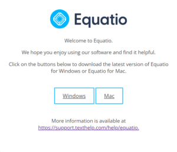
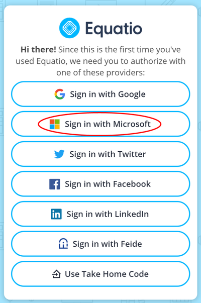
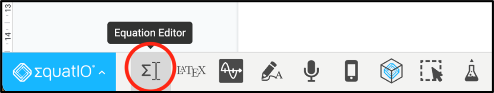
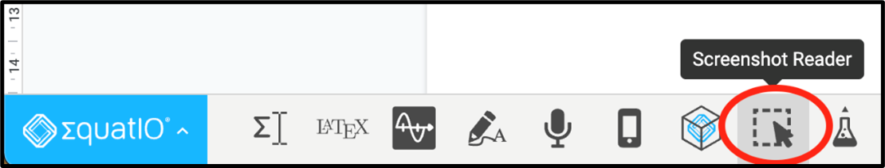
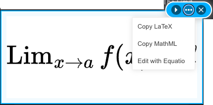

# Equatio Quick Start Guide



 <!-- review-alt -->

**Equatio** is software for writing, editing, and reading math and other STEM content on a computer.

Use Equatio to:

- Create accessible STEM content in Google Docs, Microsoft Word and PowerPoint, and Brightspace.
- Write math by typing, handwriting, or speaking, and hear math read aloud.
- Use accessible chemistry and graphing tools.

## Install

1. Go to [Equatio Desktop](https://fastdownloads2.texthelp.com/equatio_desktop/version/index.html).
    <!-- review-alt -->
2. Choose **Windows** or **Mac**.
3. Follow the installation guide.

## Access

Select **Sign in with Microsoft** and use your Langara email and password.

 <!-- review-alt -->

## Basic Functions

### Writing math

1. Open Equatio.
2. Open the **Equation Editor** to type math.
    <!-- review-alt -->
3. Type the math as you would say it (for example, “x squared”), or use math notation. Press <kbd>Enter</kbd> to accept a suggestion as you type.
4. Click **Insert Math**, or **Copy Math As…**, to put accessible math into your document.

### Reading math

Equatio’s **Screenshot Reader** reads aloud math that is only available as a picture, such as math in a scanned PDF or on a web page.

To use Equatio’s Screenshot Reader:

1. Open Equatio.
2. Select **Screenshot Reader** on the toolbar.
    <!-- review-alt -->
3. Draw a box around the math. Equatio reads it aloud. You can also copy it as MathML or LaTeX, or open it in the Equation Editor to change it.
    <!-- review-alt -->

For videos and guides, see [Equatio on Texthelp Academy](https://academy.texthelp.com/equatio/). Also review [detailed Equatio guides](https://pressbooks.bccampus.ca/accessibilityhandbook/chapter/equatio/) in the [Accessibility Handbook for Teaching and Learning](https://pressbooks.bccampus.ca/accessibilityhandbook/). For help at Langara, contact [assistivetech@langara.ca](mailto:assistivetech@langara.ca).
