# Finding More Tools

 <!-- review-alt -->

**On this page:**

- [My Computer My Way](#my-computer-my-way)
- [Unified Listing](#unified-listing)
- [AT Hive](#at-hive)

## My Computer My Way

My Computer My Way is an online interface that assists users to use built-in tools and modify settings on their device(s) to make them easier to use. The site helps users filter by need, symptoms, condition, and device to find step by step instructions to adapt their phone, tablet, or computer to be easier to use. My Computer My Way includes basic guides, examples, and detailed instructions for activating and using accessibility features built into consumer devices.

[My Computer My Way](https://mcmw.abilitynet.org.uk) is a web interface available at mcmw.abilitynet.org.uk. By default, My Computer My Way will automatically detect the user’s device and operating system to display tools and settings specific to that device. To research other operating systems and devices or when assisting others, change the **Operating system** filter to the appropriate device and operating system.
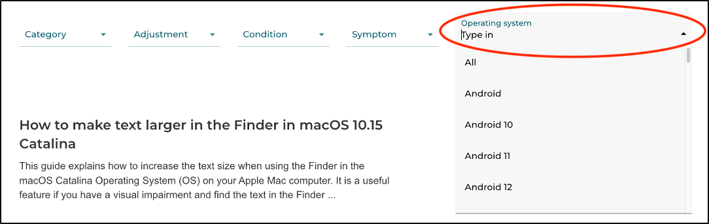 <!-- review-alt -->

Filters

By default, My Computer My Way will detect the user’s device and operating system. To research other devices or when assisting others, change the **Operating system** filter to the appropriate device and operating system.
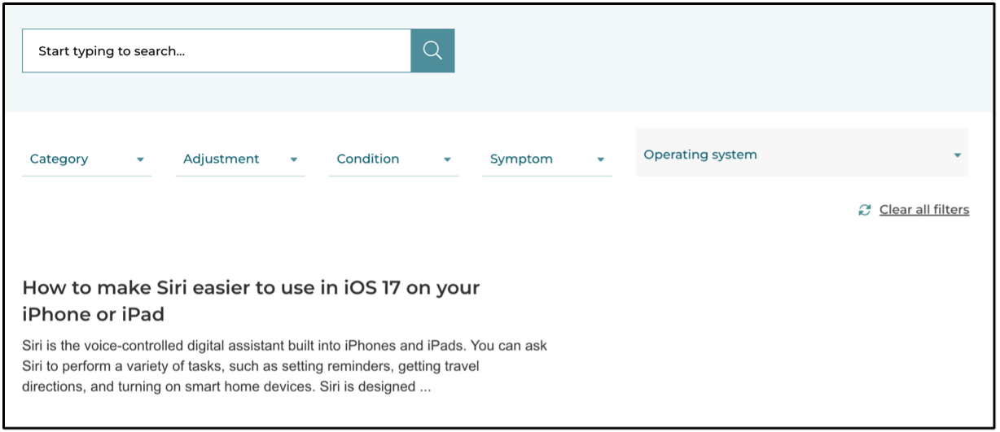 <!-- review-alt -->

Moving left to right, the first menu is **Category** which includes: Cognitive, Hearing, Motor, and Vision. Each filter menu can be operated by mouse or keyboard and allows users to search within each criterion by typing.
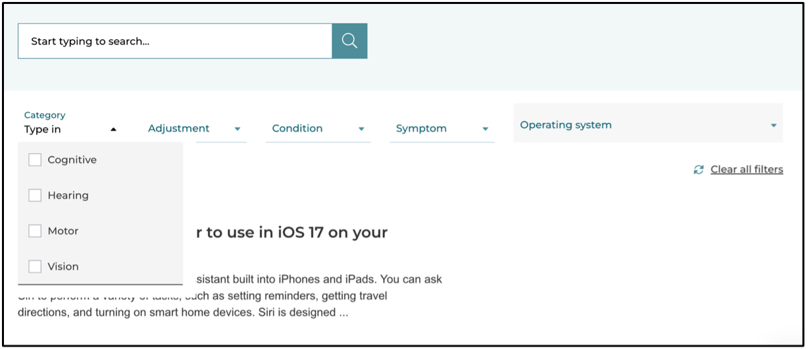 <!-- review-alt -->

Each filter allows users to select one or multiple criteria. It is not necessary to select a filter from each menu to use the tool, but choosing criteria will filter down the number of subsequent options.

The next filter, **Adjustment**, includes options such as captioning, colour settings, keyboard settings, magnify, text settings, voice options, zoom and more.
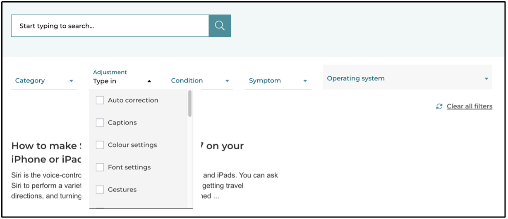 <!-- review-alt -->

The next menu, **Condition**, filters by condition such as common physical, cognitive, vision, hearing, and neurological conditions.
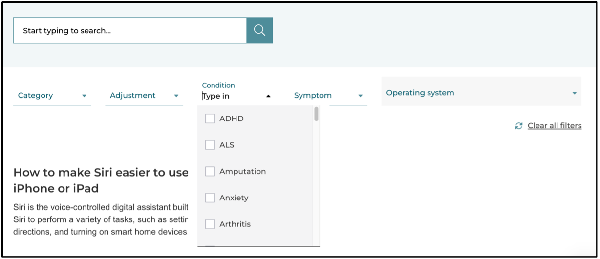 <!-- review-alt -->

Even when a user has a disability listed, use this filter with caution as useful tools may be excluded from results if they aren’t specifically tagged with that disability. This could cause a user to not be aware of a tool that could benefit them.

The fourth menu filters by **Symptom**. Filters include symptoms such as eye strain, hearing loss, low dexterity, problems reading, and more.
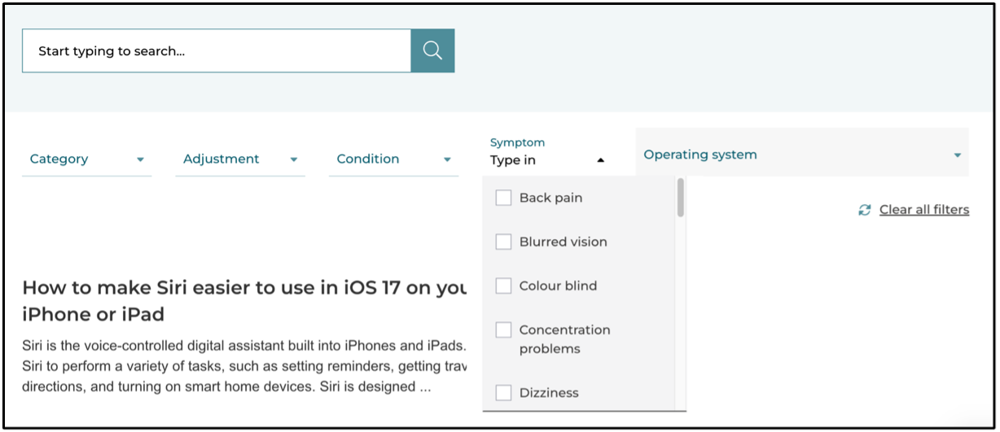 <!-- review-alt -->

The final menu is **Operating System** which, as previously discussed, automatically detects the user’s device and operating system. This menu only allows for one selection, but can be changed to any available option to research other devices and operating systems.
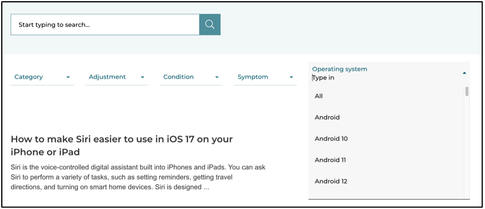 <!-- review-alt -->

Clear Filters

Users can remove individual filters by selecting the **X** beside the criterion to be removed. All filters can be removed using the **Clear all filters** button.
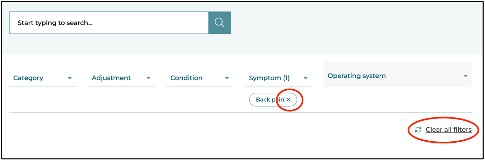 <!-- review-alt -->

Search

Use the search tool when returning to a known resource or if a user has high digital confidence and knows the specific terms. However, the My Computer My Way filters are an easier way to discover features and tools.
 <!-- review-alt -->

Settings

As My Computer My Way is a web interface there are no settings to change. If users encounter issues, consider clearing cookies and site data. In Chrome and Firefox, click the padlock icon in the address bar and choose **Clear cookies and site data** in Firefox or in Chrome select **Cookies and site data > Manage cookies and site data**. Click the trash can icon to delete saved data for the site.

Notable Issues

Beware that My Computer My Way does not include third party assistive technology solutions such as JAWS, Read&Write, Kurzweil, etc.

My Computer My Way is generally up to date and includes older operating systems. This is the most complete collection of user guides for built-in tools and settings that make consumer devices easier to use. However, that does not mean that solutions can be found that are not listed in My Computer My Way.

Links and Further Reading

- [My Computer My Way](https://mcmw.abilitynet.org.uk) by AbilityNet
- AbilityNet [assistive technology factsheets](https://abilitynet.org.uk/free-tech-support-and-info/abilitynet-factsheets)
- [Helpful tech tips: My Computer My Way](https://abilitynet.org.uk/news-blogs/helpful-tech-tips-my-computer-my-way)

## Unified Listing

Unified Listing is a collection of 14 databases to help users access communication, computers, and digital devices. Global Public Inclusive Infrastructure curates this collection of federated databases. [Unified Listing](https://ul.gpii.net) is a web interface available at ul.gpii.net. Users can create an account. Users with an account can sign up to be notified by email about changes to specific software.

Unified Listing allows users to search for software that will help them use technology. Users can search by:

- Power Search
- Guided Shopping
- Classic Search
- Find Similar Products
- View Products by Manufacturer

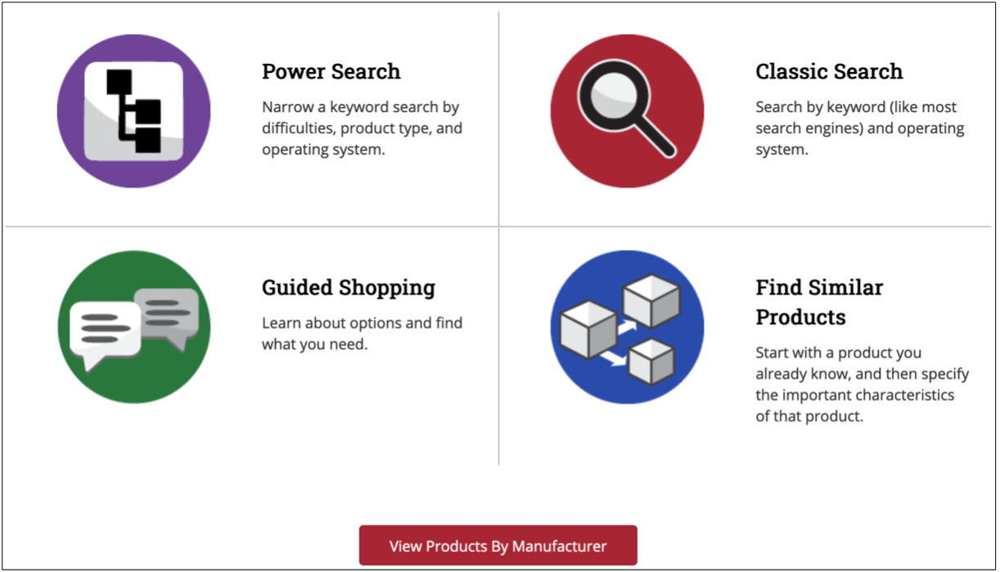 <!-- review-alt -->

Power Search

Power Search allows users to enter search terms and select criteria such as difficulties (hearing, seeing, reading, etc.), operating systems, and product types. Adding one criterion at a time allows users to narrow the number of results to help find appropriate solutions.
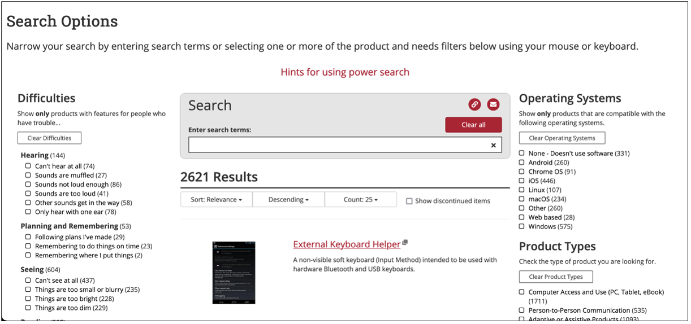 <!-- review-alt -->

Each criterion includes a **Clear \[criteria\]** button to reset that category and expand the number of results.

Above the search field, users can select **Share or save this search**.
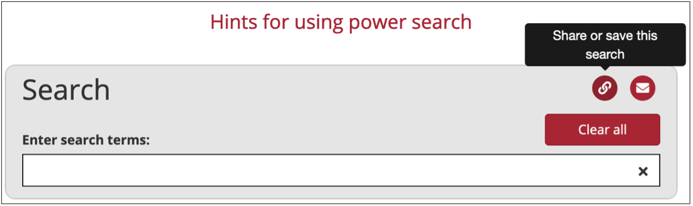 <!-- review-alt -->

This creates a unique link to the user’s search result. Users can use that link to share with others.

Guided Shopping

Guided Shopping arranges options by product type, such as **Computer Access and Use**, **Person-to-Person Communication**, **Education**, and more.

Selecting a product type leads users to additional questions with additional links. Once a user finds a specific type of product, results can be searched or filtered by operating system.
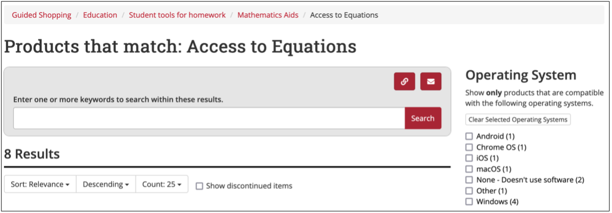 <!-- review-alt -->

The results page includes breadcrumb navigation to move back through their selection process.
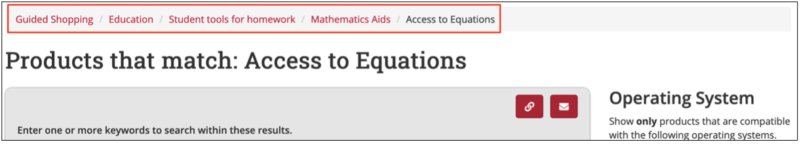 <!-- review-alt -->

Classic Search

Classic search allows users to enter keywords or product names and filter results by operating system. This simpler interface may be useful for users that find Power Search overwhelming.

Above the search field, users can select **Share or save this search**.
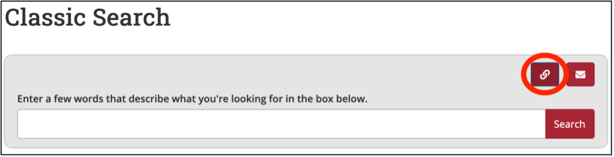 <!-- review-alt -->

Find Similar Products

Start with a product you already know, and then specify the important characteristics of that product.

1. Users can search or scroll through the list of products.
   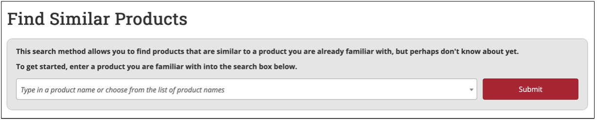 <!-- review-alt -->
2. Once a product is chosen, users are taken to a page that allows them to select what features of that product they use.
   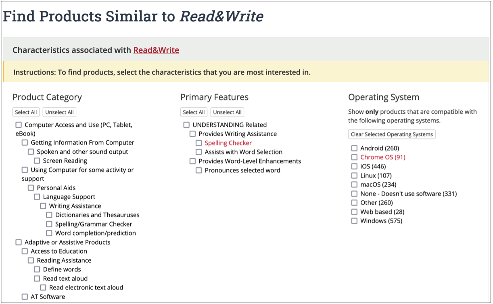 <!-- review-alt -->
3. As users select criteria, matching products are displayed below.
   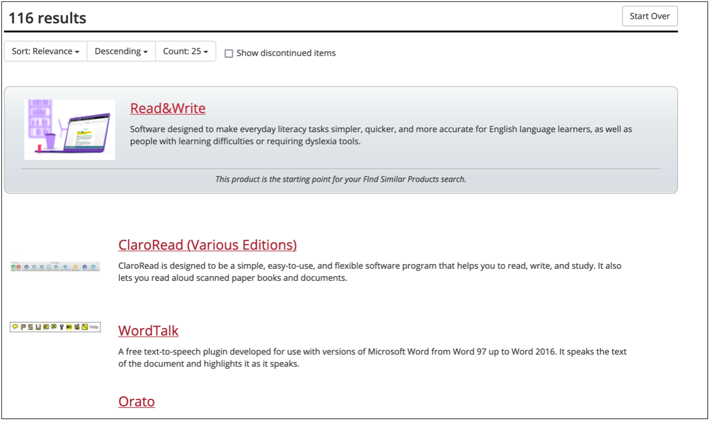 <!-- review-alt -->
   1. Results can be sorted.
4. Clicking on a result will take users to the guide for that product.
   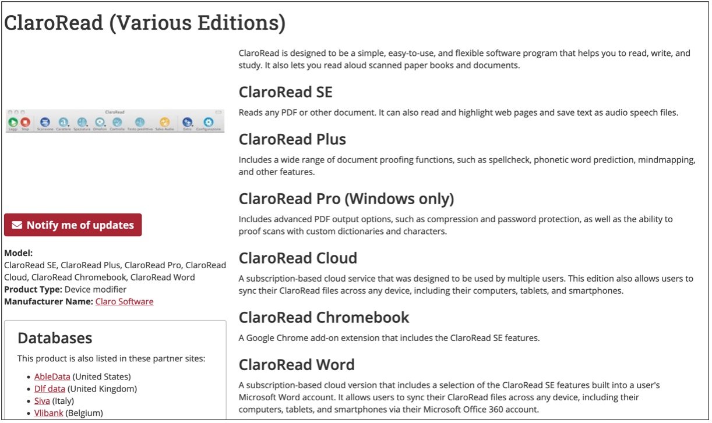 <!-- review-alt -->

View Products by Manufacturer

Selecting **View Products by Manufacturer** displays an alphabetical list of manufacturers with products included in the Unified Listing. Selecting a letter and then a manufacturer will display all the products from the chosen manufacturer. For example, selecting **T > TextHelp** reveals all of TextHelp’s products catalogued in Unified Listing.
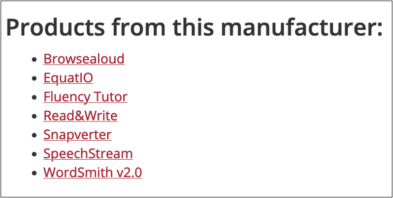 <!-- review-alt -->

Software Guides

Once a product is selected, users are taken to a guide for that tool.
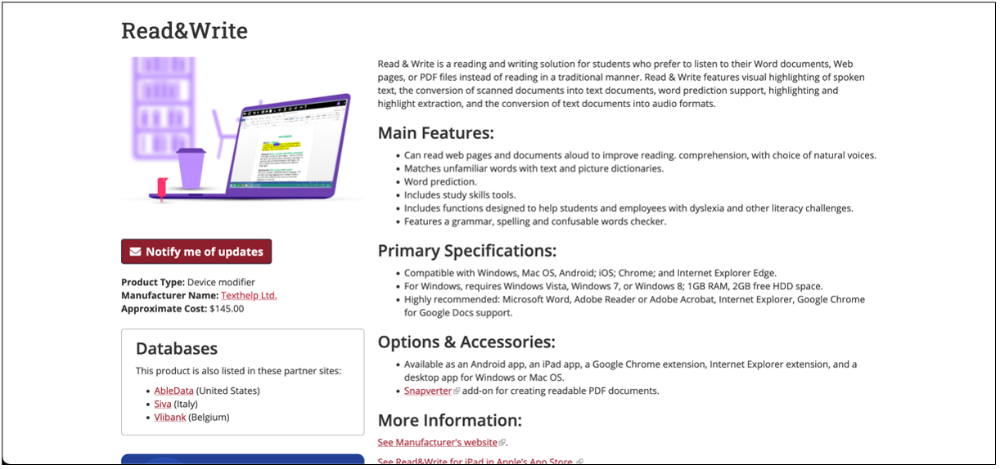 <!-- review-alt -->

Guides include descriptions of tools, main features, and links to more information.

The **Find products similar to this one** button takes users to the **Find Similar Products** tool with the original product pre-selected.
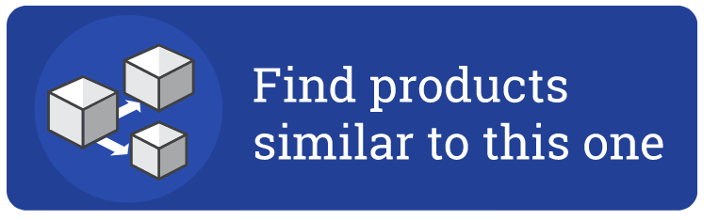 <!-- review-alt -->

Settings

At the top of the window, Unified Listing offers customization of the appearance of the site. To change settings, select **+show preferences**.
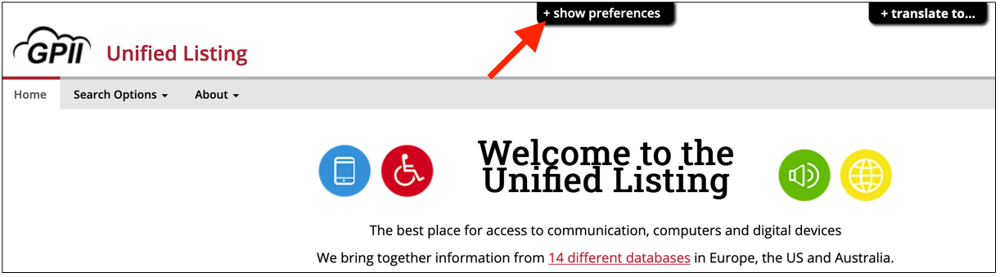 <!-- review-alt -->

Scroll horizontally through the settings to change:

1. Text size
   1. Increase text size up to 2 times default size
2. Text style
   1. Choose between:
      1. Times New Roman
      2. Comic Sans
      3. Arial
      4. Verdana
3. Line spacing
   1. Increase space between lines up to 2 times default
4. Contrast
   1. Choose between 5 colour schemes to increase contrast
5. Table of contents
   1. Adds a table of contents near the top left of the page allowing users to skip to different points on the page
6. Enhance inputs
   1. Links, buttons, menus, text fields, and other inputs are made larger and more visually prominent
7. Click **reset** to set all customizations back to default.
   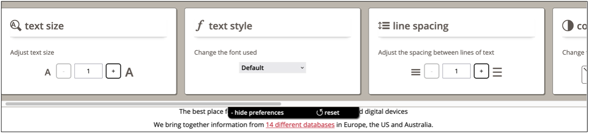 <!-- review-alt -->

Notable Issues

Unified Listing is a collection of 14 databases. However, that does not mean it includes every possible technology solution. Some of the databases included in Unified Listing may be out of date, deprecated, or abandoned.

Links and Further Reading

- [About Unified Listing](https://ul.gpii.net/about)
- [Global Public Inclusive Infrastructure](https://raisingthefloor.org/what-we-do/gpii)

## AT Hive

AT Hive is an online interface that assists users to find assistive technology by activity, device, and user accounts. Once selecting a tool, AT Hive offers introductory resources with how-to guides, links, advice, and demonstration videos. The [AT Hive](https://www.ahead.ie/Discover-your-AT) is a web interface available at ahead.ie/discover-your-at.

The homepage includes an introductory video on how to use the tool.
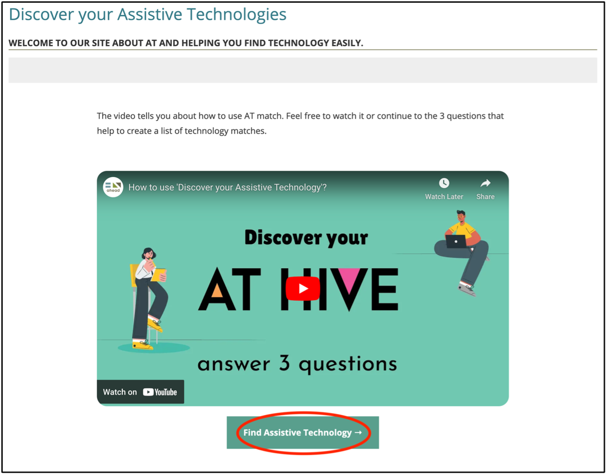 <!-- review-alt -->

Using the AT Hive

1. Begin by selecting interests and activities to be explored. Options include reading, magnification, revision and recall, writing, note-taking, spelling & grammar, organisation, motivation and focus, working together, captions and subtitles, recording, and mindset.
   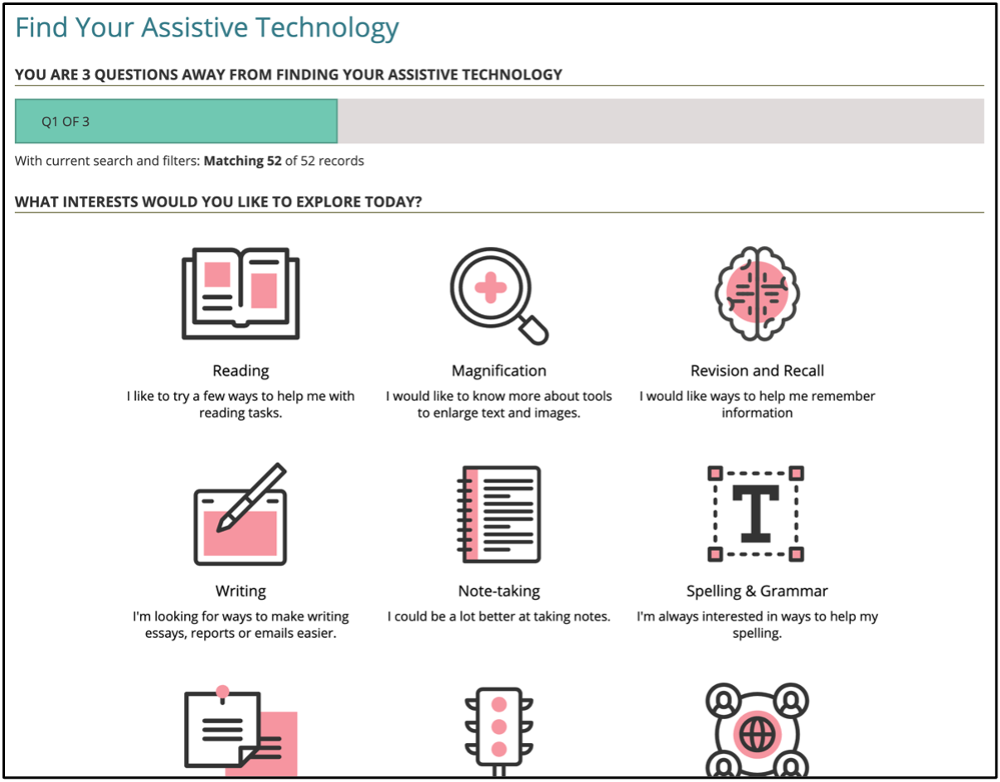 <!-- review-alt -->
2. Choose one or multiple interests. Select the **Next Question** button at the bottom of the page to continue.
   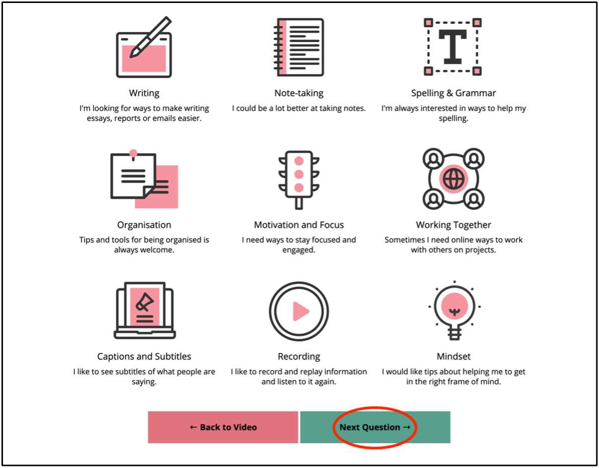 <!-- review-alt -->
3. The next step filters by user device. Select what devices are being used.
   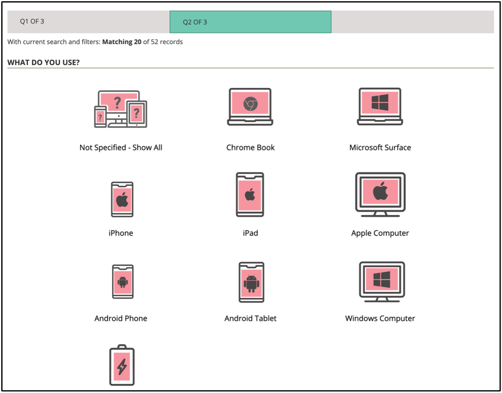 <!-- review-alt -->
4. Depending on your device settings there may be a **Detect My Current Device** button above the device options. Click this button to have AT Hive automatically detect what type of device you are using. Select one or multiple devices and then select **Next Question** at the bottom of the page.
   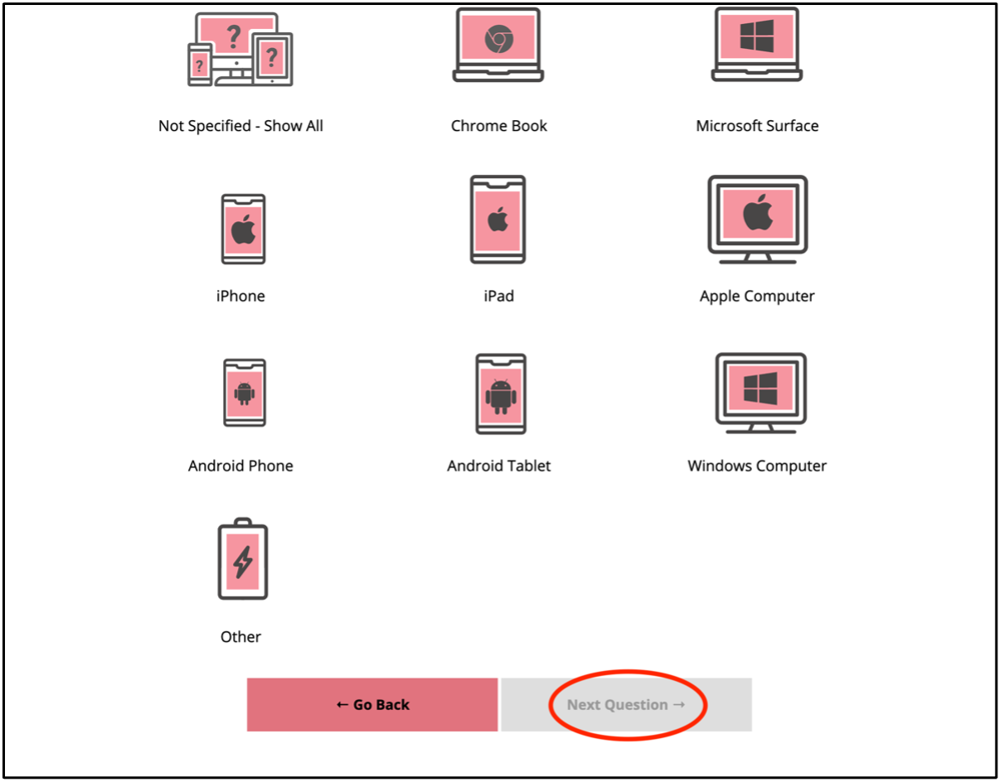 <!-- review-alt -->
5. Select Microsoft, Google, or No specific account needed. Select **Show My Results** at the bottom of the page.
   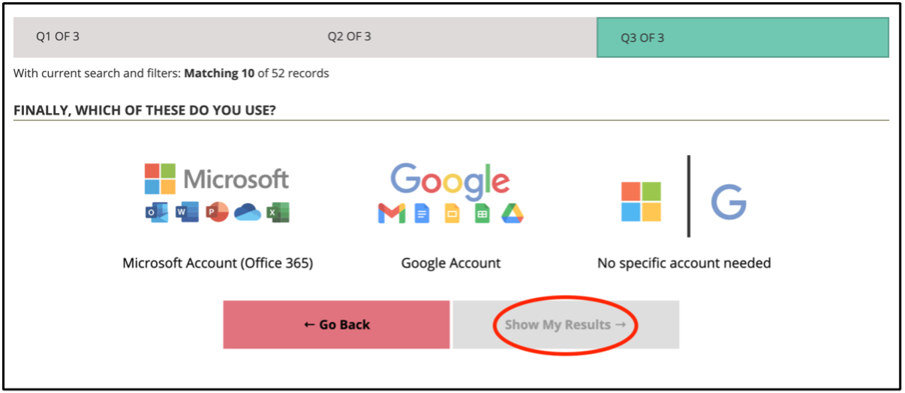 <!-- review-alt -->
6. AT Hive will display matches based on user answers. Answers can be removed by clicking on them. Additional filters for free, freemium, free trial, or paid tools can be used to refine results. Results can be emailed.
   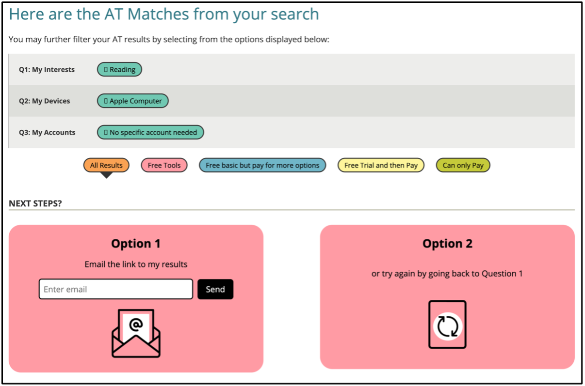 <!-- review-alt -->
7. Scroll down to see results. Select **Tell me more** to review user guides, links, and demonstration videos.
   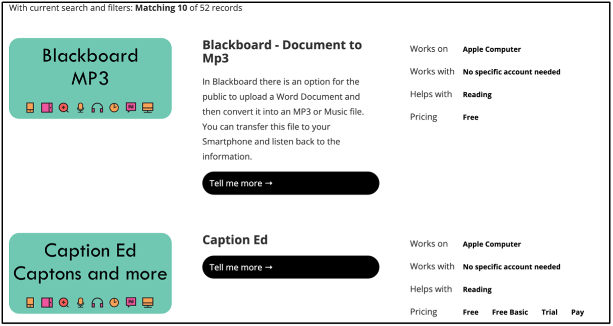 <!-- review-alt -->

Settings

As AT Hive is a web interface there are no settings to change. If users encounter issues, consider clearing cookies and site data. In Chrome and Firefox, click the padlock icon in the address bar and choose **Clear cookies and site data** in Firefox or in Chrome select **Cookies and site data > Manage cookies and site data**. Click the trash can icon to delete saved data for the site.

Notable Issues

AT Hive includes some, but few, built-in assistive technology tools and settings. AT Hive also does not list advanced assistive technologies such as JAWS, NVDA, or Kurzweil.

Links and Further Reading

[AT Hive FAQ](https://www.ahead.ie/The-AT-Hive)

---

*Assistive Technology User Guides* by Luke McKnight is licensed under a [Creative Commons Attribution-NonCommercial-ShareAlike 4.0 International License](https://creativecommons.org/licenses/by-nc-sa/4.0/).
