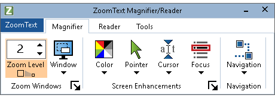
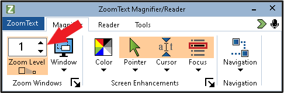
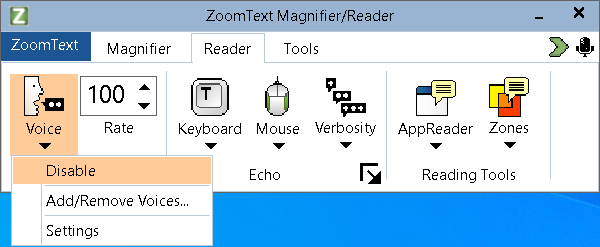
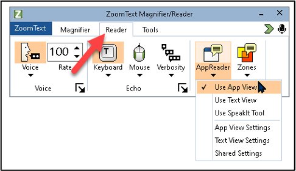
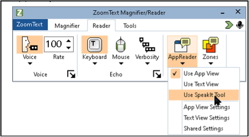
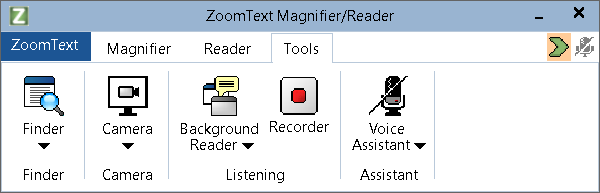
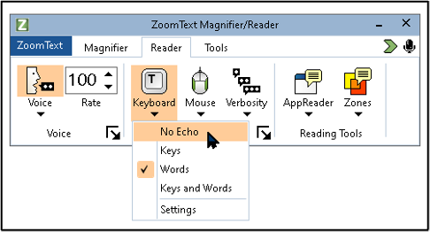

# Magnifiers

Magnifiers enlarge part or all of the screen. Most computers and phones have one built in, and most also let you make text and everything else on screen bigger.

**On this page:**

- [ZoomText](#zoomtext)
- [Android](#android)
- [Windows](#windows)
- [macOS](#macos)
- [iOS](#ios)
- [Browser Tools](#browser-tools)

## ZoomText



{: .langara}
ZoomText is available on computers in L121 as well as Accessibility Services exam computer labs.

 <!-- review-alt -->

ZoomText Magnifier/Reader is a Windows magnification and reading program for people with low vision. It enlarges and enhances what’s on screen, echoes your typing and important program activity, and reads content aloud. You can control ZoomText with the mouse, keyboard, or voice commands.

This guide uses <kbd>Caps Lock</kbd> for the ZoomText modifier key.

Setup

[Getting Started with ZoomText – Freedom Scientific](https://www.freedomscientific.com/training/zoomtext/getting-started)

Open ZoomText before other programs, such as web browsers or document software.

When ZoomText opens, the ZoomText toolbar appears.
 <!-- review-alt -->

Navigate menus using the mouse or keyboard:

- <kbd>Alt</kbd> + <kbd>Z</kbd> opens the menu.
  - Arrow down for help, configurations, and settings.
  - Go to **Preferences**.
    - Check the **Start ZoomText automatically when Windows starts** checkbox, if desired.
    - You can also set ZoomText to run on the Windows sign-in screen.
  - To keep changes to your settings, go to **ZoomText > Configurations > Save As Default**, or press <kbd>Alt</kbd> + <kbd>Z</kbd>, then <kbd>C</kbd>, <kbd>S</kbd> and <kbd>Enter</kbd>.
  - Go to **Command Keys** for a searchable list of keyboard shortcuts.
- At any point press <kbd>Esc</kbd> to close menus.

Press <kbd>Tab</kbd> to move focus between menus, tabs, and controls.

Use the <kbd>Left Arrow</kbd> and <kbd>Right Arrow</kbd> keys to move between tabs and controls.

Press <kbd>Enter</kbd> on a control to turn it on or off, or to open its menu.

<kbd>Caps Lock</kbd> + <kbd>Ctrl</kbd> + <kbd>U</kbd> brings the ZoomText toolbar to the front.

<kbd>Caps Lock</kbd> + <kbd>Ctrl</kbd> + <kbd>Enter</kbd> turns ZoomText off or on without closing it.

Or select the **ZoomText** menu on the toolbar and select **Enable ZoomText** or **Disable ZoomText**.

To set zoom level 1 as default on startup:

1. Set zoom level to 1.
2. Click **ZoomText**.
3. Select **Configurations**.
4. Click **Save As Default**.

Magnifier Tab

 <!-- review-alt -->

The Magnifier tab has these tools and options:

Zoom Level

Mouse:

- Click the up or down arrow to zoom in or out.
- <kbd>Caps Lock</kbd> + <kbd>Shift</kbd> + mouse scroll wheel to zoom in or out.

Keyboard:

- <kbd>Caps Lock</kbd> + <kbd>Up Arrow</kbd> to zoom in.
- <kbd>Caps Lock</kbd> + <kbd>Down Arrow</kbd> to zoom out.
- <kbd>Caps Lock</kbd> + <kbd>Enter</kbd> toggles between 1x zoom and the current zoom level.

Window

- **Window > One Monitor** to select a zoom mode (full, overlay, docked, lens, line).
- <kbd>Caps Lock</kbd> + <kbd>Z</kbd> to cycle through zoom modes.
- **Freeze View** freezes part of the screen so you can zoom in on it while it stays still.

Color

- <kbd>Caps Lock</kbd> + <kbd>C</kbd> to toggle on and off.
- **Color > Settings** has the colour enhancement options.
- Select **Scheme** to choose a colour scheme (inverted, yellow on black, black and white, and so on).

Pointer

- <kbd>Caps Lock</kbd> + <kbd>P</kbd> to toggle pointer enhancements on or off.
- To change the pointer’s size and colour, select **Pointer > Settings**.

Cursor

- <kbd>Caps Lock</kbd> + <kbd>R</kbd> to toggle cursor enhancements on or off.
- More styles are under **Cursor > Scheme**, and more options under **Cursor > Settings**.

Focus

- <kbd>Caps Lock</kbd> + <kbd>F</kbd> to toggle focus enhancements on or off.
- Focus enhancements highlight the item that has keyboard focus. Change the style under **Focus > Scheme**.

Navigation

Settings for how ZoomText follows the mouse pointer and keyboard focus, and where it zooms and reads from.

Reader Tab

ZoomText Magnifier/Reader also includes a screen reader. It isn’t as full-featured as JAWS or NVDA, but it can read everything on the screen and has many options for reading text and documents aloud.

Press <kbd>Alt</kbd> + <kbd>R</kbd> to go to the Reader tab of the ZoomText toolbar. It has settings for keyboard and mouse echo (speaking what you type or point at) and different reading modes.

Turn off, change, and add voices in the **Voice** menu.
 <!-- review-alt -->

Change the speaking speed with the number above **Rate**.

### AppReader

<kbd>Caps Lock</kbd> + <kbd>Alt</kbd> + <kbd>R</kbd> launches AppReader in the mode selected on the toolbar.
 <!-- review-alt -->

<kbd>Caps Lock</kbd> + <kbd>Alt</kbd> + <kbd>A</kbd> starts App View, which reads the open document or web page and outlines what is being read.

Press <kbd>Caps Lock</kbd> + <kbd>Alt</kbd> + left-click to start reading from the mouse pointer.

While AppReader is reading:

- Press <kbd>Enter</kbd> to pause, and <kbd>Enter</kbd> again to resume.
- <kbd>Right Arrow</kbd> and <kbd>Left Arrow</kbd> move to the next and previous sentence; <kbd>Down Arrow</kbd> and <kbd>Up Arrow</kbd> move by paragraph.
- Press <kbd>Tab</kbd> to switch between App View and Text View.
- Press <kbd>Escape</kbd> to stop AppReader.

Text View shows the text being read in a separate window, in the colours and font you choose. Press <kbd>Caps Lock</kbd> + <kbd>Alt</kbd> + <kbd>T</kbd> to start it.

With SpeakIt, click a word, image, icon, or other item and ZoomText reads it. On the Reader tab, click **AppReader** and select **Use SpeakIt Tool**, or press <kbd>Caps Lock</kbd> + <kbd>Alt</kbd> + <kbd>S</kbd>.
 <!-- review-alt -->

You can also click and drag over text while SpeakIt is on to hear it. Press <kbd>Escape</kbd> before selecting the next text. 

{: .note }
SpeakIt doesn’t highlight each word as it reads, as App View and Text View do.

To listen to text while you do other things, use **Background Reader** (see [Tools](#zoomtext-tools) below).

Tools

Go to the **Tools** tab or press <kbd>Alt</kbd> + <kbd>T</kbd>.
 <!-- review-alt -->

**Finder** searches the page or document and lists what it finds. Press <kbd>Caps Lock</kbd> + <kbd>Ctrl</kbd> + <kbd>F</kbd>.

**Camera** shows a printed document held up to a webcam, enlarged on screen. Press <kbd>Caps Lock</kbd> + <kbd>Ctrl</kbd> + <kbd>C</kbd>. Its toolbar has zoom and colour options.

**Background Reader** reads highlighted text aloud while you do other things:

1. Highlight text.
2. Press <kbd>Caps Lock</kbd> + <kbd>Ctrl</kbd> + <kbd>B</kbd> or navigate to the **Tools** tab and select **Background Reader**.

**Recorder** can create audio files of text you have copied to the Windows clipboard. You can listen to the audio later or on a different device.

**Voice Assistant** lets you give ZoomText commands with your voice. Press <kbd>Caps Lock</kbd> + <kbd>Alt</kbd> + <kbd>Space</kbd> or click the microphone icon at the top right of the ZoomText toolbar. To set it up, on the **Tools** tab select **Voice Assistant > Getting Started**.

By default, ZoomText reads back what you type. To turn this off, select **Reader > Keyboard > No Echo**.
 <!-- review-alt -->

Links

- [ZoomText Toolbar (video) – Vispero Training](https://www.youtube.com/watch?v=YpGF_Q4PIlY)
- [ZoomText User Guide (PDF)](https://support.freedomscientific.com/content/documents/manuals/ZoomText/ZoomText_User_Guide_English_US.pdf)
- [ZoomText hotkeys](https://www.freedomscientific.com/training/zoomtext/zoomtext-hotkeys)

## Android



 <!-- review-alt -->

### Visibility Enhancements (Samsung)

These steps are for Samsung phones. On other Android phones, look under **Settings > Accessibility** for **Magnification** and **Display size and text**.

1. Go to **Settings > Accessibility**.
2. Select **Visibility Enhancements**.
   1. Choose **High contrast** or **Large display**.
3. Select **Magnification** and turn on **Magnification shortcut**.
   1. Use two fingers to move the zoom window around the screen.
   2. Tap the two-arrow icon in the bottom right to toggle full screen zoom.
   3. Tap the Accessibility shortcut in the bottom right and select Magnification to turn it off.
4. Select **Screen zoom**.
   1. Use the slider to change the size of items displayed on screen.
5. Select **Font size and style**.
   1. Drag the slider to change the default font size.
   2. Select the default font style.
      1. Turn on **Bold font** to make all text bold.
6. The **Visibility Enhancements** menu has more settings to explore.

## Windows



 <!-- review-alt -->

Magnifier

1. Open **Settings** and select **Accessibility**.
2. Select **Magnifier**.
   1. Or press <kbd>Windows</kbd> + <kbd>Ctrl</kbd> + <kbd>M</kbd> to open Magnifier settings directly.

Here you can turn Magnifier on or off and change the zoom level, the zoom increments, and other settings, such as starting Magnifier when you sign in.

To turn on **Magnifier** and zoom in, press <kbd>Windows</kbd> + <kbd>+</kbd> (plus sign). On most keyboards the plus sign is on the <kbd>=</kbd> key, so <kbd>Windows</kbd> + <kbd>=</kbd> works too. Some laptops may be set up to require pressing <kbd>fn</kbd> <kbd>?</kbd>.

Press <kbd>Windows</kbd> + <kbd>-</kbd> to zoom out.

<kbd>Windows</kbd> + <kbd>Esc</kbd> turns off Magnifier.

Magnifier has three views: Full Screen, Docked, and Lens. Change views in the Magnifier menu, or while Magnifier is running press:

- <kbd>Ctrl</kbd> + <kbd>Alt</kbd> + <kbd>M</kbd> to cycle through the views
- <kbd>Ctrl</kbd> + <kbd>Alt</kbd> + <kbd>F</kbd> for Full Screen (hold <kbd>Ctrl</kbd> + <kbd>Alt</kbd> + <kbd>Space</kbd> to see the whole screen for a moment)
- <kbd>Ctrl</kbd> + <kbd>Alt</kbd> + <kbd>D</kbd> for Docked
- <kbd>Ctrl</kbd> + <kbd>Alt</kbd> + <kbd>L</kbd> for Lens

- [Use Magnifier to make things on the screen easier to see – Microsoft Support](https://support.microsoft.com/en-us/windows/use-magnifier-to-make-things-on-the-screen-easier-to-see-414948ba-8b1c-d3bd-8615-0e5e32204198)
- [How to magnify the screen with the Magnifier tool in Windows 11 – My Computer My Way](https://mcmw.abilitynet.org.uk/how-to-magnify-the-screen-with-the-magnifier-tool-in-windows-11)

See also [Morphic](morphic.md), a toolbar with quick access to Magnifier and other Windows accessibility tools.

Display Settings

To make text or everything on screen bigger:

1. Go to **Settings > Accessibility**.
2. Choose **Text size** and use the slider to make text bigger.
3. To make everything bigger, go to **Settings > System > Display** and choose a percentage under **Scale**.

To change colours and contrast:

1. Go to **Settings > Accessibility**.
2. Choose **Contrast themes** and pick a theme.
3. Or choose **Color filters**, turn them on, and pick a filter.
   1. Turn on **Keyboard shortcut for color filters**, then press <kbd>Windows</kbd> + <kbd>Ctrl</kbd> + <kbd>C</kbd> to turn the filter on or off.

**Mouse pointer and touch** and **Text cursor** under **Settings > Accessibility** have options to make the pointer and cursor easier to see.

[Make Windows easier to see – Microsoft Support](https://support.microsoft.com/en-us/windows/make-windows-easier-to-see-c97c2b0d-cadb-93f0-5fd1-59ccfe19345d)

## macOS



macOS has a built-in magnifier called Zoom. To turn it on:

1. Go to **System Settings > Accessibility > Zoom**.
2. Turn on **Use keyboard shortcuts to zoom**.
   1. Keyboard shortcuts:
      1. <kbd>Command</kbd> + <kbd>Option</kbd> + <kbd>8</kbd> toggles zoom on/off.
      2. <kbd>Command</kbd> + <kbd>Option</kbd> + <kbd>=</kbd> zooms in.
      3. <kbd>Command</kbd> + <kbd>Option</kbd> + <kbd>-</kbd> zooms out.
3. Or turn on **Use trackpad gesture to zoom** and follow the instructions shown.

In the same settings, choose a **Zoom style**:

- **Full Screen** zooms the whole screen.
- **Split Screen** shows a zoomed window at the top of the screen that follows the pointer.
- **Picture-in-Picture** shows a small zoomed box that follows the pointer.

**Advanced…** has more options.

Turn on **Use scroll gesture with modifier keys to zoom** to zoom with the trackpad or scroll wheel while holding a key (<kbd>Control</kbd> by default).

Turn on **Hover Text** to show a large version of the text under the pointer while you hold <kbd>Command</kbd>. **Options…** changes the key and the text size.

[Zoom in on what’s onscreen on Mac – Apple Support (CA)](https://support.apple.com/en-ca/guide/mac-help/mchl779716b8/mac)

Display Settings

To make everything on the screen bigger:

1. Go to **System Settings**.
2. Select **Displays**.
3. Choose a size between **Larger Text** and **More Space**.

[Increase font size and icons on Mac – Apple Support (CA)](https://support.apple.com/en-ca/guide/mac-help/mchld786f2cd/mac)

## iOS



 <!-- review-alt -->

Zoom

1. Go to **Settings > Accessibility**.
2. Choose **Zoom**.
3. Turn on **Zoom**.
   1. Double-tap with three fingers to zoom in and out.
   2. Drag with three fingers to move around the screen.
4. Select **Zoom Region** to choose **Full Screen Zoom** or **Window Zoom**.

[Zoom in on the iPhone screen – Apple Support (CA)](https://support.apple.com/en-ca/guide/iphone/iph3e2e367e/ios)

Display & Text Size

1. Go to **Settings > Accessibility**.
2. Choose **Display & Text Size**.
3. Select **Larger Text**.
   1. Turn on **Larger Accessibility Sizes**.
   2. Drag the slider to choose the size.
4. Back in **Display & Text Size**, there are other options such as **Bold Text**, **Increase Contrast**, and colour inversion.

[Change the font size on your iPhone and iPad – Apple Support (CA)](https://support.apple.com/en-ca/102453)

Magnifier

1. Open the Magnifier app.
    <!-- review-alt -->
   1. Or swipe down on the Home Screen and type “Magnifier.”
2. Zoom in and out with the slider, or by swiping up and down in the viewfinder.
3. Tap the screen to focus.
4. To freeze the current view, tap the shutter button (bottom centre) or press a volume button.
5. Other controls adjust the brightness and contrast, turn on the flashlight, and apply colour filters.

[Magnify or describe things around you with Magnifier on iPhone – Apple Support (CA)](https://support.apple.com/en-ca/guide/iphone/iphe867dc99c/ios)

## Browser Tools



Every web browser can zoom in on web pages:

- Zoom in: <kbd>Ctrl</kbd> (<kbd>Command</kbd> on macOS) + <kbd>=</kbd>
- Zoom out: <kbd>Ctrl</kbd> (<kbd>Command</kbd> on macOS) + <kbd>-</kbd>
- Reset to actual size: <kbd>Ctrl</kbd> (<kbd>Command</kbd> on macOS) + <kbd>0</kbd>

Browsers can also set a default zoom level for all pages, a minimum font size, and your own fonts and colours. See [Browsers](browsers.md) for step-by-step instructions for Chrome, Edge, Firefox, and Safari, and for the UI Options Plus extension.
