# Mind Mapping

A mind map is a diagram that organizes information visually, as a hierarchy of topics with links between related ideas. Mind mapping can help you brainstorm ideas for a paper, organize notes and research, plan tasks, and see connections between concepts. It can also help with organization and focus.

The most useful mind mapping tools can turn a map into a text outline, which is a great way to start an essay or assignment. Each tool below explains how.

**On this page:**

- [GitMind](#gitmind)
- [MindMeister](#mindmeister)
- [MindMup](#mindmup)
- [Mindomo](#mindomo)
- [Word Outline](#word-outline)
- [Inspiration](#inspiration)
- [Kurzweil](#kurzweil)

GitMind

 <!-- review-alt -->

[GitMind](https://gitmind.com) is a mind mapping tool you can use online or download for Windows, macOS, iOS, and Android. A free account includes many features; some need a paid account.

1. Create a new map.
   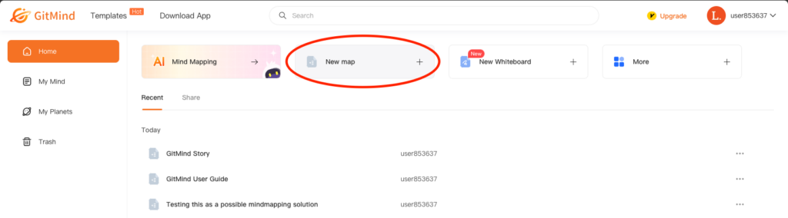 <!-- review-alt -->
2. Use the toolbar to add nodes, subnodes, and customize the appearance of content.
   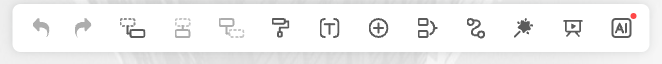 <!-- review-alt -->
3. Select a node and click **Insert** to add images, notes, links, and more.
   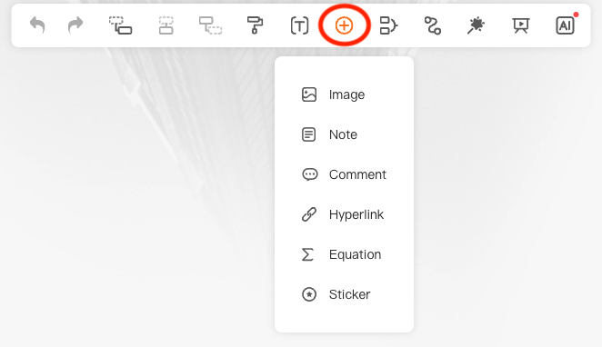 <!-- review-alt -->
4. Select **Style** to change background, theme, and map style.
   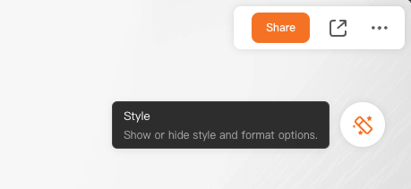 <!-- review-alt -->
5. Select **Outline View** to see a hierarchical text version of your map.
   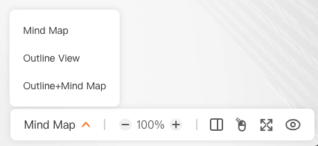 <!-- review-alt -->
6. **Export** as an image or document.
   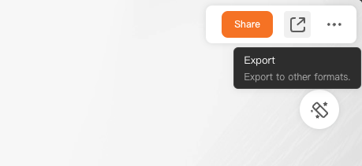 <!-- review-alt -->
   When you export to a Word document, nodes and subnodes appear as different sizes of text but are not real heading levels.

One especially useful GitMind feature is **Split Screen**.

1. Open the **More** menu and select **Split Screen**.
   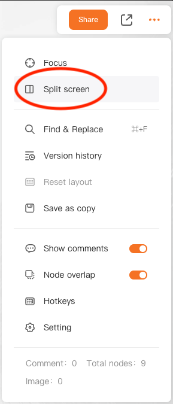 <!-- review-alt -->
2. Open a document, webpage, or whiteboard beside your map, for project planning, note-taking, and research.

To review keyboard shortcuts, select **More** and click **Hotkeys**.

Learn more in [How to use GitMind](https://gitmind.com/faq/how-to-use-gitmind.html).

MindMeister

 <!-- review-alt -->

[MindMeister](https://www.mindmeister.com) is an online mind mapping tool that runs in your web browser. You need to create an account. The free plan is limited to a few mind maps; paid plans have more features.

To create a mind map:

1. Select **Mind Map**.
2. Begin with a title or main topic.
   1. Press <kbd>Tab</kbd> to add a subtopic.
   2. Press <kbd>Enter</kbd> to add a sibling (equivalent subtopic).
3. Select **Actions** to add comments, notes, connections, and other tools.
   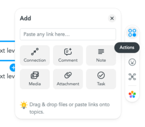 <!-- review-alt -->

To switch to a text outline:

1. Click **Mind Map** in the bottom left corner of the window.
   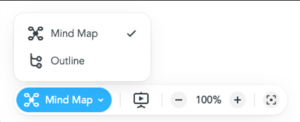 <!-- review-alt -->
2. Select **Outline**.
3. Changes you make in Outline view also appear in the mind map.

To export an outline:

1. Select **Export** in the top left.
   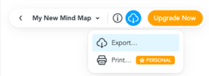 <!-- review-alt -->
2. Choose **Export…**
3. Choose **Document Outline**.
   1. Check **Include topic styling**.
4. Click **Export…**
   1. The exported document is an .RTF file with real heading levels.

Learn more about [MindMeister features](https://www.mindmeister.com/pages/product-tour).

MindMup

 <!-- review-alt -->

MindMup is an online mind mapping tool. It is free to use, and a paid version has more features. You need a Google account to use MindMup.

To get started:

1. Navigate to [MindMup](https://app.mindmup.com).
2. Select **CREATE A FREE MAP**.
3. On your first visit, MindMup asks to connect to your Google account.

To create a mind map:

1. Build the mind map by entering topics, subtopics, and siblings.
   1. Press <kbd>Tab</kbd> to create a subtopic.
   2. Press <kbd>Enter</kbd> to create a sibling topic.
   3. The toolbar has buttons to create siblings, subtopics, and connections.
2. [Create connections between nodes](https://www.mindmup.com/tutorials/connections.html) by selecting the first node and then clicking **Connect to another node** on the toolbar and clicking the destination node, or holding <kbd>Alt</kbd> and clicking the destination node.
3. Press <kbd>N</kbd> to [add a note to a topic](https://www.mindmup.com/tutorials/notes.html).
   1. Or open **View > Sidebar > Show Notes** to add and edit notes in the sidebar.

To export an outline:

1. Open the **File** menu.
2. Select **Download as**.
3. Choose **Outline**.
4. Make sure **MS Word/Google Writer** is the selected format.
5. Check the **Include text notes** box. Without it, your notes are left out.
6. Click **Export**.
7. Click **Download**. MindMup saves a Word document.

The exported outline uses nested lists to show the structure of the map. To get real heading levels instead, change the **Outline type** setting before exporting.

- [MindMup tutorials and guides](https://www.mindmup.com/tutorials/index.html)
- [What are concept maps? – MindMup](https://www.mindmup.com/tutorials/concept_mapping.html)
- [How to create document outlines with MindMup 2.0 (video, 1:08)](https://www.youtube.com/watch?v=hfmfblIqXD0)

Mindomo

 <!-- review-alt -->

[Mindomo](https://www.mindomo.com) is an online mind mapping tool that runs in your web browser. It is free to use, and a paid version has more features.

To create a mind map:

1. Click **Create** and choose a diagram style.
   1. We recommend **Blank mind map** or **Blank concept map**.
2. Click the placeholder and type the main topic.
3. Press <kbd>Tab</kbd> to create a subtopic. Repeat as needed.
4. Press <kbd>Enter</kbd> to create a sibling topic.
5. Click the down arrow on a topic for more options:
   - **Notes**, to add detail.
   - Hyperlinks and attachments.
   - Media such as images, videos, audio recordings, and icons.
   - Relationships, to connect two topics with a line.

Open the menu and select **Shortcuts** to see a list of keyboard shortcuts to add topics, subtopics, and relationships between topics.

To convert a mind map to an outline:

1. Expand the menu and select **View as Outline** to see a bullet point version of the mind map.
   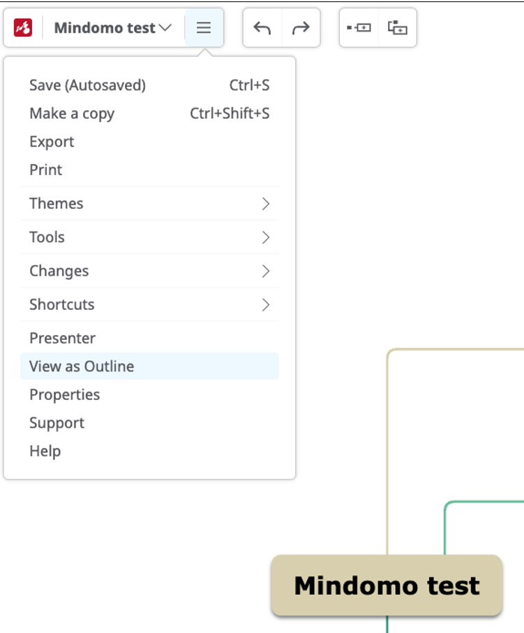 <!-- review-alt -->
2. Changes you make in the outline also appear in the mind map.

To export an outline:

1. Open the menu and select **Export**.
2. Choose **Text File (.txt)**, click **Export** and select **My Computer**.
3. The exported document includes tab indents to show structure.

- [What is a mind map? – Mindomo](https://www.mindomo.com/c/what-is-a-mind-map/)
- [Getting started with Mindomo](https://help.mindomo.com)
- [Mindomo how to video playlist](https://www.youtube.com/watch?v=oXKnrDLg2KA&list=PLOwUlX-xhRljs_vpUeWPUvh2o0yfoHzg-)

Word Outline

 <!-- review-alt -->

Word can’t draw a mind map, but its Outline view is a good way to organize ideas as an outline. Outline view is only in the desktop versions of Word (Windows and macOS). To install Word, go to [Microsoft 365](https://www.office.com/?auth=2), sign in with your Langara account, and select **Install apps**.

To create an outline:

1. Navigate to **View > Outline**.
   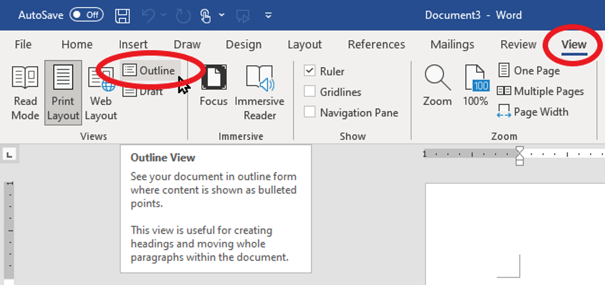 <!-- review-alt -->
2. Enter your main topic as **Level 1**.
3. Press <kbd>Tab</kbd> and enter subtopics. Repeat to create as many levels as needed.
   1. Or use the promote and demote buttons to set the level.
4. Enter links, notes, and evidence as body text.
   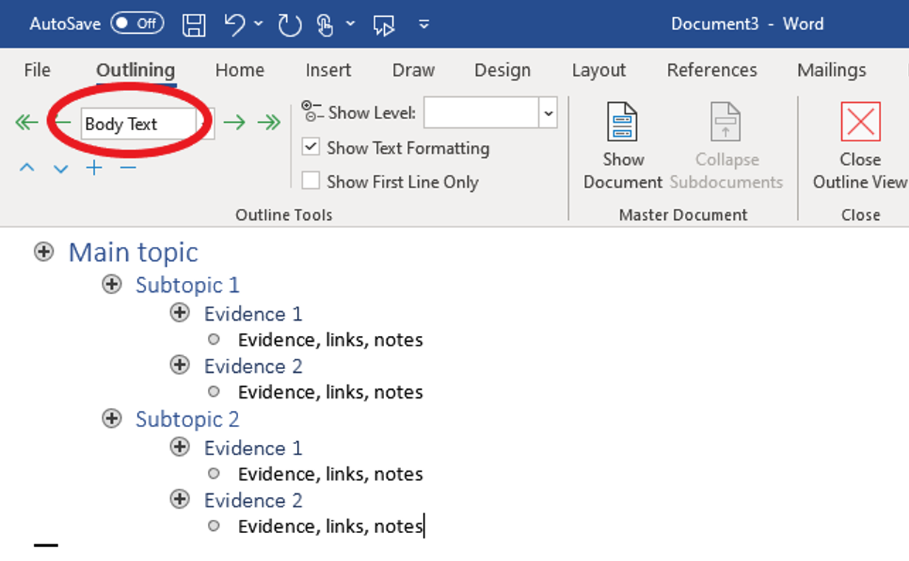 <!-- review-alt -->
5. Click **Close Outline View** to return to the document. The outline will appear as text with heading levels organizing topics, subtopics, and content.
   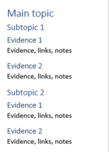 <!-- review-alt -->

{: .tip }
You can also turn a Word outline into PowerPoint slides: see [Create a PowerPoint presentation from an outline – Microsoft Support](https://support.microsoft.com/en-us/office/import-a-word-outline-into-powerpoint-a25f6e01-9a19-4c0d-a108-7f533e42dfe9).

Inspiration

 <!-- review-alt -->

Inspiration is software for creating diagrams, outlines, and maps, with templates and a built-in tutorial. [Download a free trial of Inspiration](https://www.inspiration-at.com/) or buy a licence. These steps and links are for Inspiration 10; newer versions may look different.

To begin:

1. Choose a document type: Diagram, Outline, or Map.
   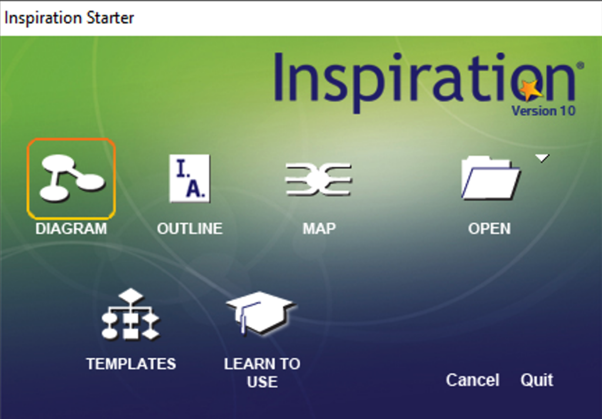 <!-- review-alt -->
   1. A diagram lets you arrange topics, subtopics, and notes freely.
   2. Maps follow a more structured process with a central main idea.
   3. An outline is a text list of your ideas, arranged in levels.
2. Start with your main topic and add subtopics.
   1. Use the **Relate** tool in a Map to create connections.
   2. Use the **Link** tool in a Diagram to create connections.
3. In a Diagram or Map, select **Outline** (or open the **View** menu and choose **Outline**) to see it as a text outline.
4. When your outline is complete, select **File > Export**.
5. Choose **Microsoft Word**.
6. You can change what to include in the export, but the default settings usually work best.
7. Click **Save**, then open the document in Word to continue your project.

For more information:

- [Inspiration resources and videos](https://www.inspiration-at.com/resources)
- [Inspiration explainer videos](https://www.inspiration-at.com/inspiration-explainer-videos/#explainer-videos)
- [Inspiration how-to videos](https://www.inspiration-at.com/inspiration-for-windows-how-to-videos)
- [Inspiration user manuals](https://www.inspiration-at.com/inspiration-help-manual/)
- [Inspiration Needs Report Justification Guide](https://inspiration-software.s3.eu-west-2.amazonaws.com/Inspiration+Justification+Guide+-+Inspiration+10+and+Maps.pdf) (this interactive guide is organized by user need and links to Inspiration features that may help).

Kurzweil

 <!-- review-alt -->

Kurzweil 3000 is a literacy suite with many tools (see also [Reading Alternate Format Material](reading-alternate-format-material.md#kurzweil)). Its **Brainstorm** tool makes a mind map that can be turned into an outline and then a draft document.

Students may be able to get Kurzweil through [ATBC grant funding](https://www.at-bc.ca/programs/grant-equipment-for-students-csg/), or [buy a Kurzweil licence from Bridges Canada](https://www.bridges-canada.com/products/kurzweil-3000-english-standalone). Visit the [Kurzweil download centre](https://www.kurzweiledu.com/products/download-center.html) for trials and updates.

By default, Kurzweil reads aloud as you type. To change this, go to **Tools > Options** and check or uncheck the options under **Speak as Typing**.

Select **File > New > Brainstorm > Blank** or **From Template**. There are templates for many different layouts.

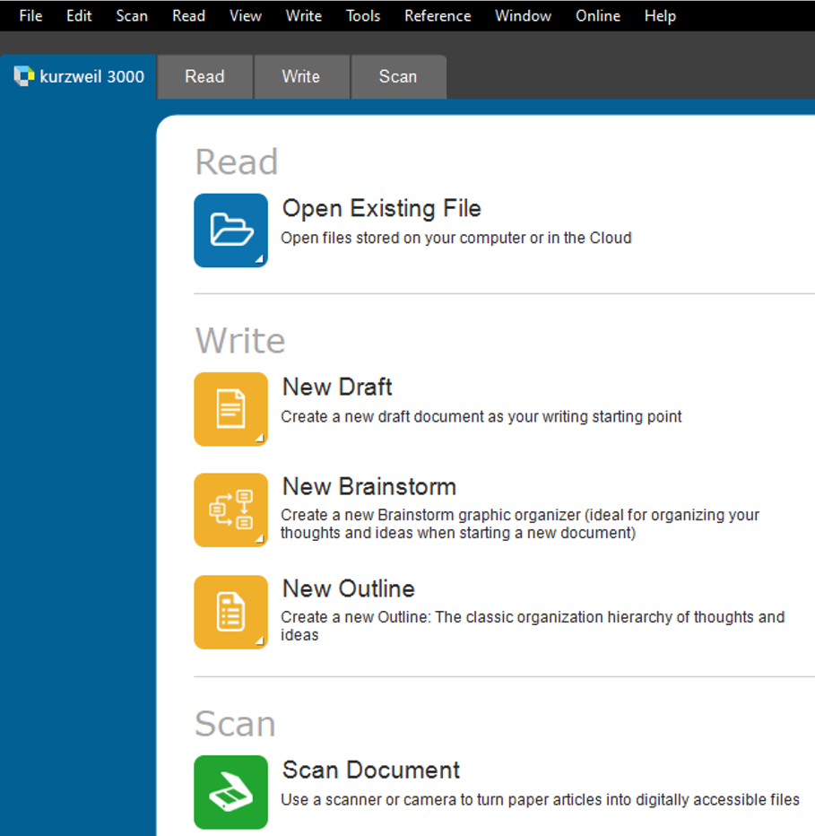 <!-- review-alt -->

1. Enter a main topic.
2. Add subtopics as ovals, rectangles, or rounded rectangles.
   1. Using different shapes and colours is another way to organize your ideas.
3. The Brainstorm Palette has tools for shapes, links, and other options.
   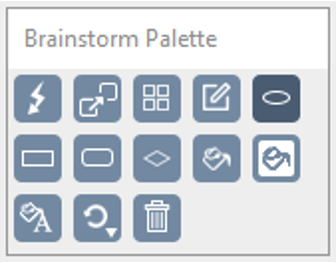 <!-- review-alt -->
   1. Use **Quick Takes** to quickly enter subtopics.
   2. Create **Links** between ideas.
   3. Select **Arrange** to clean up the diagram.
      1. This can change the look of your diagram a lot. To go back, select **Edit > Undo**.

To convert the diagram to an outline:

1. Select **Outline View**.
   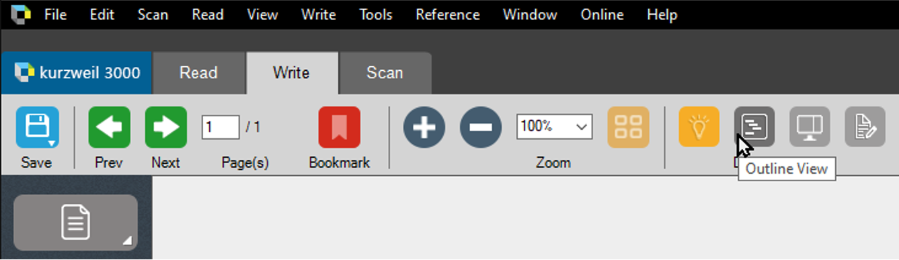 <!-- review-alt -->
2. **Outline View** converts the diagram to a list of indented bullet points.
   1. You can add information, notes, links, or other media in **Outline View**.
   2. Select **Split Screen View** to open a blank **Draft** document beside the outline, and start writing.
3. Choose **Save As…** and select **MS Word 2007 (\*.DOCX)**.
4. Open the document in Word to complete the project.

[Kurzweil 3000 for Windows Getting Started Guide (PDF)](https://www.kurzweiledu.com/files/pdf/2018shared/win_getting_started_guide.pdf)

