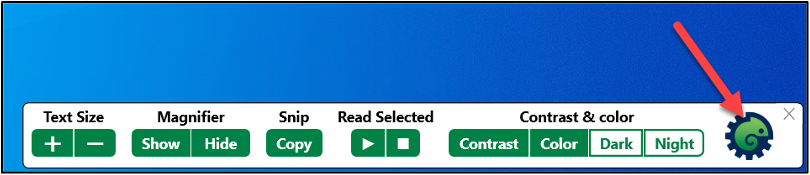
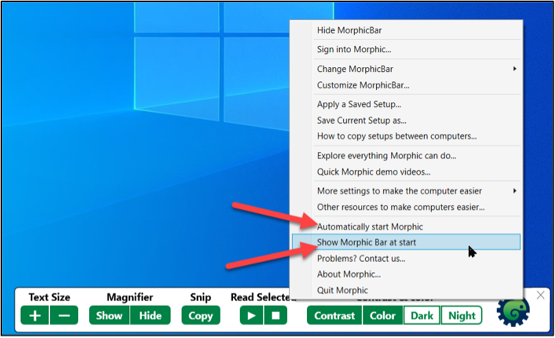
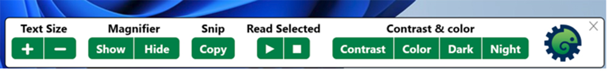

# Morphic

 <!-- review-alt -->

Morphic is a free toolbar that gives you one-click access to the accessibility tools built into your computer, such as text size, magnification, and read aloud. It is available for Windows 10 and 11 and recent versions of macOS. The steps on this page are for Windows.

[Download Morphic](https://morphic.org/download)

## Start Morphic automatically

1. Select the Morphic icon on the toolbar.
    <!-- review-alt -->
2. Check **Automatically start Morphic** and **Show Morphic Bar at start**.
    <!-- review-alt -->

## Toolbar shortcuts

The Morphic toolbar has these buttons:

 <!-- review-alt -->

1. **Text Size**
   1. Use **+** and **–** to make text bigger or smaller.
2. **Magnifier**
   1. Click **Show** or **Hide**.
   2. Magnifier starts with its default settings. To change them, go to **Settings > Accessibility (**Ease of Access** in Windows 10) > Magnifier**.
   3. While Magnifier is on, its window has options to change the view, zoom level, and other settings. See [Magnifiers guide](magnifiers.md#windows) for more information.
3. **Snip** takes a screenshot and copies it, ready to paste into a document.
   1. Select **Snip**, then click and drag over the area you want.
4. **Read Selected**
   1. Highlight text and click the play button under **Read Selected** to hear it read aloud.
   2. Change the voice in **Settings > Time & Language > Speech**.
5. **Contrast & color** turns on high contrast, colour filters, dark mode, and night mode.

## Shortcuts to Windows settings

Morphic also has shortcuts to the Windows accessibility settings.

1. Select the Morphic icon on the toolbar.
2. Choose **More settings to make the computer easier**.
    <!-- review-alt -->
3. The submenu has shortcuts to Windows accessibility tools and settings.

## Learn more

- [Morphic](https://morphic.org)
- [Morphic FAQ](https://morphic.org/faq)
- [Finding More Tools](finding-more-tools.md): Morphic is made by Raising the Floor, which also runs the Unified Listing.
