# Note-taking and Transcription

Note-taking is a skill, and technology helps most when paired with a method that works for you. This page covers popular note-taking methods, and apps that record and transcribe lectures, either afterward or live as you listen.

**On this page:**

- [Note-taking Strategies](#note-taking-strategies)
- [Note-taking Software](#note-taking-software)
  - [Record and Transcribe](#record-and-transcribe)
  - [Live Note-taking and Transcription](#live-note-taking-and-transcription)

## Note-taking Strategies

Few people have ever been taught how to take notes. Technology and accommodations help most when you already have a note-taking method that works for you. Many schools have a learning or academic success centre with note-taking workshops and tutoring.

{: .langara }
Langara’s [Academic Success Centre](https://langara.ca/student-services/academic-support/academic-success-centre) has resources, workshops, and tutoring that can help with note-taking.

Consider these free tools for note-taking:

- [Microsoft OneNote](https://support.microsoft.com/en-us/office/introducing-onenote-38be036d-5b5a-49ad-83be-292fe53ad7b3)
- [Apple Notes](https://support.apple.com/en-ca/guide/notes/welcome/mac)
- [Google Keep](https://workspace.google.com/products/keep/)
- [Microsoft Word](https://support.microsoft.com/en-us/word) (select **File > New** and choose a notes template)
- [Google Docs](https://workspace.google.com/products/docs/) (select **File > New > From template gallery > Class notes**)

Popular note-taking methods include:

[Outline](https://academicresourcecenter.harvard.edu/note-taking#ui-accordion-2-header-1) notes are bullet points that mimic the organization of the material or presentation.

[Cornell](https://academicresourcecenter.harvard.edu/note-taking#ui-accordion-2-header-0) notes organize material using a template ([Word](https://www.yorku.ca/scld/wp-content/uploads/sites/36/2024/01/Cornell-Notes-Template.docx), [Google Docs Template](https://docs.google.com/document/d/1X5vuSm8piiUwnsoYlyTt28inijWNTBvj7-jGWTUSmSQ/edit)).

[Sentence](https://academicresourcecenter.harvard.edu/note-taking#ui-accordion-2-header-3) note-taking means writing a sentence for each point, then organizing the material once the overall structure is clear.

[Mapping](https://academicresourcecenter.harvard.edu/note-taking#ui-accordion-2-header-2) is a visual style that emphasizes major concepts and connections between ideas. Consider [MindMeister](https://www.mindmeister.com), [Inspiration](https://www.inspiration-at.com) or OneNote. See also [Mind Mapping](mind-mapping.md).

[Boxing](https://www.goodnotes.com/blog/boxing-note-taking-method) is a visual style that organizes material with boxes around each subtopic.

Learn more about [note-taking strategies in *Student Success*](https://opentextbc.ca/studentsuccess/chapter/note-taking).

## Note-taking Software

### Record and Transcribe

One way to take notes is to record the audio and transcribe the recording later. You can’t correct or annotate the transcript as you go, but it may suit you better if you find it hard to focus and write at the same time. This method also suits **lectures and presentations**, because the recorder can be placed near the speaker.

{: .note }
Ask your instructor before recording a class, and keep recordings private.

To record audio:

1. On a digital recorder, press the record button to start recording.
   1. Get to know its other features, such as sound modes and recording levels, before class.
2. On a phone, tablet, or computer, open a recording app and start recording:
   - **Samsung**: Voice Recorder. On newer Galaxy phones it can also [transcribe recordings](https://www.samsung.com/ca/support/mobile-devices/how-to-use-transcribe-assist-on-the-galaxy-s24/).
   - **Google Pixel**: [Recorder](https://support.google.com/pixelphone/answer/9516618), which also transcribes.
   - **Apple**: Voice Memos, on [iPhone](https://support.apple.com/en-ca/guide/iphone/iph4d2a39a3b/ios), [iPad](https://support.apple.com/en-ca/guide/ipad/ipadf455678c/ipados), and [Mac](https://support.apple.com/en-ca/guide/voice-memos/vmaa4b813415/mac).
   - **Windows**: [Sound Recorder](https://support.microsoft.com/en-us/windows/how-to-use-voice-recorder-6fbb53d5-0539-abda-a9a4-0bcb84a778e7).
3. When you’re done, press **Stop**. Then move the recording to a computer: for a digital recorder, use its cable; from a phone, use cloud storage (such as OneDrive, iCloud, or Google Drive) or email the file to yourself.

To transcribe audio to text, use any of the following tools:

Microsoft Word



Microsoft Word for Windows and Word for the web have an excellent transcription tool. The audio file must be a .wav, .mp4, .m4a, or .mp3 file.

1. On Windows, open a new Word document.
   1. On macOS, open a new document in [Word for the web](https://www.office.com/launch/word?auth=2) instead. Transcribe is not in Word for Mac.
2. On the **Home** ribbon, select the arrow below or beside **Dictate** and choose **Transcribe**.
   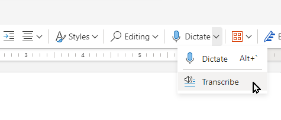 <!-- review-alt -->
3. Select the **Upload audio** button.
   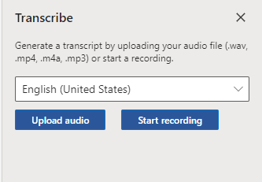 <!-- review-alt -->
4. Choose your file and select **Open**.
5. When it’s done, you can edit the transcript and add it to your document, with or without speaker names and timestamps.
   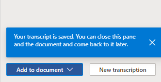 <!-- review-alt -->
   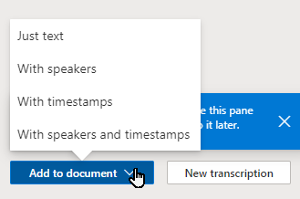 <!-- review-alt -->

{: .tip }
You can upload up to 300 minutes of audio a month.

- [Transcribe your recordings – Microsoft Support](https://support.microsoft.com/en-us/office/transcribe-your-recordings-7fc2efec-245e-45f0-b053-2a97531ecf57)
- [Dictate your documents in Word – Microsoft Support](https://support.microsoft.com/en-us/office/dictate-your-documents-in-word-3876e05f-3fcc-418f-b8ab-db7ce0d11d3c)
- [Dictate your notes in OneNote – Microsoft Support](https://support.microsoft.com/en-us/office/dictate-your-notes-in-onenote-2f5d1549-afe1-4abd-95ff-829a839e3d00)

Dragon



Dragon for Windows can transcribe .wav, .mp3, and .m4a recordings to text.

1. Open the **Tools** menu and select **Transcribe Recording**.
   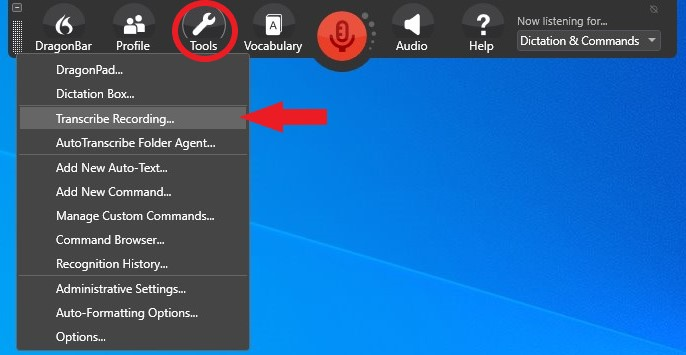 <!-- review-alt -->
2. Choose a file and select **Transcribe**.
   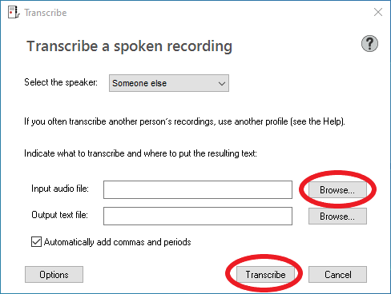 <!-- review-alt -->
   1. If the recording is of someone else’s voice, select **Someone else** in the **Select the speaker** menu.
   2. By default, the text file is saved in the same folder as the audio file.
3. Wait for the transcription to finish. Dragon creates an .RTF text file, which you can open in DragonPad or Word, or keep for later.
   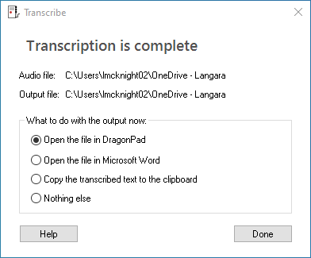 <!-- review-alt -->

Watch a [demonstration of Dragon’s transcription tool (video, 2:01)](https://www.youtube.com/watch?v=zC9i1KkdHd4).

- [Transcribing recorded speech – Dragon Help](https://www.nuance.com/products/help/dragon15/dragon-for-pc/enx/dpg-cp/Content/DictationSources/transcribe_recorded_dictation.htm)
- [Dragon user documentation](https://dragon.nuance.com/en-us/user-documentation)

macOS and iOS Voice Memos



Voice Memos can transcribe recordings in some languages, including English. On a Mac:

1. Go to the Voice Memos app 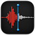 <!-- review-alt --> on your Mac.
2. Click the recording with the transcript you want to view.
3. Click  <!-- review-alt --> to view the transcript.
4. Select the text you want to copy, Control-click (or right-click) it, then choose **Copy**. Paste it into a document, email, or anywhere else.

[View a Voice Memos transcription on Mac – Apple Support (CA)](https://support.apple.com/en-ca/guide/voice-memos/vm4a03609f0d/mac)

Audapolis



[Audapolis](https://github.com/bugbakery/audapolis) is a free, open source editor for Windows, macOS, and Linux that transcribes audio on your own computer, without uploading it, and lets you edit the transcript.

### Live Note-taking and Transcription

Live transcription apps record and transcribe audio as it happens, and let you add notes and highlights while you listen.

Because the audio is recorded by your own device, they may not work well in large lectures or noisy rooms, where the speaker is far from the microphone or there is background noise and echo. They work best for **small meetings, seminars, and group work**.

{: .warning }
Most of these apps upload your recordings to the company’s servers. Check their privacy terms, and ask your instructor and group before recording.

OneNote



Microsoft OneNote can record audio while you type notes, and links each note to the moment in the recording when you typed it.

To record audio and type notes in OneNote:

1. On the **Home** tab, open the **Transcribe** menu (1) and select **Record Audio** (2).
   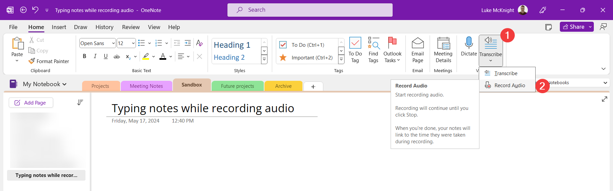 <!-- review-alt -->
   1. If the **Transcribe** menu does not appear on the **Home** tab, check the **Insert** tab.
2. OneNote will automatically begin recording.
3. Type your notes below.
   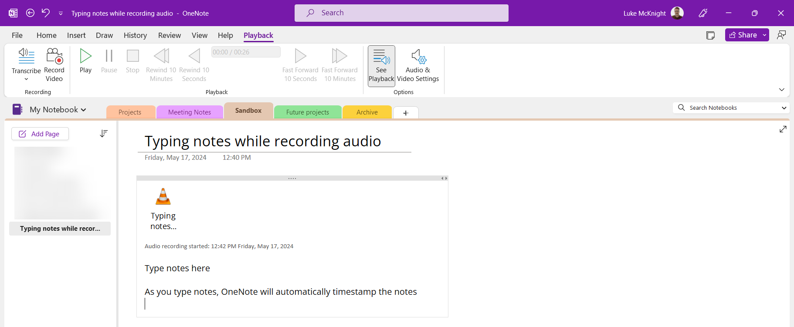 <!-- review-alt -->
4. When finished, click the **Stop** button on the **Playback** tab.
5. Place the mouse cursor on a line of text and then click the play button that appears to the left.
   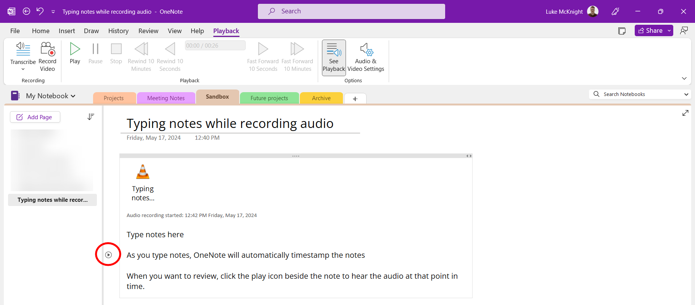 <!-- review-alt -->
6. OneNote will play the audio from the time you typed the note.

[Watch: Record Audio in OneNote (YouTube video)](https://www.youtube.com/watch?v=YJqT-dCQ1DI)

To transcribe the entire audio file:

1. Right-click on the audio file and select **Save As…**
   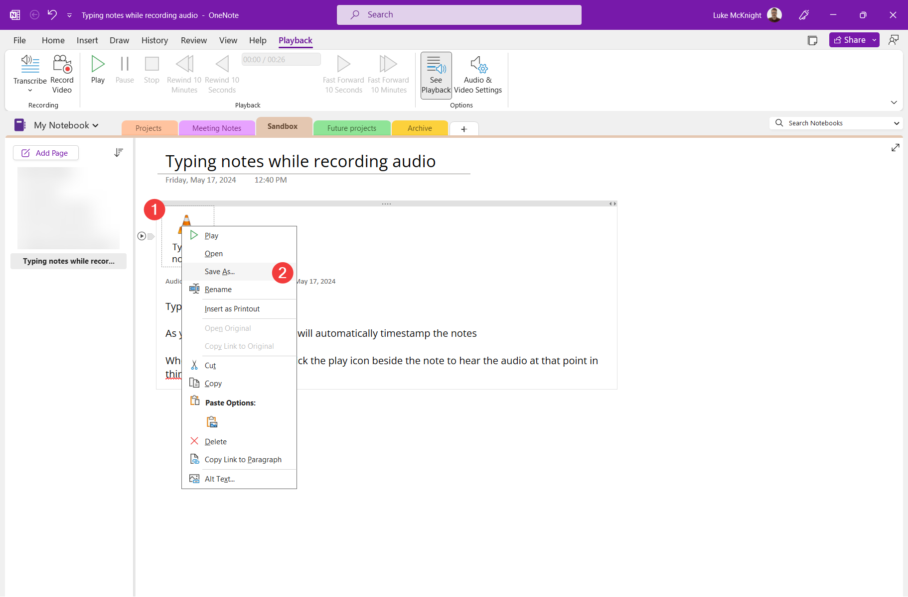 <!-- review-alt -->
2. On the **Playback** tab, open the **Transcribe** menu and click **Transcribe**.
   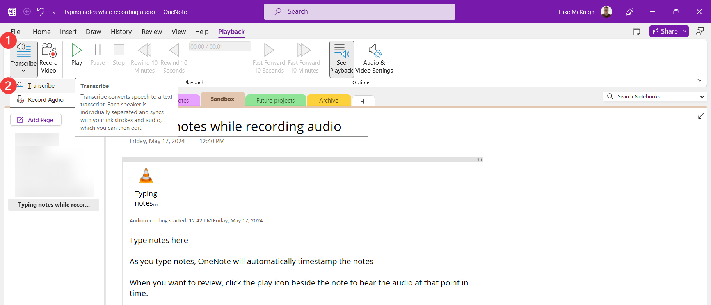 <!-- review-alt -->
3. In the **Transcribe** panel that opens, click **Upload** and select the audio file saved in step 1.
   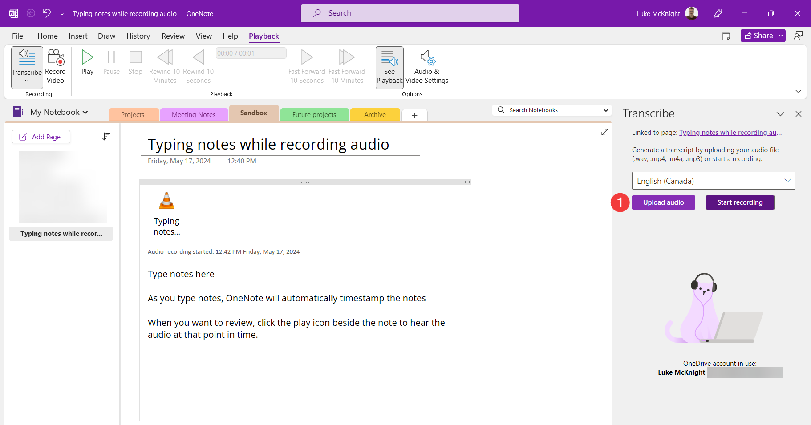 <!-- review-alt -->
4. When transcription is complete, open the **Add to page** menu and select your desired format.
   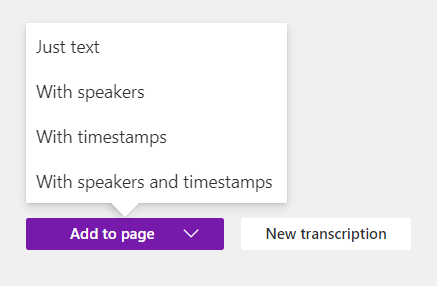 <!-- review-alt -->

Genio



[Genio](https://genio.co) (formerly Glean, and before that Sonocent) is a note-taking app that can transcribe audio to text. Its note-taking tool, Genio Notes, is available as a web app and a mobile app. If you already have a Glean account, you will be moved to Genio the next time you sign in.

To use Genio to take notes and transcribe audio:

1. [Sign in to Genio Notes](https://app.genio.co/notes).
2. Select **New Event**.
3. Click **Record** and choose **Microphone**. The first time you record, allow Genio to use your microphone.
4. While Genio records, you can add notes, headings, or attachments. Each one is linked to that moment in the recording.
5. When the presentation is over, stop the recording.
6. Select **Transcript**, then **Transcribe Audio**. Choose a language and select **Transcribe Audio** again.
7. When it's ready, select **Transcript** to view the transcript.

To use Genio to transcribe pre-recorded audio:

1. [Sign in to Genio Notes](https://app.genio.co/notes).
2. Select **New Event**.
3. Select **Import Audio** and choose a file. The file must be an .mp3 or .wav file, up to 3 hours long. Keep the Event open until the import is finished.
4. Select **Transcript**, then **Transcribe Audio**. Choose a language and select **Transcribe Audio** again.
5. When it's ready, select **Transcript** to view the transcript.
6. Highlight text and copy it to a Word document, or select **Post** to add it to your notes in the Genio Event, where it is saved automatically.

[Genio Help Centre](https://help.genio.co)

Notta



[Notta](https://www.notta.ai/en) is a transcription and note-taking app with a free plan that includes a limited number of minutes each month.

To use Notta to take notes and transcribe audio:

1. [Log in to Notta](https://app.notta.ai).
2. Select **Record an Audio**.
3. Click **Add Notes** to add a timestamped note.
4. Click **Stop**.
5. Select **Download** to export the recording, the transcript, or both.

To use Notta to transcribe pre-recorded audio:

1. [Log in to Notta](https://app.notta.ai).
2. Select **Import Files**.
3. Once transcription is complete, open the file from the Notta Dashboard.
4. Make edits, add notes, and export in various formats.

[Notta Help Center](https://support.notta.ai/hc/en-us)

Otter.ai



[Otter.ai](https://otter.ai) is a transcription app available on the web, as a Chrome extension, and as a mobile app.

To use Otter to take notes and transcribe audio:

1. [Sign in to Otter](https://otter.ai/home).
2. Click **Record**.
3. Otter will open a new conversation and begin recording.
4. Click on any transcribed text to add a comment.
5. Select **Stop Recording** when you are finished. The audio recording and transcribed text will be available for review and export.

To use Otter to transcribe pre-recorded audio:

1. [Sign in to Otter](https://otter.ai/home).
2. On the Otter dashboard, select the **Import** button.
3. Drag and drop your file or select **Browse files**.
4. Wait for the transcription process to complete.
5. Select **Go to transcript**.
6. Play the audio and correct the transcript as needed.
7. Add comments and highlights to the transcript.
8. Export the transcript from **My Conversations**.

[Otter.ai Help Center](https://help.otter.ai/hc/en-us)

