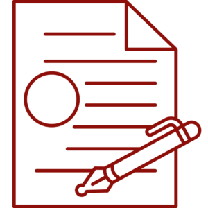

# Note-taking and Transcription

 <!-- review-alt -->

**On this page:**

- [Note-taking Strategies](#note-taking-strategies)
- [Note-taking Software](#note-taking-software)
  - [Record and Transcribe](#record-and-transcribe)
  - [Live Note-taking and Transcription](#live-note-taking-and-transcription)

## Note-taking Strategies

Few people have been taught how to take notes. Unfortunately, instructing students how to take notes is no one’s responsibility. If a student does not understand how to take and interpret notes, no amount of technology or accommodation will be useful. Langara’s [Academic Success Centre](https://langara.ca/academic-success-centre/index.html) has resources, workshops, and tutoring that may assist students with note-taking.

Consider these free tools for note-taking:

- [Microsoft OneNote](https://support.microsoft.com/en-us/office/introducing-onenote-38be036d-5b5a-49ad-83be-292fe53ad7b3)
- [Apple Notes](https://support.apple.com/en-ca/guide/notes/welcome/mac)
- [Google Keep](https://www.google.com/keep)
- [Microsoft Word](https://support.microsoft.com/en-us/word) (select **File > New** or **New from Template > Notes**)
- [Google Docs](https://www.google.ca/docs/about) (select **File > New > From document gallery > Class notes**)

Popular note-taking methods include:

[Outline](https://academicresourcecenter.harvard.edu/note-taking#ui-accordion-2-header-1) notes are bullet points that mimic the organization of the material or presentation.

[Cornell](https://academicresourcecenter.harvard.edu/note-taking#ui-accordion-2-header-0) notes organize material using a template ([Word](https://www.ohio.edu/university-college/sites/ohio.edu.university-college/files/sites/university-college/Notetaking%20System.doc), [Google Docs Template](https://docs.google.com/document/d/1X5vuSm8piiUwnsoYlyTt28inijWNTBvj7-jGWTUSmSQ/edit)).

[Sentence](https://academicresourcecenter.harvard.edu/note-taking#ui-accordion-2-header-3) notetaking involves writing a sentence for each point and organizing material once the overall structure is clear.

[Mapping](https://academicresourcecenter.harvard.edu/note-taking#ui-accordion-2-header-2) is a visual style that emphasizes major concepts and connections between ideas. Consider [MindMeister](https://www.mindmeister.com), [Inspiration](https://www.inspiration-at.com) or OneNote. See also [Mind Mapping](mind-mapping.md).

[Boxing](https://www.goodnotes.com/blog/boxing-note-taking-method) is a visual style that organizes material with boxes around each subtopic.

Learn more about [notetaking strategies](https://opentextbc.ca/studentsuccess/chapter/note-taking).

## Note-taking Software

### Record and Transcribe

One method for notetaking is to record audio and transcribe the recording later. While this does not allow students to correct and annotate the transcript in real-time, it may be a better solution for students that struggle with focus. This method is also better suited for **lectures and presentations** as the recorder can be placed near the speaker or presenter.

To record audio:

1. On a digital recorder, press the record button to begin capturing audio.
   1. Users should familiarize themselves with additional features such as sound modes and recording levels.
2. To record audio on a smart device:
   1. Use an audio recording application.
      1. [Voice Recorder](https://www.samsung.com/au/support/mobile-devices/using-voice-recorder) is the default app on Samsung devices and [Recorder](https://support.google.com/pixelphone/answer/9516618?hl=en) is the default on Google devices.
      2. [Voice Memos](https://support.apple.com/en-ca/guide/iphone/iph4d2a39a3b/ios) is the default app on [iOS](https://support.apple.com/en-ca/guide/iphone/iph4d2a39a3b/ios), [iPadOS](https://support.apple.com/en-ca/guide/ipad/ipadf455678c/ipados), and [macOS](https://support.apple.com/en-ca/guide/voice-memos/vmaa4b813415/mac#:~:text=In%20the%20Voice%20Memos%20app,in%20the%20lower%2Dright%20corner.).
      3. [Voice Recorder](https://support.microsoft.com/en-us/windows/how-to-use-voice-recorder-6fbb53d5-0539-abda-a9a4-0bcb84a778e7) is the default app for Windows.
   2. Begin recording.
3. When done recording, press **Stop**. Then transfer the recording to a computer. For a digital recorder, use the included connector and for a smart device consider cloud storage (such as OneDrive, iCloud, or Google Drive) or emailing the audio file to yourself.

To transcribe audio to text, use any of the following tools:

Microsoft Word

The Windows and web version of Microsoft Word offers an excellent transcription tool. To transcribe audio, you must have a .wav, .mp4, .m4a, or .mp3 file format.

1. On Windows, open a new Word document.
   1. On macOS, open a new [Word document in the web platform](https://www.office.com/launch/word?auth=2) (https://www.office.com/launch/word?auth=2).
2. On the **Home** ribbon, select the arrow below or beside **Dictate** and choose **Transcribe**.
    <!-- review-alt -->
3. Select the **Upload audio** button.
    <!-- review-alt -->
4. Choose your file and select **Open**.
5. When the process is complete, you can edit the transcript and add it to your document with various features such as speaker labels and timestamps.
    <!-- review-alt -->
    <!-- review-alt -->

Note: users can transcribe 300 minutes per month.

- Official Microsoft documentation on [transcribing your recordings](https://support.microsoft.com/en-us/office/transcribe-your-recordings-7fc2efec-245e-45f0-b053-2a97531ecf57) with Word web version.
- How to [dictate speech into Word](https://support.microsoft.com/en-us/office/dictate-your-documents-in-word-3876e05f-3fcc-418f-b8ab-db7ce0d11d3c) on all platforms.
- [Dictate your notes in OneNote](https://support.microsoft.com/en-us/office/dictate-your-notes-in-onenote-2f5d1549-afe1-4abd-95ff-829a839e3d00#ID0EDBN=Windows)

Dragon

[Dragon Naturally Speaking](https://www.nuance.com/products/help/dragon15/dragon-for-pc/enx/dpg-cp/Content/DictationSources/transcribe_recorded_dictation.htm) can transcribe .wav, .mp3, and .m4a file types to text.

1. Open the **Tools** menu and select **Transcribe Recording**.
    <!-- review-alt -->
2. Choose a file and select **Transcribe**.
    <!-- review-alt -->
   1. If the recording is of someone else’s voice, select **Someone else** in the **Select the speaker** menu.
   2. By default, the Output text file location will be the same as the Input audio file location.
3. Wait for the transcription process to complete. Dragon creates a text file that can be opened in DragonPad or Word or saved for later as an .RTF text file.
    <!-- review-alt -->

Watch a [demonstration of Dragon’s transcription tool (video, 2:01)](https://www.youtube.com/watch?v=zC9i1KkdHd4).

- [Transcribing recorded speech with Dragon](https://www.nuance.com/products/help/dragon15/dragon-for-pc/enx/dpg-cp/Content/DictationSources/transcribe_recorded_dictation.htm)
- Visit Dragon [Watch and Learn](https://www.nuance.com/dragon/dragon-for-pc/how-to-videos.html) for videos of common Dragon features in action.

macOS and iOS Voice Memos

1. Go to the Voice Memos app  <!-- review-alt --> on your Mac.
2. Click the recording with the transcript you want to view.
3. Click  <!-- review-alt --> to view the transcript.
4. Select the text you want to copy, [Control-click](https://support.apple.com/en-am/guide/voice-memos/aside/glosb9214f98/3.0/mac/15.0) it, then choose **Copy**. Open a document, email, or anywhere else you can input text and paste.

Read more about [Voice Memos transcription on Mac](https://support.apple.com/en-am/guide/voice-memos/vm4a03609f0d/mac).

Audapolis

[Audapolis is an open source transcript editor](https://github.com/audapolis/audapolis) that automatically transcribes audio to text.

### Live Note-taking and Transcription

An increasingly popular technology-based note-taking solution is live transcription and note-taking platforms. These tools record and transcribe audio that users can amend and annotate in real-time.

As the audio is recorded by the user’s device, these solutions may not work in large lectures or noisy environments due to space between speaker and microphone, background noise, and echoes. Live transcription options work best for **small meetings, seminars, or group work**.

OneNote

Microsoft OneNote can record audio while you type notes. OneNote automatically links typed notes to the recording time when the note was added.

To record audio and type notes in OneNote:

1. On the **Home** tab, open the **Transcribe** menu (1) and select **Record Audio** (2).
    <!-- review-alt -->
   1. If the **Transcribe** menu does not appear on the **Home** tab, check the **Insert** tab.
2. OneNote will automatically begin recording.
3. Type your notes below.
    <!-- review-alt -->
4. When finished, click the **Stop** button on the **Playback** tab.
5. Place the mouse cursor on a line of text and then click the play button that appears to the left.
    <!-- review-alt -->
6. OneNote will play the audio from the time you typed the note.

[Watch: Record Audio in OneNote (YouTube video)](https://www.youtube.com/watch?v=YJqT-dCQ1DI)

To transcribe the entire audio file:

1. Right-click on the audio file and select **Save As…**
    <!-- review-alt -->
2. On the **Playback** tab, open the **Transcribe** menu and click **Transcribe**.
    <!-- review-alt -->
3. In the **Transcribe** panel that opens, click **Upload** and select the audio file saved in step 1.
    <!-- review-alt -->
4. When transcription is complete, open the **Add to page** menu and select your desired format.
    <!-- review-alt -->

Glean

[Glean](https://glean.co) (formerly Sonocent) is a notetaking application that can transcribe audio to text. Glean is available as a web application and mobile app.

To use Glean to take notes and transcribe audio:

1. [Sign in to Glean](https://app.glean.co).
2. Select **New Event**.
3. Click the red dot **Record** button.
4. As Glean is recording you can add notes, headings, or attachments. Your interactions will be noted at the time in the recording.
5. When the presentation is over, click **Transcribe Audio**.
6. Click **Transcript**.

To use Glean to transcribe pre-recorded audio:

1. [Sign in to Glean](https://app.glean.co).
2. Select **New Event**.
3. Open the **Event Options** menu in the top right of the window.
4. Select **Import Audio** and choose a file.
5. Click **Transcribe Audio**.
6. Click **Transcript**.
7. Select **Text**.
8. Highlight text and copy to a Word document, or select **Post** to post the transcribed text to the Glean Event, where it is saved automatically.

[Glean Help Centre](https://help.glean.co)

Notta

[Notta](https://www.notta.ai/en) is a notetaking application.

To use Notta to take notes and transcribe audio:

1. [Log in to Notta](https://app.notta.ai).
2. Select **Record an Audio**.
3. Click **Add Notes** to add a timestamped note.
4. Click **Stop**.
5. Select **Download** to export the recording and/or transcript in various formats.

To use Notta to transcribe pre-recorded audio:

1. [Log in to Notta](https://app.notta.ai).
2. Select **Import Files**.
3. Once transcription is complete, open the file from the Notta Dashboard.
4. Make edits, add notes, and export in various formats.

[Notta Help Center](https://support.notta.ai/hc/en-us)

Otter.ai

[Otter.ai](https://otter.ai) is a speech to text transcription application available as a web application, Chrome extension, and mobile app.

To use Otter to take notes and transcribe audio:

1. [Sign in to Otter](https://otter.ai/home).
2. Click **Record**.
3. Otter will open a new conversation and begin recording.
4. Click on any transcribed text to add a comment.
5. Select **Stop Recording** when you are finished. The audio recording and transcribed text will be available for review and export.

To use Otter to transcribe pre-recorded audio:

1. [Sign in to Otter](https://otter.ai/home).
2. On the Otter dashboard, select the **Import** button.
3. Drag and drop your file or select **Browse files**.
4. Wait for the transcription process to complete.
5. Select **Go to transcript**.
6. The audio file can be played and the transcript can be edited for accuracy.
7. The transcript can also be manipulated, annotated, and highlighted.
8. From **My Conversations** the transcript can be exported.

[Otter.ai Help Center](https://help.otter.ai/hc/en-us)

---

*Assistive Technology User Guides* by Luke McKnight is licensed under a [Creative Commons Attribution-NonCommercial-ShareAlike 4.0 International License](https://creativecommons.org/licenses/by-nc-sa/4.0/).
