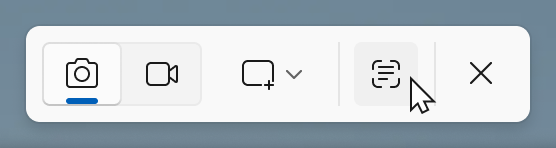
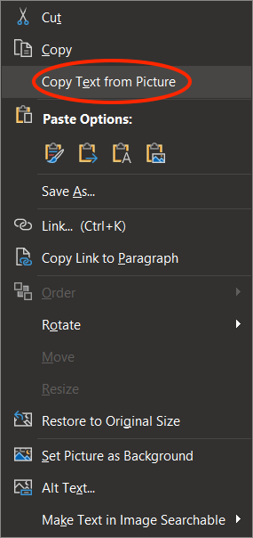
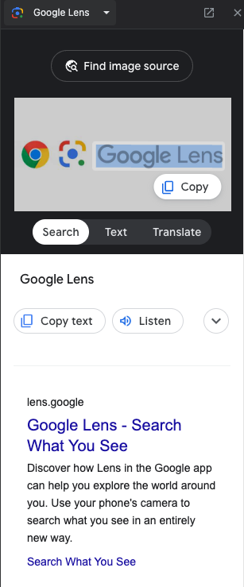

# Optical Character Recognition

Optical character recognition (OCR) turns pictures of text, such as scans, screenshots, and photos, into text you can select, copy, and have read aloud. These tools can help you get the text out of inaccessible documents and websites.

None of these tools replace accessible documents. The people who create content are always responsible for making it accessible.

**On this page:**

- [Screenshot Readers](#screenshot-readers)
- [Optical Character Recognition Tools](#optical-character-recognition-tools)

## Screenshot Readers

Screenshot readers capture part of your screen and pull out the text, for example from a scanned PDF, an image, or a badly built website.

Windows Snipping Tool



The Windows Snipping Tool has a text extractor for copying text from anything on screen.

Open Snipping Tool with <kbd>Windows</kbd> + <kbd>Shift</kbd> + <kbd>S</kbd> and click the **Text Extractor** button in the toolbar.

 <!-- review-alt -->

Click and drag over the text. The text is copied to the clipboard, ready to paste into a document.

PowerToys



 <!-- review-alt -->

[Microsoft PowerToys](https://learn.microsoft.com/en-us/windows/powertoys) is a free set of extra tools for Windows. Its **Text Extractor** copies the text from any part of the screen, including images and videos.

1. With PowerToys running, press <kbd>Windows</kbd> + <kbd>Shift</kbd> + <kbd>T</kbd> to activate Text Extractor.
2. Click and drag over content.
3. The text is copied to the clipboard.
4. Paste it into Notepad, Word, or another app.

iOS/iPadOS/macOS



 <!-- review-alt -->

**Live Text** lets you select and copy text in photos, screenshots, and paused videos on iPhone and iPad (iOS and iPadOS 15 or later) and Mac (macOS 12 or later).

On a Mac, open an image or an inaccessible document in Preview, Photos, or Safari. Over text, the pointer turns into a text cursor: click and drag to select the text, then copy it.

On iPhone and iPad, open the image in Photos (or point the Camera at the text) and tap the **Live Text** button , or touch and hold a word.

- [Interact with text in a photo using Live Text in Preview on Mac – Apple Support (CA)](https://support.apple.com/en-ca/guide/preview/prvw625a5b2c/mac)
- [Copy and translate text from photos on your iPhone or iPad – Apple Support (CA)](https://support.apple.com/en-ca/120004)

OneNote



 <!-- review-alt -->

In OneNote for Windows, insert an image or a file printout, right-click it and select **Copy Text from Picture**, then paste the text into OneNote or another document.

 <!-- review-alt -->

[Copy text from pictures and file printouts using OCR in OneNote – Microsoft Support](https://support.microsoft.com/en-us/office/copy-text-from-pictures-and-file-printouts-using-ocr-in-onenote-93a70a2f-ebcd-42dc-9f0b-19b09fd775b4)

{: .note }
The **Microsoft Lens** scanning app was retired in early 2026 and removed from the app stores. Microsoft recommends the scanner in the OneDrive mobile app instead.

Google Lens



Google Lens, like Apple’s Live Text, can pick out the text in a photo on your phone. [Download Google Lens for Android](https://play.google.com/store/apps/details?id=com.google.ar.lens). Google Lens is also built into Chrome on computers:

1. In **Chrome**, navigate to an image and **right-click** on the image.
2. Select **Search Image with Google**.
3. Highlight the text you want, or use the **Select all text** button.
4. Use the **Copy text** or **Listen** buttons.
    <!-- review-alt -->

[Google Lens – Google Search](https://search.google/ways-to-search/lens/)

ShareX



 <!-- review-alt -->

ShareX is a free screenshot app for Windows that includes OCR. Capture all or part of the screen, then copy the text into another program, for example to have it read aloud.

1. [Download ShareX from the Microsoft Store](https://apps.microsoft.com/detail/9nblggh4z1sp).
2. Open ShareX.
3. Select **Capture**.
4. Select **Text Capture (OCR)…**
5. Draw a box around the text. The text appears in a new window, where you can copy it, or send it to an online service such as Google Translate, which can read short passages aloud.

[ShareX OCR documentation](https://getsharex.com/docs/ocr)

Snagit



 <!-- review-alt -->

Snagit is paid screen capture and recording software for Windows and macOS. Langara has some licences. To copy all the text from an image:

1. Open an image in the Snagit Editor (either via screenshot or existing file).
2. Right-click and select **Grab Text…**
3. The **Grab Text Results** window appears with options to edit, copy parts of the text, or **Copy All**.

To select specific text:

1. Open an image in the Snagit Editor (either via screenshot or existing file).
2. Click the **Selection** tool.
3. Click and drag around desired text.
4. Right-click and choose **Grab Text**.
5. The **Grab Text Results** window appears allowing you to edit and copy the text.

[Grab & Edit Text – Snagit tutorial](https://www.techsmith.com/learn/tutorials/snagit/edit-image-text/)

Firefox (macOS)



 <!-- review-alt -->

1. Right-click on an image.
2. Select **Copy Text from Image**.
3. A pop-up containing the image’s text appears.
   1. The complete text is automatically copied to the clipboard.
   2. To copy only part of it, select that text and press <kbd>Command</kbd> + <kbd>C</kbd>.
4. Click **Close** or press <kbd>Escape</kbd>.

This feature is only available in Firefox for macOS.

[Copy text from images on Firefox for macOS – Firefox Help](https://support.mozilla.org/en-US/kb/text-recognition)

Equatio



 <!-- review-alt -->

Equatio’s **Screenshot Reader** reads aloud math that is only available as a picture, and can copy it as MathML or LaTeX. For steps, see [Reading math in the Equatio Quick Start Guide](equatio-quick-start-guide.md#reading-math).

[Equatio Screenshot Reader introduction – Texthelp Academy](https://academy.texthelp.com/equatio/screenshot-reader)

{: .note }
Many screenshot readers limit how much text they can capture at once, or crash on large selections. They are not meant for converting whole documents: for that, use one of the OCR tools below.

## Optical Character Recognition Tools

TextAid



 <!-- review-alt -->

Upload a picture or scan of text and TextAid converts it to text it can read aloud, and saves it to your Library.

{: .langara }
[Access TextAid](https://ws.readspeaker.com/a/wasp/app/8) using your Langara email and password.

1. Select **Image to Text** in the sidebar.
    <!-- review-alt -->
2. Choose file, set options, and click **Start**.
    <!-- review-alt -->
3. Wait for the file to process and then select **Go to your library** to access your file.
    <!-- review-alt -->
4. You can now use the reading options and tools described in [Reading Alternate Format Material](reading-alternate-format-material.md#textaid).
5. Click the **Listen** button to read the whole document.
    <!-- review-alt -->
6. Select **Text Mode** to see the text as plain text and use more tools, such as selecting text to listen to it.
    <!-- review-alt -->

[TextAid Image to Text Tool](https://www.readspeaker.com/blog/textaid-features/#7)

Kurzweil



Kurzweil can scan printed pages and turn them into documents it can read aloud.

1. Select the **Scan** tab.
2. Select **Scanner Setup** to choose your scanner and page size.
3. Turn on any options you need before you scan:
    - **Scan in Color** (scans are black and white by default)
    - **Double-Sided Scanning** for pages printed on both sides
    - **Two Page Mode** to scan two pages of an open book at once
    - **Scan Repeatedly** to scan several pages without pressing scan each time. Turn the page while the timer counts down.
4. Place the page on the scanner and select **Start a Scan**.
5. When the scan is done, use the [Kurzweil reading tools](reading-alternate-format-material.html#kurzweil) to have it read aloud.

If something goes wrong:

- **Rescan Page** replaces a page that came out too light, too dark, or crooked.
- **Insert Page** adds a page you missed. Go to where it belongs, place it on the scanner, and select **Insert Page**.
- **Delete Page** removes a duplicate or poor scan.
- **Edit Underlying Text** lets you fix words Kurzweil read incorrectly.

See the [Kurzweil 3000 for Windows Getting Started Guide (PDF)](https://www.kurzweiledu.com/files/pdf/2018shared/win_getting_started_guide.pdf), pages 22-24 for more.

Google Drive



 <!-- review-alt -->

Google Drive can convert scanned PDFs and images into editable text:

1. Upload the file to Google Drive. It must be a PDF, JPEG, PNG, or GIF file of 2 MB or less.
2. Right-click the file and select **Open with > Google Docs**. A new Google Doc opens with the text from the file.

[Convert PDF and photo files to text – Google Drive Help](https://support.google.com/drive/answer/176692)

Acrobat



 <!-- review-alt -->

The free Adobe Acrobat Reader can’t do OCR. You need a paid version of Acrobat.

1. Open a PDF file containing a scanned image in Acrobat for Mac or PC.
2. Open the **Scan & OCR** tool.
3. Under **Recognize Text**:
   1. Choose **In This File**.
   2. Click **Recognize Text**.
4. OCR does not make a PDF fully accessible: making the text readable is only the first step.

[How to use Acrobat OCR for PDFs in 4 easy steps](https://www.adobe.com/acrobat/how-to/ocr-software-convert-pdf-to-text.html)

Langara has an OCR scanner and Kurzweil software available. Contact [assistivetech@langara.ca](mailto:assistivetech@langara.ca) for more information.
