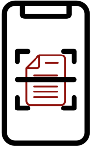

# Optical Character Recognition

 <!-- review-alt -->

These optical character recognition tools may assist users to glean text from inaccessible documents and websites. None of the tools on this page are meant as a replacement for accessible document creation. Content creators are always responsible for creating accessible material.

**On this page:**

- [Screenshot Readers](#screenshot-readers)
- [Optical Character Recognition Tools](#optical-character-recognition-tools)

## Screenshot Readers

Screenshot Readers help users capture a selection of their screen and extract text from improperly formatted PDFs, images, or poorly coded websites.

Windows Snipping Tool

Windows Snipping Tool includes a text extractor that allows users to select and copy text from images.

Open Snipping Tool with <kbd>Windows</kbd> + <kbd>Shift</kbd> + <kbd>S</kbd> and click the **Text Extractor** button in the toolbar.

 <!-- review-alt -->

Click and drag over the text. The text is then copied to the clipboard allowing users to paste the text in a document.

PowerToys

 <!-- review-alt -->

[Microsoft PowerToys](https://learn.microsoft.com/en-us/windows/powertoys) is an add-on for Windows that includes a number of utilities. **Text Extractor** allows users to capture a portion of their screen and extract text from images or videos.

1. With PowerToys running, press <kbd>Windows</kbd> + <kbd>Shift</kbd> + <kbd>T</kbd> to activate Text Extractor.
2. Click and drag over content.
3. Text is extracted and saved to your clipboard.
4. Open Notepad or Word and paste extracted text.

iOS/iPadOS/macOS

 <!-- review-alt -->

On **iOS/iPadOS 15+** and **macOS 12+** (running on Apple processors) users can extract text from images via **Live Text**. Open an image in Preview and the mouse pointer will turn to a text cursor over selectable text. Click and drag then copy text from images.

On macOS, if a user opens an inaccessible document or image of text in Preview, Photos, or Safari, they can use Live Text to copy the text to a document. This also works for a paused video.

- [macOS guide to Live Text](https://support.apple.com/en-ca/guide/preview/prvw625a5b2c/mac)
- [iOS Live Text guide](https://support.apple.com/en-ca/HT212630)

Microsoft Lens

 <!-- review-alt -->

Microsoft Lens for iOS and Android supports several OCR options. Using **Document**, users can scan a document and have it sent to various Microsoft platforms such as Word or OneDrive. Swiping to **Actions**, users can extract text in real time to be read aloud or copied. [Read more about Microsoft Lens](https://support.microsoft.com/en-us/office/microsoft-lens-for-android-ec124207-0049-4201-afaf-b5874a8e6f2b).

### OneNote

 <!-- review-alt -->

Users can upload images or documents to **OneNote**, right-click on the item and select **Copy Text from Picture**, then paste the text in OneNote or another document.

 <!-- review-alt -->

[Read more about OneNote OCR](https://support.microsoft.com/en-us/office/copy-text-from-pictures-and-file-printouts-using-ocr-in-onenote-93a70a2f-ebcd-42dc-9f0b-19b09fd775b4).

Google Lens

 <!-- review-alt -->

Google Lens, like Microsoft Lens or iOS Live Text, can allow a smartphone to extract text from an image. [Download Google Lens for Android](https://play.google.com/store/apps/details?id=com.google.ar.lens&hl=en_CA&gl=US). Google Lens within Google Chrome can also do that on a desktop.

1. In **Chrome**, navigate to an image and **right-click** on the image.
2. Select **Search Image with Google**.
3. Highlight any text desired or use the **Select all text** button.
4. Use the **Copy text** or **Listen** buttons.
    <!-- review-alt -->

[How Google Lens Works](https://lens.google/howlensworks)

ShareX

 <!-- review-alt -->

ShareX is a screenshot application that includes OCR. Users can use ShareX to capture their screen (or a portion of it) and then copy the extracted text to another program to be read aloud.

1. [Download ShareX](https://www.microsoft.com/en-ca/p/sharex/9nblggh4z1sp?rtc=1#activetab=pivot:overviewtab).
2. Open ShareX.
3. Select **Capture**.
4. Select **Text Capture (OCR)…**
5. Text will appear in a new window to be copied or (by default) opened in Google Translate to be read aloud (note: only works for short blocks of text).

[ShareX OCR Help Document](https://getsharex.com/docs/ocr)

Snagit

 <!-- review-alt -->

Snagit is a screen capture and recording software available for macOS and Windows. Snagit is paid software, although Langara does have some licenses. To extract text from an image:

1. Open an image in the Snagit Editor (either via screenshot or existing file).
2. Right-click and select **Grab Text…**
3. The **Grab Text Results** window appears with options to edit, copy parts of the text, or **Copy All**.

To select specific text:

1. Open an image in the Snagit Editor (either via screenshot or existing file).
2. Click the **Selection** tool.
3. Click and drag around desired text.
4. Right-click and choose **Grab Text**.
5. The **Grab Text Results** window appears allowing you to edit and copy the text.

Email [edtech@langara.ca](mailto:edtech@langara.ca) if you would like a Snagit license.

[Grab & Edit Text with Snagit](https://www.techsmith.com/learn/tutorials/snagit/edit-image-text)

Firefox (macOS)

 <!-- review-alt -->

1. Right-click on an image.
2. Select **Copy Text from Image**.
3. A pop-up containing the image’s text appears.
   1. The complete text is automatically copied to the clipboard.
   2. Or, users can select just part of the text and copy with <kbd>Command</kbd> + <kbd>C</kbd>.
4. Click **Close** or press <kbd>Escape</kbd>.

[Copy text from images on Firefox for macOS](https://support.mozilla.org/en-US/kb/text-recognition#:~:text=To%20copy%20text%20from%20an,image%20to%20bring%20it%20up.)

Equatio

 <!-- review-alt -->

Equatio’s **Screenshot Reader** can be used to capture images of math or other inaccessible math content.

To use Equatio’s Screenshot Reader:

1. Open Equatio.
2. Select **Screenshot Reader** on the toolbar.
    <!-- review-alt -->
3. Draw a box around inaccessible math. The content will be read aloud and can be exported to various formats (MathML, LaTeX, accessible image) or opened in the equation editor for further revision or completion.
    <!-- review-alt -->

[Equatio Screenshot Reader Introduction](https://academy.texthelp.com/equatio/screenshot-reader)

See also the [Equatio Quick Start Guide](equatio-quick-start-guide.md).

**Note**: Many screenshot readers limit the number of words or crash when attempting to extract large text selections. Screenshot readers are not meant for full document remediation.

## Optical Character Recognition Tools

TextAid

 <!-- review-alt -->

Users can upload an image of text that is converted to machine-readable text and saved to the TextAid library.

1. Navigate to the [TextAid web application](https://ws.readspeaker.com/a/wasp/app/8) and sign in with Office 365.
2. Select **Image to Text** in the sidebar.
    <!-- review-alt -->
3. Choose file, set options, and click **Start**.
    <!-- review-alt -->
4. Wait for the file to process and then select **Go to your library** to access your file.
    <!-- review-alt -->
5. Once the processing is completed, you can use the reading options and tools described in [Reading Alternate Format Material](reading-alternate-format-material.md#textaid).
6. Click the **Listen** button to read the whole document.
    <!-- review-alt -->
7. Select **Text Mode** to see a plain text conversion and use additional tools such as select to listen.
    <!-- review-alt -->

[TextAid Image to Text Tool](https://www.readspeaker.com/blog/textaid-features/#7)

Google Drive

 <!-- review-alt -->

Google Drive can be used to OCR documents and images. To do so:

1. Upload a file or image to Google Drive.
2. Right-click on the file and select **Open with > Google Docs**. A new Google Docs document will open with the file automatically OCRed.

[More information on Google Drive OCR](https://support.google.com/drive/answer/176692?hl=en&co=GENIE.Platform%3DDesktop)

Acrobat

 <!-- review-alt -->

Adobe Reader does not support OCR. Only Acrobat Pro has this feature.

1. Open a PDF file containing a scanned image in Acrobat for Mac or PC.
2. Open the **Scan & OCR** tool.
3. Under **Recognize Text**:
   1. Choose **In This File**.
   2. Click **Recognize Text**.
4. This will not make a document entirely accessible.
   1. Making the text machine readable is the bare minimum first step to making a PDF accessible.

[How to use Acrobat OCR for PDFs in 4 easy steps](https://www.adobe.com/acrobat/how-to/ocr-software-convert-pdf-to-text.html)

Langara has an OCR scanner and Kurzweil software available. Contact [assistivetech@langara.ca](mailto:assistivetech@langara.ca) for more information.

---

*Assistive Technology User Guides* by Luke McKnight is licensed under a [Creative Commons Attribution-NonCommercial-ShareAlike 4.0 International License](https://creativecommons.org/licenses/by-nc-sa/4.0/).
