# Reading Alternate Format Material

Alternate format material is print, or inaccessible digital material, that has been converted into an accessible format such as EPUB, Word, or accessible PDF. The tools on this page can read it aloud and let you change how it looks.

**On this page:**

- [TextAid](#textaid)
- [Calibre](#calibre)
- [Kurzweil](#kurzweil)
- [Speechify](#speechify)
- [NaturalReader](#naturalreader)

## TextAid

 <!-- review-alt -->

The TextAid web app has several tools to help with reading. Sign in as described under [TextAid](text-to-speech-tools.md#textaid) on the Text to Speech Tools page.

New Text

1. Select **New Text**.
   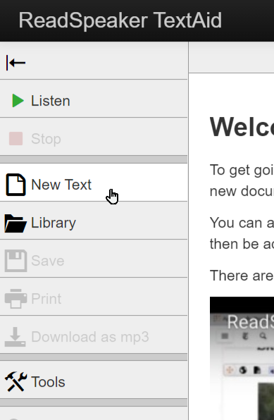 <!-- review-alt -->
2. Type or paste text from another source.
3. Create, edit, and listen to the text in this window.
4. **Save** it to your Library, **Print** it to paper or PDF, or **Download** it as an MP3 to listen to later.

Library

The Library holds the files you have saved, created, or uploaded.

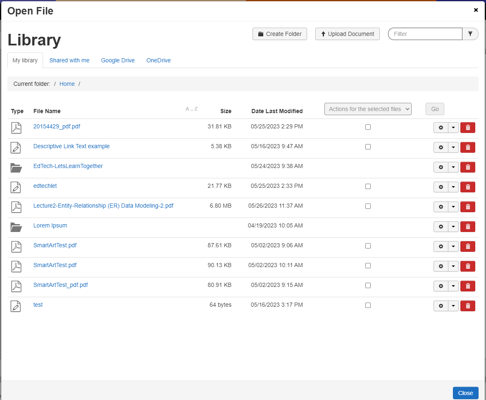 <!-- review-alt -->

To add a new document to TextAid:

1. Open **Library** from the left-hand toolbar.
2. Select **Upload Document** to add PDFs or other documents you want to read.
3. Once uploaded, click on the file in the Library window to access and read it.
4. Click **Listen** to begin reading.
   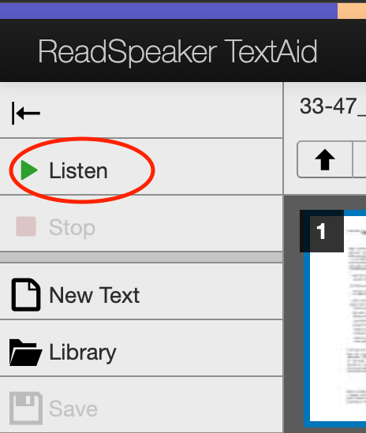 <!-- review-alt -->
   1. Select **Text Mode** to see the document as plain text. This may change its layout or formatting.
      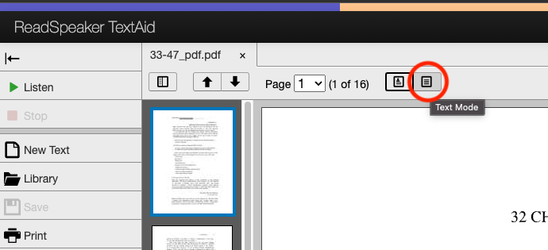 <!-- review-alt -->
5. Select text and click **Listen** to read only selected passages.
   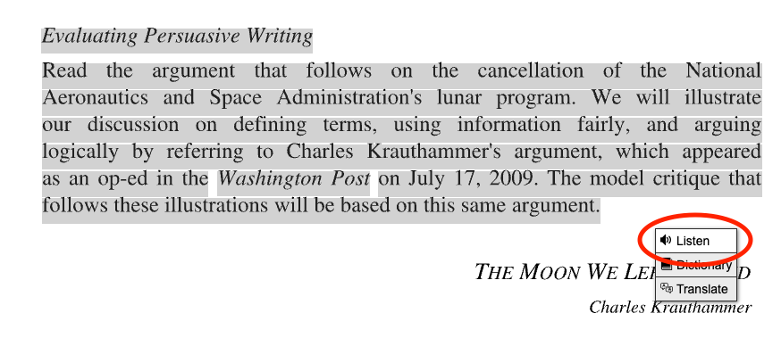 <!-- review-alt -->

Annotations and Highlighter

1. Select **Annotations** to add notes to a document.
   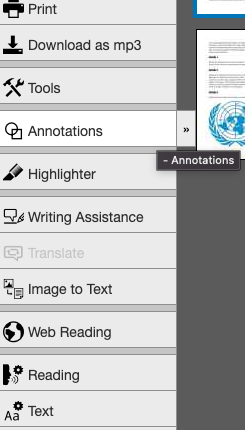 <!-- review-alt -->
2. The Annotations toolbar opens with options for sticky notes, text boxes, shapes, and markers.
   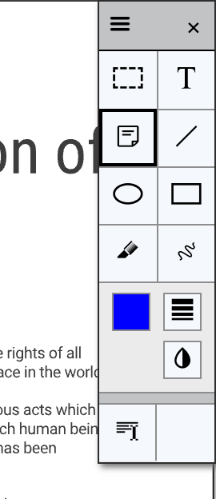 <!-- review-alt -->
3. Make notes and other markings and then select **Save** in the toolbar on the left.

The **Highlighter** lets you highlight passages of text and then collect and download your highlights.

1. Select the **Highlighter** tool in the left-hand toolbar.
   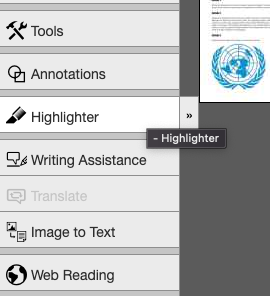 <!-- review-alt -->
2. The **Highlighter** toolbar will appear with options to select different colours.
   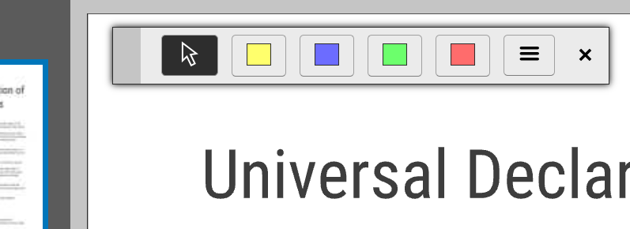 <!-- review-alt -->
3. After highlighting content, select the menu for options.
   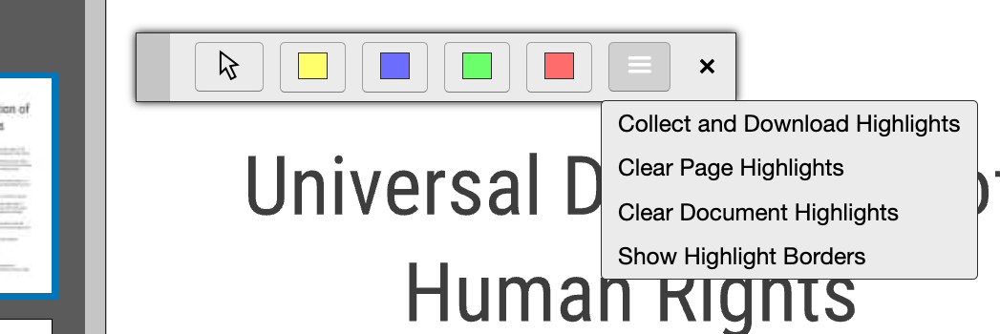 <!-- review-alt -->
   1. Select **Collect and Download Highlights** to gather your highlights into a new TextAid document. You can choose how they are collected and sorted.
      - Tip: use a different colour for each topic, so your highlights are sorted by topic.
   2. **Clear Page Highlights** and **Clear Document Highlights** will remove highlights from the active page or whole document.
   3. **Show Highlight Borders** adds a different border (solid, dashed, or dotted) to each highlight colour, which helps if you have trouble telling the colours apart.

Tools

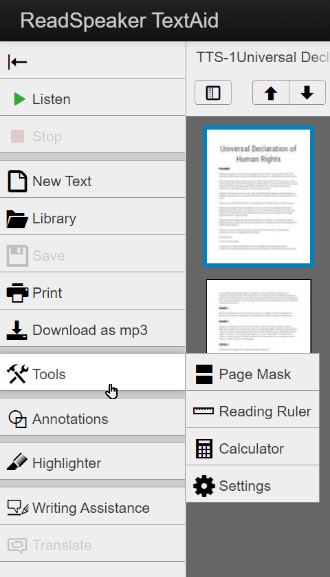 <!-- review-alt -->

1. **Page Mask**
   1. Dims or blocks out the rest of the screen except for the line(s) you are reading.
2. **Reading Ruler**
   1. Places a solid bar on screen that follows your mouse.
3. **Calculator**
   1. A basic calculator that reads its calculations aloud.
4. **Settings**
   1. Settings to customize Page Mask and Reading Ruler.

Image to Text

Upload a picture of text and TextAid converts it to text it can read aloud, and saves it to your Library.

To use Image to Text:

1. Select **Image to Text** in the sidebar.
   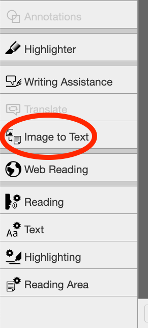 <!-- review-alt -->
2. Select **Choose File** and select your file.
   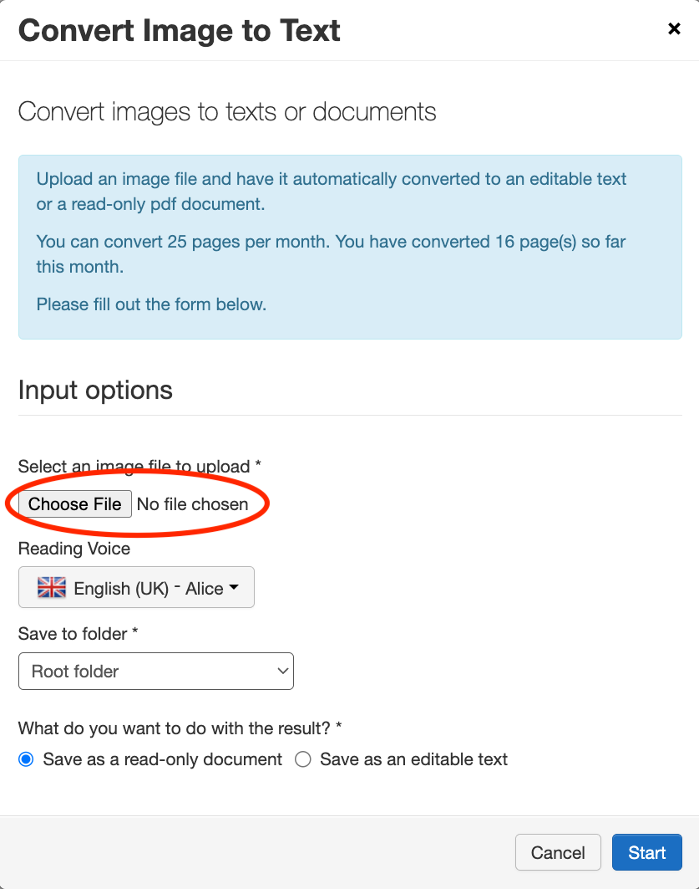 <!-- review-alt -->
3. Wait for the file to process and then select **Go to your library** to access your file.
   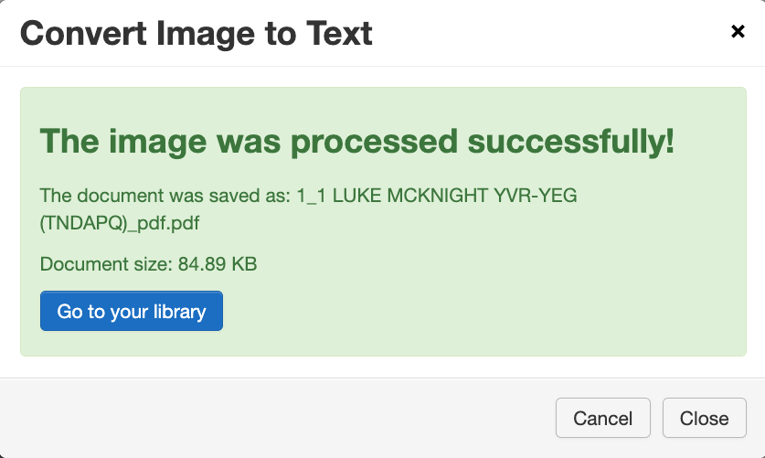 <!-- review-alt -->
4. You can now use the reading options and tools described above.
5. Select the **Listen** button to read the whole document.
   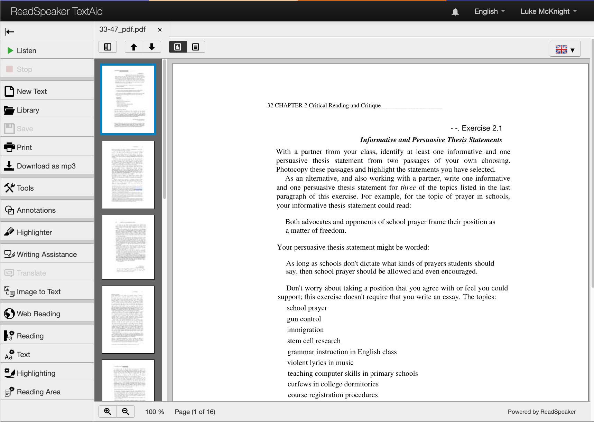 <!-- review-alt -->
6. Select **Text Mode** to see the text as plain text and use more tools, such as selecting text to listen to it.
   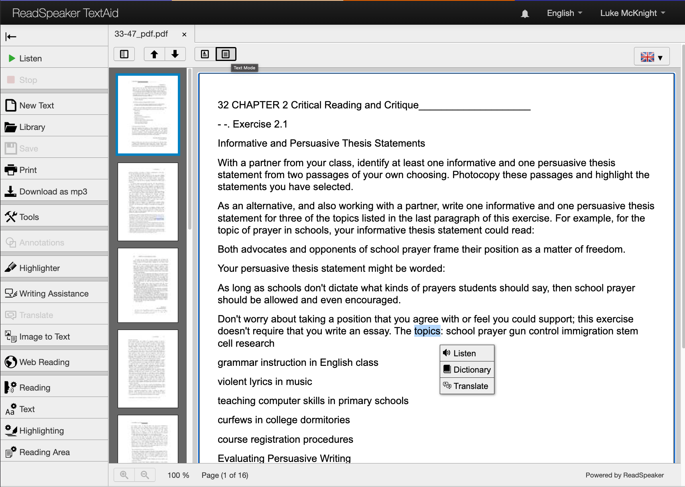 <!-- review-alt -->

Settings

1. **Reading**
   1. Use this menu to change **Reading Voice**, **Reading Speed**, and **Pause Between Words**.
   2. Use the **Play** button at the bottom of the window to hear a preview.
2. **Text**
   1. Find settings for **Text Colour**, **Background Colour**, **Text Size**, **Font Style**, and **Text Spacing**.
   2. A preview of changes appears at the bottom of the window.
   3. Changes made here will only be visible in **Text Mode**.
3. **Highlighting**
   1. These are settings for word and sentence highlighting while reading, not the Highlighter tool.
   2. Choose the colours for the highlighted word, the highlighted sentence, and the text.
4. **Reading Area**
   1. Choose how text is selected for reading or highlighting.
   2. **Mouse selection**: click and drag over the text you want.
   3. **Text selection**: hovering the mouse over text selects a block of it, such as a paragraph.
   4. **From mouse pointer to page end** selects all text from the mouse pointer location to the end of the page.

Learn More

- [TextAid Quick start student guide (PDF)](https://www.readspeaker.com/wp-content/uploads/learning-library-readspeaker-textaid-admin-student-quickstart-guide-student.pdf)
- [How to use TextAid YouTube playlist](https://www.youtube.com/playlist?list=PLVqWGX39IRjX50BiM09imK-7JrZVBTTyY)

## Calibre

Calibre is a free e-book reader and library. It is installed on Langara computers, and you can [download Calibre for Windows, macOS, and Linux](https://calibre-ebook.com/download).

Set up Calibre

Calibre is mainly for reading EPUB files. To read PDFs in Calibre, first change one setting:

1. Navigate to **Preferences**.
   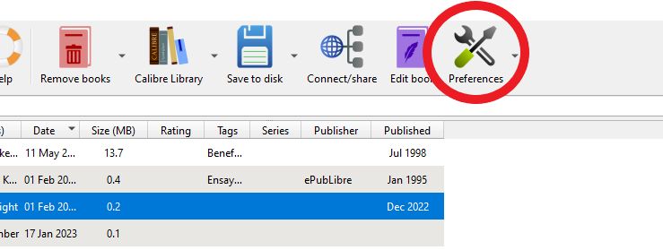 <!-- review-alt -->
2. Select **Behavior**.
   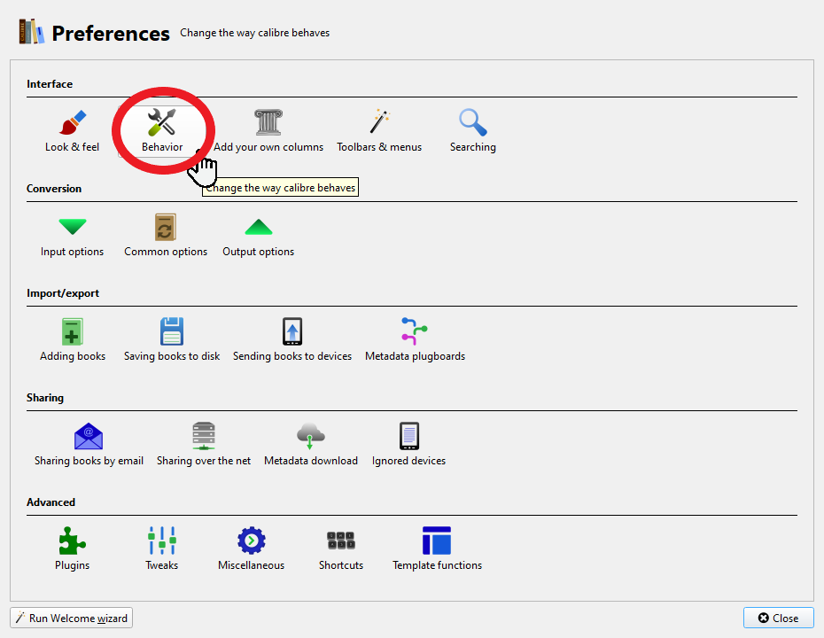 <!-- review-alt -->
3. Check **PDF** under **Use internal viewer for**.
   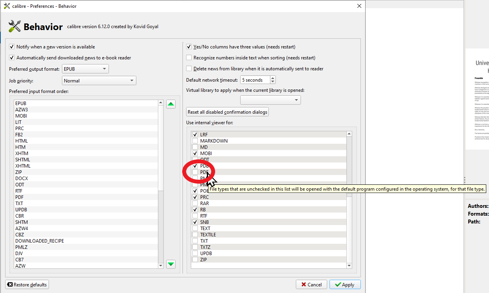 <!-- review-alt -->

Using Calibre

Calibre can organize e-texts, PDFs, and other documents in a library. To add files, select the menu beside **Add books**:
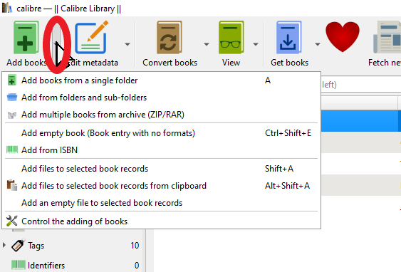 <!-- review-alt -->

Select **Add books from a single folder** for single files or **Add from folders and sub-folders** for multiple files.

To open a book or file, double-click it. To have it read aloud, right-click in the document window and select **Read aloud**:
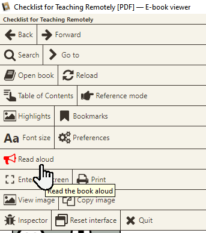 <!-- review-alt -->

The same menu has **Font size** and **Preferences**, where you can change how the book looks.

While Calibre reads aloud, a toolbar appears with options to pause, change the speed, and change the voice.
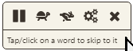 <!-- review-alt -->

[calibre User Manual – calibre E-Book Viewer](https://manual.calibre-ebook.com/#the-calibre-e-book-viewer)

## Kurzweil

Kurzweil 3000 is available for use in L121. Students may be able to get funding for their own copy, or borrow equipment, through Assistive Technology British Columbia (ATBC). Accessibility Services can help you [apply to ATBC for funding or an equipment loan](https://www.at-bc.ca/for-students/).

Kurzweil opens many document types, including Word, PDF, EPUB, and Kurzweil’s own KES files.

Select **File > Open** and choose the file you want to read.

The first time you open a file, Kurzweil converts it. Long documents may take a while.
 <!-- review-alt -->

By default, Kurzweil starts reading from the blinking red cursor.

Select **Audio Options** to change voice and speed.
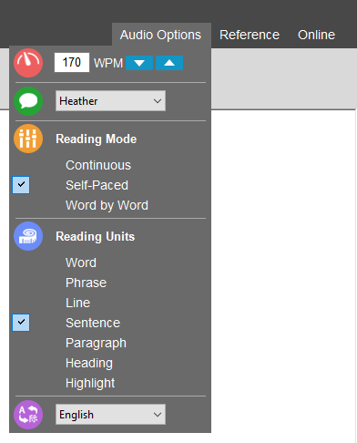 <!-- review-alt -->

**Reading Mode** and **Reading Units** control how Kurzweil reads. **Continuous** reads until you pause it, while **Self-Paced** pauses after each **Reading Unit** (word, line, sentence, and so on). To read only part of a document, select it and press **Play**.

To see the highlighting without hearing the voice, turn off **Audible Reading**.
 <!-- review-alt -->

- Press <kbd>F3</kbd> to play or pause reading
- Press <kbd>F2</kbd> to go to the previous Reading Unit (word, line, sentence, and so on)
- Press <kbd>F4</kbd> to go to the next Reading Unit

Kurzweil also has tools for writing and [mind mapping](mind-mapping.md#kurzweil). Contact [assistivetech@langara.ca](mailto:assistivetech@langara.ca) for information and resources on Kurzweil, or see the [Kurzweil Academy](https://www.kurzweiledu.com/kurzweil-academy/kurzweil-academy.html) for how-to videos and guides.

## Speechify

Speechify is a text to speech app with a free version. It is available for:

- [iOS](https://speechify.com/ios/)
- [Android](https://speechify.com/android/)
- [macOS](https://speechify.com/mac/)
- [Chrome (extension)](https://chromewebstore.google.com/detail/speechify-text-to-speech/ljflmlehinmoeknoonhibbjpldiijjmm)
- [the web](https://app.speechify.com/)

In the web app, you can add files from your device, Dropbox, or Google Drive.
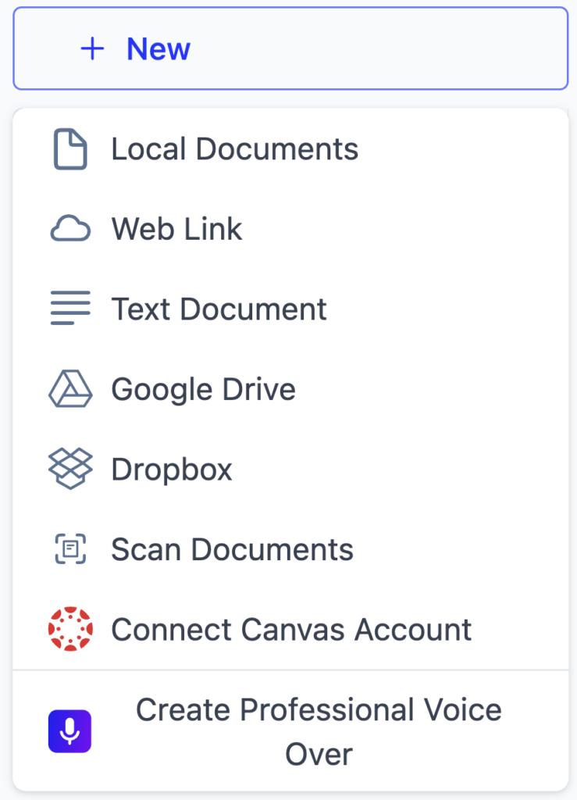 <!-- review-alt -->

Your files are kept in a library, which you can organize into folders. Click the plus button to create a folder.
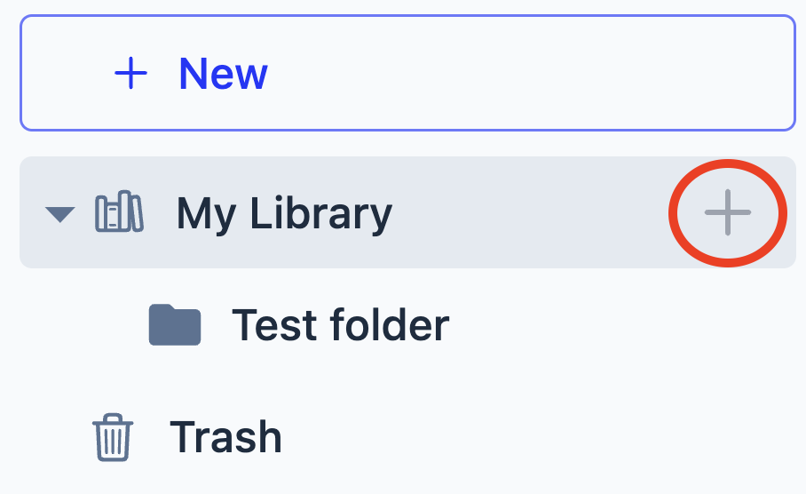 <!-- review-alt -->

Folders can be edited, renamed, and deleted.

When a document is open, change the voice, speed, and appearance in the menu on the left.
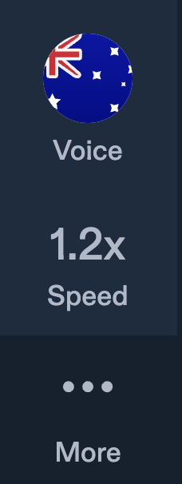 <!-- review-alt -->

**Note**: Only the standard voices (those without a golden diamond on the profile picture) are free.

## NaturalReader

NaturalReader is a text to speech tool with a free version. Use it [online](https://www.naturalreaders.com/online/), or download [NaturalReader for Windows and macOS](https://www.naturalreaders.com/software.html) or the [NaturalReader app for Android and iOS](https://www.naturalreaders.com/appdownload.html).

You can build a library of files:
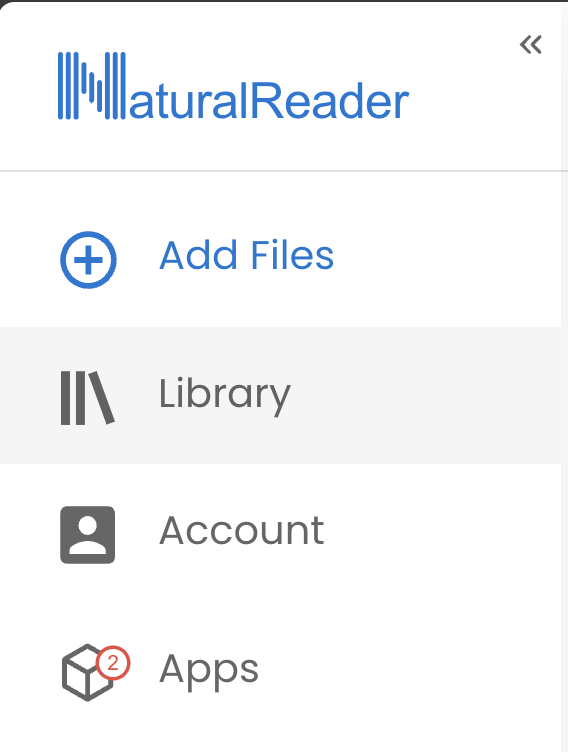 <!-- review-alt -->

Add files from various sources:
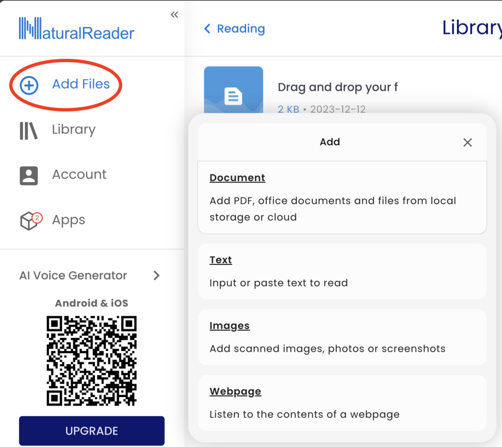 <!-- review-alt -->

Change the voice and playback speed with the toolbar along the top:
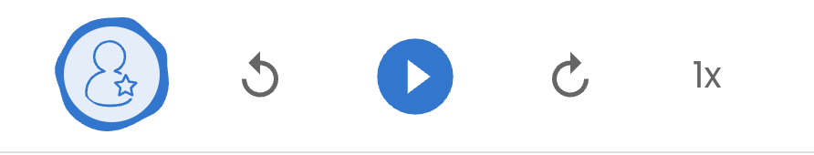 <!-- review-alt -->

Only a few voices are free. Most need a paid subscription.

**Settings** are available from the **More** icon (three dots) in the top right corner.
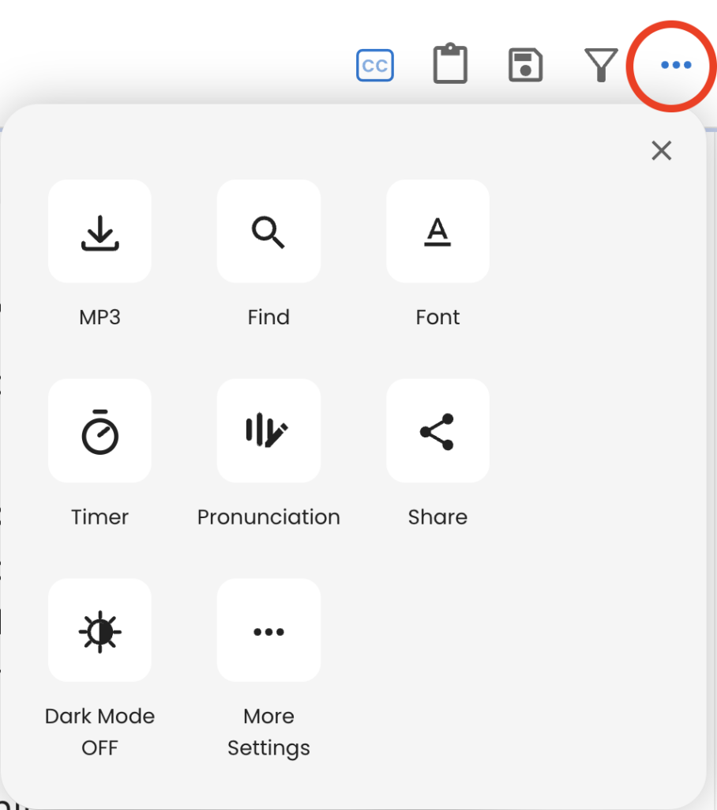 <!-- review-alt -->
