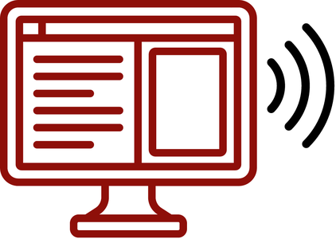

# Screen Readers

 <!-- review-alt -->

A screen reader reads aloud everything on the screen, including menus, buttons, and links, and lets you control the computer or phone with the keyboard or gestures instead of a mouse. Screen readers are used mainly by people who are blind or have low vision. Testing your own web pages and documents with a screen reader is also a good way to check their accessibility.

**On this page:**

- [JAWS](#jaws)
- [NVDA](#nvda)
- [VoiceOver](#voiceover)
- [TalkBack](#talkback)
- [ChromeVox](#chromevox-chromeos)

## JAWS

JAWS (Job Access With Speech) is one of the most widely used screen readers. It runs only on Windows, and lets you do almost everything in Windows with the keyboard and audio. JAWS is expensive, paid software and takes time to learn, but many blind and low vision people rely on it. [Download JAWS from Freedom Scientific](https://support.freedomscientific.com/Downloads/JAWS).

Common JAWS commands

This guide uses <kbd>JAWS</kbd> for the JAWS key, which is <kbd>Insert</kbd> with the desktop keyboard layout or <kbd>Caps Lock</kbd> with the laptop layout. Some commands are different in the laptop layout.

| Action | Key command |
| --- | --- |
| Contextual Help (overview of website or document, such as headings, links, etc.) | <kbd>JAWS</kbd> + <kbd>F1</kbd> |
| List JAWS hotkeys for the current program | <kbd>JAWS</kbd> + <kbd>H</kbd> |
| Read the whole window from the top | <kbd>JAWS</kbd> + <kbd>B</kbd> |
| Show list of all buttons, frames, graphics, lists, links, etc. | <kbd>JAWS</kbd> + <kbd>F3</kbd> |
| Buttons list | <kbd>Ctrl</kbd> + <kbd>JAWS</kbd> + <kbd>B</kbd> |
| Form elements (fields, radio buttons, checkboxes, etc.) list | <kbd>JAWS</kbd> + <kbd>F5</kbd> |
| Headings list | <kbd>JAWS</kbd> + <kbd>F6</kbd> |
| Links list | <kbd>JAWS</kbd> + <kbd>F7</kbd> |
| Frames list | <kbd>JAWS</kbd> + <kbd>F9</kbd> |
| Start reading continuously from current point | <kbd>JAWS</kbd> + <kbd>Down Arrow</kbd> |
| Stop reading | <kbd>Ctrl</kbd> |
| Read next item | <kbd>Down Arrow</kbd> |
| Move to next/previous paragraph | <kbd>P</kbd> / <kbd>Shift</kbd> + <kbd>P</kbd> |
| Move to next/previous focusable item (link, button, text field, etc.) | <kbd>Tab</kbd> / <kbd>Shift</kbd> + <kbd>Tab</kbd> |
| Activate link or button | <kbd>Enter</kbd> |
| Move to next/previous heading | <kbd>H</kbd> / <kbd>Shift</kbd> + <kbd>H</kbd> |
| Move to main content region | <kbd>Q</kbd> |
| Move to next/previous region | <kbd>R</kbd> / <kbd>Shift</kbd> + <kbd>R</kbd> |
| Next/previous radio button | <kbd>A</kbd> / <kbd>Shift</kbd> + <kbd>A</kbd> |
| Next/previous frame | <kbd>M</kbd> / <kbd>Shift</kbd> + <kbd>M</kbd> |
| Toggle Virtual Cursor on/off | <kbd>JAWS</kbd> + <kbd>Z</kbd> |
| Refresh screen without reloading page | <kbd>JAWS</kbd> + <kbd>Escape</kbd> |
| Speech history (last 100 items read by JAWS) | <kbd>JAWS</kbd> + <kbd>Space</kbd>, then <kbd>H</kbd> |

This is not a complete list of JAWS keystrokes. See the links at the end of this section for more.

Virtual Viewer

Press <kbd>JAWS</kbd> + <kbd>Alt</kbd> + <kbd>W</kbd> to show all the text in the current window, line by line, in the Virtual Viewer. This can make it easier to review messages or copy codes.

Press <kbd>JAWS</kbd> + <kbd>Shift</kbd> + <kbd>V</kbd> to do the same for just the current control, such as a pop-up or notification.

Forms Mode

When you move into a field in a properly coded form (on the web or in a PDF), JAWS switches to Forms Mode and plays a sound. In Forms Mode, most single-key JAWS commands are turned off so you can type into the form. To enter Forms Mode yourself, press <kbd>Enter</kbd> on a form field. 

To leave it, press <kbd>Num Pad Plus</kbd>, or <kbd>Escape</kbd> on a laptop without a number pad. Some laptops may be set up to require pressing <kbd>fn</kbd> <kbd>?</kbd>.

PDFs

You can move through a properly tagged PDF just like a web page, by headings (<kbd>H</kbd>), tables (<kbd>T</kbd>), and links (<kbd>JAWS</kbd> + <kbd>F7</kbd>). PDFs can still be awkward to read with JAWS. If you get stuck, press <kbd>Alt</kbd> + <kbd>Tab</kbd> until the PDF has focus, then press <kbd>JAWS</kbd> + <kbd>B</kbd> to read the window from the top.

Convenient OCR

If JAWS says a PDF is empty, the PDF is probably a scanned image of text with no real text in it. JAWS’s built-in optical character recognition (OCR) tool, Convenient OCR, can pull the text out so JAWS can read it:

1. Open a PDF.
2. If the PDF is inaccessible, JAWS should offer to use **Convenient OCR**. <kbd>Tab</kbd> to **Yes** and press <kbd>Enter</kbd>.
3. If JAWS doesn’t offer, or you closed the dialog by accident, press <kbd>JAWS</kbd> + <kbd>Space</kbd>, then <kbd>O</kbd>, then <kbd>D</kbd> to start Convenient OCR.
4. When the document is displayed in JAWS Virtual Viewer, press <kbd>Tab</kbd> to **Open in Word** and press <kbd>Enter</kbd> to view the document in Word.

See [Optical Character Recognition](optical-character-recognition.md) for other OCR tools.

PlaceMarkers

On websites you visit often, PlaceMarkers take you straight to the parts you need. Move to the place on the page you want to come back to, press <kbd>Ctrl</kbd> + <kbd>Shift</kbd> + <kbd>K</kbd>, and press <kbd>Enter</kbd> on the **Add** button. Next time you visit the page, press <kbd>K</kbd> to move through your PlaceMarkers, or <kbd>Ctrl</kbd> + <kbd>Shift</kbd> + <kbd>K</kbd> to see a list of them.

Ignore next key press

Sometimes a web page has its own keyboard controls (for example, “press the left or right arrow to move through the slides”) that JAWS intercepts. Press <kbd>JAWS</kbd> + <kbd>3</kbd>, then the key. <kbd>JAWS</kbd> + <kbd>3</kbd> passes the next key press straight to the page, as if JAWS weren’t running.

General Windows Keyboard Commands

These Windows keyboard shortcuts are also useful with JAWS:

- <kbd>Ctrl</kbd> + <kbd>F</kbd> to search in a webpage or document.
- <kbd>Alt</kbd> + <kbd>Tab</kbd> to move between open windows.
- <kbd>Windows</kbd> + <kbd>D</kbd> moves to the desktop. From the desktop, <kbd>Windows</kbd> + <kbd>D</kbd> moves focus back to the previous window.
- <kbd>Windows</kbd> + <kbd>T</kbd> moves to the taskbar. <kbd>Windows</kbd> and a number opens or moves to that taskbar item.
- Press the <kbd>Windows</kbd> key and type to search the computer.

Links

- [Freedom Scientific JAWS guide to web browsing](https://www.freedomscientific.com/training/jaws/hotkeys)
- Freedom Scientific [complete list of JAWS keystrokes](https://www.freedomscientific.com/Content/Documents/Manuals/JAWS/Keystrokes.pdf)
- WebAIM [Keyboard Shortcuts for JAWS](https://webaim.org/resources/shortcuts/jaws)
- Deque University [JAWS Keyboard Shortcuts](https://dequeuniversity.com/screenreaders/jaws-keyboard-shortcuts)
- [Surf’s Up!](https://support.freedomscientific.com/SurfsUp/1-StartHere.htm), Freedom Scientific’s course on browsing the web with JAWS, with practice pages.
- Portland Community College has a helpful guide to [navigating D2L with JAWS](https://www.pcc.edu/instructional-support/accessibility/resources/jaws/d2l).
- Cracking the Code, [Reading PDFs with JAWS](https://doccenter.freedomscientific.com/doccenter/archives/2021_04_15_Tips_for_Reading_PDFs_with_JAWS/Cracking_the_Code_Reading_PDFs_with_JAWS_Resource_File.pdf)
- General [screen reader shortcuts](https://www.a11yproject.com/posts/learning-common-keyboard-shortcuts-for-screen-readers)

## NVDA

NVDA is a free, open source screen reader for Windows. It is nearly as widely used as JAWS and has many similar features. [Download NVDA](https://www.nvaccess.org/download) from nvaccess.org.

The first time NVDA starts, it asks you to choose some settings, most importantly the NVDA key. This guide uses <kbd>NVDA</kbd> for whichever key you choose: <kbd>Caps Lock</kbd>, <kbd>Insert</kbd>, or <kbd>Num Pad Insert</kbd>.

Common NVDA commands

| Action | Keystroke |
| --- | --- |
| Open NVDA | <kbd>Ctrl</kbd> + <kbd>Alt</kbd> + <kbd>N</kbd> |
| Close NVDA | <kbd>NVDA</kbd> + <kbd>Q</kbd>, and <kbd>Enter</kbd> to confirm |
| Change speech mode (off, beeps, talk) | <kbd>NVDA</kbd> + <kbd>S</kbd> |
| Open NVDA menu | <kbd>NVDA</kbd> + <kbd>N</kbd> |
| Preferences | (With NVDA menu open) <kbd>P</kbd> |
| Tools | (With NVDA menu open) <kbd>T</kbd> |
| Help | (With NVDA menu open) <kbd>H</kbd> |
| Read from current position | <kbd>NVDA</kbd> + <kbd>Down Arrow</kbd> |
| Read current line | <kbd>NVDA</kbd> + <kbd>Up Arrow</kbd> |
| Read previous/next word | <kbd>Ctrl</kbd> + <kbd>Left Arrow</kbd> / <kbd>Right Arrow</kbd> |
| Read previous/next paragraph | <kbd>Ctrl</kbd> + <kbd>Up Arrow</kbd> / <kbd>Down Arrow</kbd> |
| Read next item | <kbd>Down Arrow</kbd> |
| Stop reading | <kbd>Ctrl</kbd> |
| Pause/resume reading | <kbd>Shift</kbd> |
| Speak faster/slower | <kbd>NVDA</kbd> + <kbd>Ctrl</kbd> + <kbd>Up Arrow</kbd> / <kbd>Down Arrow</kbd> |
| Input help (press keys to hear what they do, without doing it) | <kbd>NVDA</kbd> + <kbd>1</kbd> |
| Elements (links, headings, buttons, etc.) window | <kbd>NVDA</kbd> + <kbd>F7</kbd> |
| Move between elements lists | <kbd>Tab</kbd> |
| Move between focusable elements (links, buttons, forms, menus) | <kbd>Tab</kbd> / <kbd>Shift</kbd> + <kbd>Tab</kbd> |
| Next heading | <kbd>H</kbd> |
| Heading level 1-6 | <kbd>1</kbd> to <kbd>6</kbd> |
| Next link | <kbd>K</kbd> |
| Next unvisited link | <kbd>U</kbd> |
| Next visited link | <kbd>V</kbd> |
| Next landmark/region | <kbd>D</kbd> |
| Next form field | <kbd>F</kbd> |
| Next text field | <kbd>E</kbd> |
| Next checkbox | <kbd>X</kbd> |
| Next radio button | <kbd>R</kbd> |
| Open combo box | <kbd>Alt</kbd> + <kbd>Down Arrow</kbd> |
| Next table | <kbd>T</kbd> |
| Navigate table cells | <kbd>Ctrl</kbd> + <kbd>Alt</kbd> + arrow keys |
| Next button | <kbd>B</kbd> |
| Next list | <kbd>L</kbd> |
| Next list item | <kbd>I</kbd> |
| Next image | <kbd>G</kbd> |
| Move to previous instance | <kbd>Shift</kbd> + any of the single keystrokes above |
| Search | <kbd>NVDA</kbd> + <kbd>Ctrl</kbd> + <kbd>F</kbd> |
| Move to next/previous search result | <kbd>NVDA</kbd> + <kbd>F3</kbd> / <kbd>NVDA</kbd> + <kbd>Shift</kbd> + <kbd>F3</kbd> |
| Switch between browse mode (normal NVDA keys) and focus mode (keys go to the page, for typing in forms) | <kbd>NVDA</kbd> + <kbd>Space</kbd> |
| Pass the next key press to the page | <kbd>NVDA</kbd> + <kbd>F2</kbd> |

General Windows Keyboard Commands

These Windows keyboard shortcuts are also useful with NVDA:

- <kbd>Ctrl</kbd> + <kbd>F</kbd> to search in a webpage or document.
- <kbd>Alt</kbd> + <kbd>Tab</kbd> to move between open windows.
- <kbd>Windows</kbd> + <kbd>D</kbd> moves to the desktop. From the desktop, <kbd>Windows</kbd> + <kbd>D</kbd> moves focus back to the previous window.
- <kbd>Windows</kbd> + <kbd>T</kbd> moves to the taskbar. <kbd>Windows</kbd> and a number opens or moves to that taskbar item.
- Press the <kbd>Windows</kbd> key and type to search the computer.

Links

- WebAIM [Using NVDA to Evaluate Web Accessibility](https://webaim.org/articles/nvda)
- WebAIM [Keyboard Shortcuts for NVDA](https://webaim.org/resources/shortcuts/nvda)
- A11y Project [Getting started with NVDA](https://www.a11yproject.com/posts/getting-started-with-nvda)
- [NVDA User Guide](https://download.nvaccess.org/documentation/userGuide.html)

## VoiceOver

VoiceOver is a screen reader built into macOS and iOS.

VoiceOver on macOS

To activate VoiceOver on macOS:

1. Go to **System Settings > Accessibility**.
2. Choose **VoiceOver**.
3. Turn on **VoiceOver**.
   1. Or press <kbd>Command</kbd> + <kbd>F5</kbd> to turn VoiceOver on or off.

Click **Open VoiceOver Training…** for help and training.

Click **Open VoiceOver Utility…**, or press <kbd>Control</kbd> + <kbd>Option</kbd> + <kbd>F8</kbd> while VoiceOver is running, to change VoiceOver’s speech, sound, keyboard, and other settings.

VoiceOver commands start with the VoiceOver keys, <kbd>Control</kbd> + <kbd>Option</kbd>, so that they don’t clash with other macOS shortcuts. Below, <kbd>VO</kbd> means holding <kbd>Control</kbd> + <kbd>Option</kbd>.

| Action | Keystroke |
| --- | --- |
| Open Rotor to display headings, links, regions, etc. lists | <kbd>VO</kbd> + <kbd>U</kbd> |
| Start reading | <kbd>VO</kbd> + <kbd>A</kbd> |
| Stop reading | <kbd>Control</kbd> |
| Next | <kbd>VO</kbd> + <kbd>Right Arrow</kbd> |
| Previous | <kbd>VO</kbd> + <kbd>Left Arrow</kbd> |
| Next paragraph | <kbd>VO</kbd> + <kbd>P</kbd> |
| Next link | <kbd>VO</kbd> + <kbd>Command</kbd> + <kbd>L</kbd> |
| Next heading | <kbd>VO</kbd> + <kbd>Command</kbd> + <kbd>H</kbd> |
| Move to table | <kbd>VO</kbd> + <kbd>Command</kbd> + <kbd>T</kbd> |
| Activate focused element | <kbd>VO</kbd> + <kbd>Space</kbd> |
| Next link, form field, button, etc. | <kbd>Tab</kbd> |
| Previous link, form field, etc. | <kbd>Shift</kbd> + <kbd>Tab</kbd> |

VoiceOver works best with Safari for browsing the web.

[VoiceOver Quick Nav](https://support.apple.com/en-ca/guide/voiceover/vo27943/mac) lets you navigate with the arrow keys or single keys, without holding <kbd>VO</kbd>. To turn it on:

1. Go to **System Settings**.
2. Choose **Accessibility**.
3. Select **VoiceOver**.
4. Select **Open VoiceOver Utility…**
5. Move to **Commanders** in the sidebar.
6. Move to the **Quick Nav** tab.
7. Check **Enable arrow-key Quick Nav** and **Enable single-key Quick Nav**.

- [VoiceOver User Guide for Mac – Apple Support (CA)](https://support.apple.com/en-ca/guide/voiceover/welcome/mac), including the full list of commands and gestures
- [Getting started with macOS VoiceOver](https://www.a11yproject.com/posts/getting-started-with-voiceover)
- [WebAIM VoiceOver guide](https://webaim.org/articles/voiceover)

VoiceOver on iPhone

To turn on VoiceOver:

1. Go to **Settings**.
2. Choose **Accessibility**.
3. Tap **VoiceOver**.
4. Turn on **VoiceOver**.
   1. To change the voice, select **Speech** and then **Voice**.

### Using VoiceOver

VoiceOver has a practice area where you can try gestures: VoiceOver tells you the name of each gesture and what it does.

1. With VoiceOver on, go to **Settings > Accessibility > VoiceOver**.
2. Select **VoiceOver Practice**.

- Tap anywhere on the screen to have an item read aloud.
- Drag a finger to move between items.
- Swipe right to read next, swipe left to read previous.
- Rotate two fingers on the screen, like turning a dial, to use the rotor.
  - The rotor lets you choose to move by headings, links, words, or other items.
  - Then swipe up or down to move by that item.
- Tap an item to select it, and double-tap to activate it.
- Tap with two fingers to pause or resume speech.
- Swipe up from the bottom to return to Home, and keep dragging up to go to the App Switcher.
  - Flick left or right with three fingers to move between apps.
  - Flick three fingers up to close an app.

[Getting started with VoiceOver – Apple Support (CA)](https://support.apple.com/en-ca/guide/iphone/iph3e2e415f/ios)

[AppleVis](https://www.applevis.com) is a resource for blind and low vision users of Apple products.

## TalkBack

TalkBack is the default screen reader for Android.

Using TalkBack

To enable TalkBack:

1. Go to **Settings > Accessibility**.
2. Select **TalkBack**, turn it on, and turn on **TalkBack shortcut**.
   1. With the shortcut on, press and hold both volume buttons for a few seconds to turn TalkBack on or off.
3. The first time TalkBack is turned on, a tutorial opens.

Using TalkBack:

- Swipe right to read next, swipe left to read previous.
- Tap an item to hear it.
  - Drag a finger around the screen to hear what is under it.
- Double-tap to follow a link, press a button, or open a menu.
- Swipe down then up in one motion to choose how to move: by headings, controls, links, and so on.
  - Then swipe up or down to move by that item.

TalkBack has a practice area where you can try gestures: TalkBack tells you the name of each gesture and what it does. To use it:

1. Go to **Settings > Accessibility > TalkBack**.
2. Choose **TalkBack Settings > Tutorial and help > Practice gestures**.

[Get started with TalkBack – Android Accessibility Help](https://support.google.com/accessibility/android/topic/10601570)

## ChromeVox (ChromeOS)

ChromeVox is the built-in screen reader on Chromebooks.

Using ChromeVox

Toggle ChromeVox on or off by pressing <kbd>Ctrl</kbd> + <kbd>Alt</kbd> + <kbd>Z</kbd>.

To open the ChromeVox menus, press <kbd>Search</kbd> + <kbd>.</kbd> (period).

The ChromeVox menus include speech options and help, and lists of headings, landmarks, links, form controls, and tables.

| Action | Keystroke |
| --- | --- |
| Start reading from current location | <kbd>Search</kbd> + <kbd>R</kbd> |
| Go to top of page | <kbd>Search</kbd> + <kbd>Ctrl</kbd> + <kbd>Left Arrow</kbd> |
| Read next line | <kbd>Search</kbd> + <kbd>Down Arrow</kbd> |
| Read next word | <kbd>Search</kbd> + <kbd>Ctrl</kbd> + <kbd>Shift</kbd> + <kbd>Right Arrow</kbd> |
| Move to next heading | <kbd>Search</kbd> + <kbd>H</kbd> |
| Move to next link | <kbd>Search</kbd> + <kbd>L</kbd> |
| Move to next landmark | <kbd>Search</kbd> + <kbd>;</kbd> |
| Move to previous heading/link/landmark | <kbd>Shift</kbd> + <kbd>Search</kbd> + <kbd>H</kbd>, <kbd>L</kbd> or <kbd>;</kbd> |
| Show heading list | <kbd>Search</kbd> + <kbd>Ctrl</kbd> + <kbd>H</kbd> |
| Show links list | <kbd>Search</kbd> + <kbd>Ctrl</kbd> + <kbd>L</kbd> |
| Show landmark list | <kbd>Search</kbd> + <kbd>Ctrl</kbd> + <kbd>;</kbd> |

[Use the built-in screen reader on your Chromebook – Chromebook Help](https://support.google.com/chromebook/answer/7031755)

