# Speech to Text Tools

Speech to text, also called dictation, turns what you say into typed text. This page covers dictation in Word, Windows, Android, iOS, and macOS, and Dragon; to control your computer or phone with your voice, see [Voice Control](voice-control.md).

**On this page:**

- [Word Dictate](#word-dictate)
- [Windows Voice Typing](#windows)
- [Android](#android-and-chromeos)
- [iOS and macOS](#ios-and-macos)
- [Dragon](#dragon)

## Word Dictate



{: .langara}
Langara students can access the full Microsoft 365 suite of tools using their Langara email and password.

Microsoft Word has a built-in dictation tool available on all platforms.

Word Dictate

Dictate is built into Microsoft 365 versions of Word for Windows, macOS, the web, and mobile:

1. On the **Home** ribbon, click the microphone icon labelled **Dictate**.
   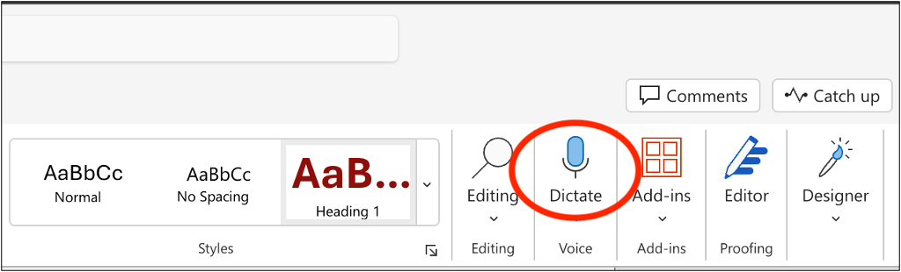
2. Wait for the Dictate toolbar and **Listening** message to appear.
   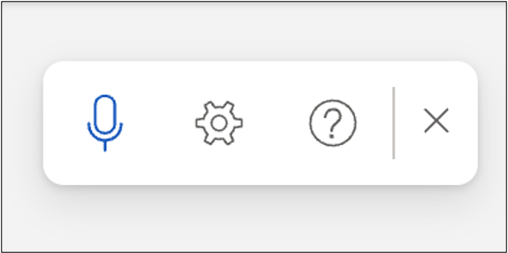
   1. Check that the right microphone is selected in the Settings menu.
      
      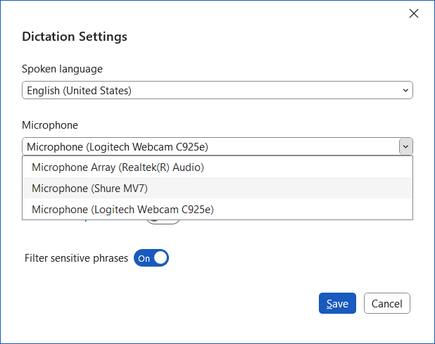
3. Speak clearly at a steady pace.
4. Say punctuation such as “period,” “comma,” and “question mark.”
5. Say “pause dictation” or “stop dictation” to stop. Click the microphone to start again.

[Dictate your documents in Word – Microsoft Support](https://support.microsoft.com/en-us/office/dictate-your-documents-in-word-3876e05f-3fcc-418f-b8ab-db7ce0d11d3c)

### Settings

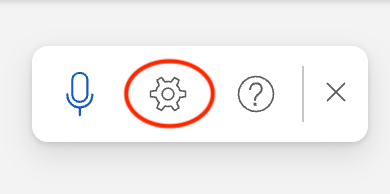

The gear icon on the toolbar opens **Dictation Settings**:

- **Spoken language**: set the language you speak, for accurate spelling.
- **Microphone**: if you have more than one, choose which to use.
- **Auto-punctuation**: turn automatic punctuation on or off.
- **Filter sensitive phrases**: on by default. Profanity and other sensitive words are replaced with asterisks, so a recognition error can’t put offensive words in your document.

## Windows



Microsoft Windows 11 has built-in dictation called **Voice Typing**.

Windows Voice Typing

Windows Voice Typing lets you type with your voice anywhere you can type text, including apps and web pages. To use **Voice Typing**:

1. Open **Settings** and navigate to **Privacy & security**. Select **Speech** and toggle **Online speech recognition** on.
2. Place your cursor in any text box and press <kbd>Windows</kbd> + <kbd>H</kbd> to dictate text.
   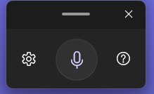
3. Select the cog icon to access **Settings**.
   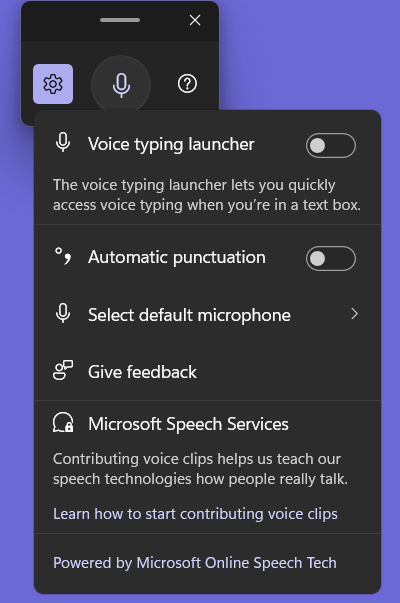
   1. Toggle **Voice typing launcher** on to quickly access voice typing whenever you place the cursor in a text box.
      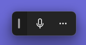
4. Voice Typing may display tips and suggestions.
   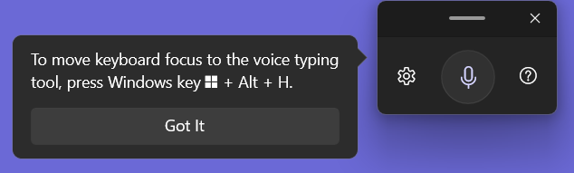 

[Use voice typing to talk instead of type on your PC – Microsoft Support](https://support.microsoft.com/en-us/windows/use-voice-typing-to-talk-instead-of-type-on-your-pc-fec94565-c4bd-329d-e59a-af033fa5689f) lists the voice typing and punctuation commands.

To control your whole computer by voice, see [Voice Control](voice-control.md).

[How to use Voice typing in Windows 11 – My Computer My Way](https://mcmw.abilitynet.org.uk/how-to-use-voice-typing-in-windows-11)

## Android and ChromeOS



Android and ChromeOS devices offer Google Voice Typing allowing users to dictate text.

Android and ChromeOS

You can dictate text on Android and ChromeOS. Many apps (Chrome, Play Store, Docs) have a microphone icon in the search box for searching with your voice.

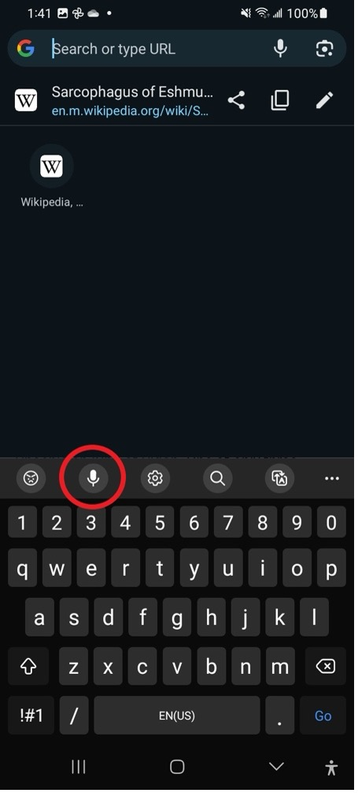

To type with your voice, tap the microphone on the keyboard.

Voice typing is usually on by default. If you don’t see the microphone icon on a Samsung phone:

1. Go to **Settings > General Management**.
2. Select **Keyboard list and default**.
   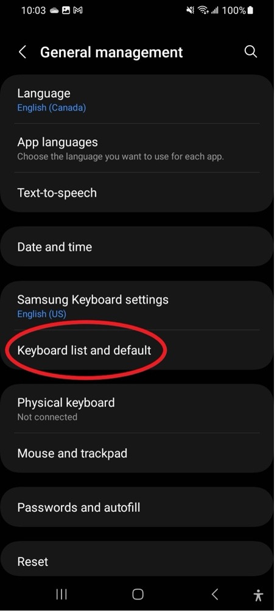
3. Toggle on **Google Voice Typing**.
   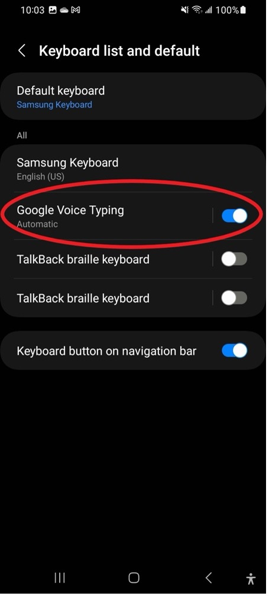

Use **Live Transcribe** to turn speech around you into text on screen (see also [Closed Captions](closed-captions.md#android)). To turn on **Live Transcribe**:

1. Go to **Settings > Accessibility**.
2. Select **Installed apps**.
3. Choose **Live Transcribe** and toggle **Live Transcribe shortcut** to **On**.
4. Tap on **Accessibility shortcut**.
5. Select **Live Transcribe**.
   1. Follow prompts to set permissions.
6. Use the shortcut to start Live Transcribe.

[Use advanced voice typing features – Gboard Help](https://support.google.com/gboard/answer/11197787) (Pixel phones)

## iOS and macOS



iOS and macOS offer **Dictation** tools built-in.

iOS and macOS

### iOS

1. Go to **Settings > General > Keyboard**.
2. Turn on **Enable Dictation**.
   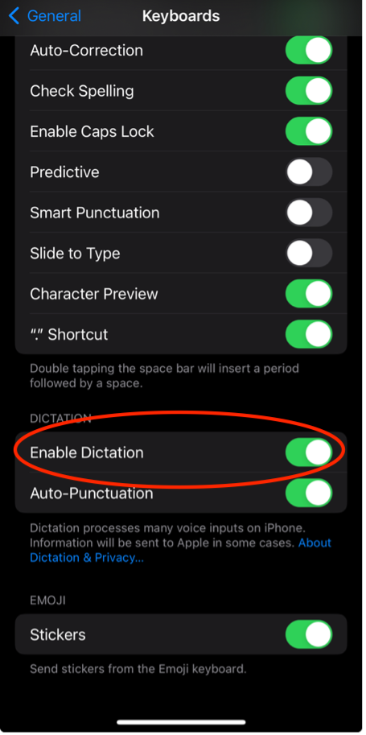
3. When the onscreen keyboard appears, tap the microphone icon in the bottom right.
   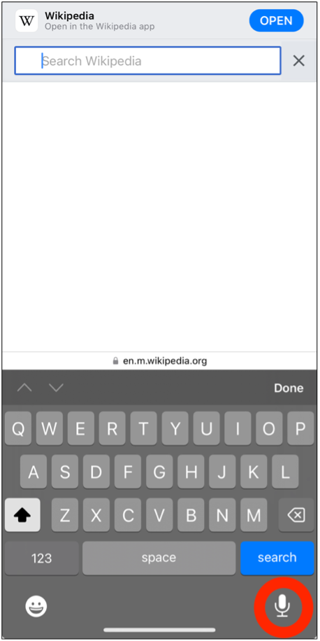

[Dictate text on iPhone – Apple Support (CA)](https://support.apple.com/en-ca/guide/iphone/iph2c0651d2/ios)

### macOS

macOS has built-in dictation. To turn it on:

1. Go to **System Settings**.
2. Select **Keyboard**.
3. Scroll down to **Dictation**.
4. Turn on **Dictation**.
   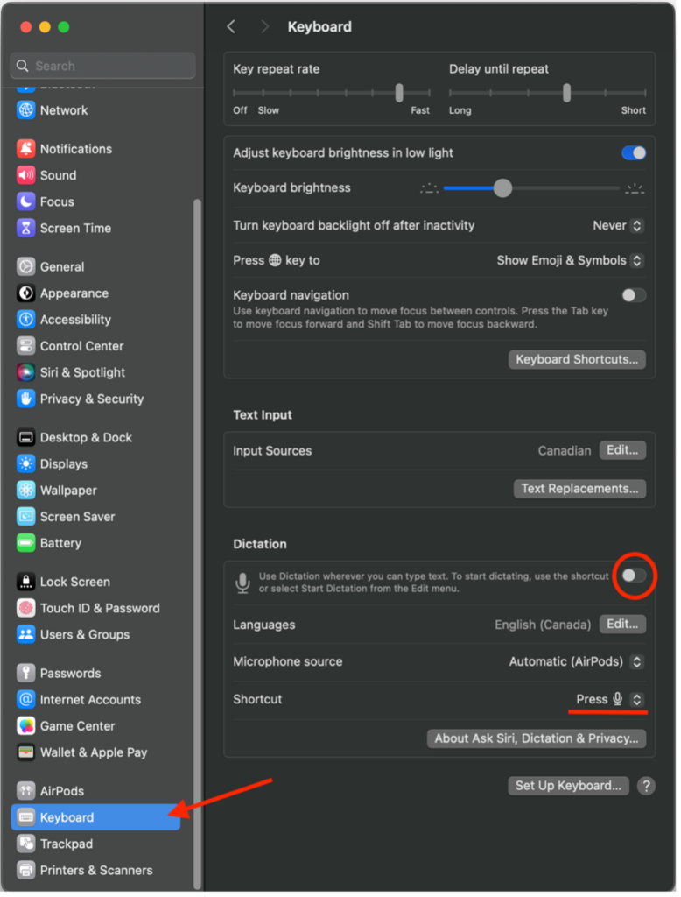

In the same settings, check the **Language** (for correct spelling), the **Microphone source**, and the **Shortcut**.

To dictate, click in a text field (such as a document or the browser address bar) and press the dictation shortcut (by default, the Microphone key, <kbd>F5</kbd> on many keyboards), or choose **Edit > Start Dictation**.

Speak clearly and say commands in plain language, such as “new line” or “exclamation point”.

- [Commands for dictating text on Mac – Apple Support (CA)](https://support.apple.com/en-ca/guide/mac-help/mh40695/mac)
- [Dictate messages and documents on Mac – Apple Support (CA)](https://support.apple.com/en-ca/guide/mac-help/mh40584/mac)

## Dragon



{: .langara}
Langara has a limited number of Dragon licences. Contact Accessibility Services for information.

Dragon is powerful speech to text software.

Dragon

Dragon can dictate into almost any text field. To do so:

1. Put the blinking text cursor where you want the text to go.
2. Turn on Dragon’s microphone.
3. Start speaking. Your words are typed into the text field.

To turn Dragon on or off:

1. When the microphone icon is red, Dragon is not listening. Click the icon to start Dragon.
    
2. When the microphone icon is green, Dragon is listening and will transcribe what you say.
    
   1. Click the green icon to stop Dragon.
3. Say “go to sleep” and the icon turns blue. Dragon is in sleep mode and won’t type what you say. Say “wake up” or click the icon to continue.
   

If Dragon makes a spelling error, say “correct that.” If the correct word appears in the menu, select it to automatically replace the incorrect word with the correct one. If the correct word does not appear in the menu, say “spell that” and spell the word letter by letter.

### Common commands

- Say “period” or “comma” to add punctuation.
- Say “new line” to move to a new line.
- Say “delete that” to delete what you last dictated, or “delete last (number) words”, for example “delete last 3 words”.

{: .tip }
It is often quickest to dictate most of your text with Dragon and then fix small errors with the mouse and keyboard.

Dragon has a [YouTube playlist of videos](https://www.youtube.com/watch?v=6jzDdcZHxss&list=PLRFp5KqXtQ6zUuRgW4ewyYPDK82yVDfGG) demonstrating common features.

See [Voice Control](voice-control.md) for more on using Dragon.

### Transcription

Dragon can transcribe .wav, .mp3, .wma, .dss, .ds2, and .m4a audio files to text.

1. Open the **Tools** menu.
2. Select **Transcribe Recording**.
3. Choose a file.
4. Click **Transcribe**.

Dragon creates an .rtf text file, which you can open and edit in DragonPad or Word, or keep for later.

See [Note-taking and Transcription](note-taking.md#record-and-transcribe) for step-by-step transcription instructions with screenshots.

