# Text to Speech Tools

 <!-- review-alt -->

**On this page:**

- [ReadSpeaker](#readspeaker)
  - [webReader](#webreader)
  - [docReader](#docreader)
  - [TextAid](#textaid)
- [Word](#word)
- [Device Built-in](#device-built-in)
  - [Android](#android)
  - [ChromeOS](#chromeos)
  - [iOS](#ios)
  - [macOS](#macos)
- [Browser tools](#browser-tools)
  - [Chrome](#chrome)
  - [Edge](#edge)
  - [Firefox](#firefox)
  - [Safari](#safari)

## ReadSpeaker

ReadSpeaker makes three tools available to Langara students: **webReader** and **docReader**, which are built into Brightspace, and **TextAid**, a web app and browser extension for reading content anywhere on the web.

webReader

Brightspace has a built-in text to speech tool. Use the **Listen** button that appears on topic, discussion, and quiz pages:
 <!-- review-alt -->

Activating the **Listen** button will reveal the Player:
 <!-- review-alt -->

The player will read aloud, and (by default) highlight, content as it is read.

In quizzes, each question has its own **Listen** button. The player will stop after reading each question and possible responses. Answer the question and select the next **Listen** button to continue.
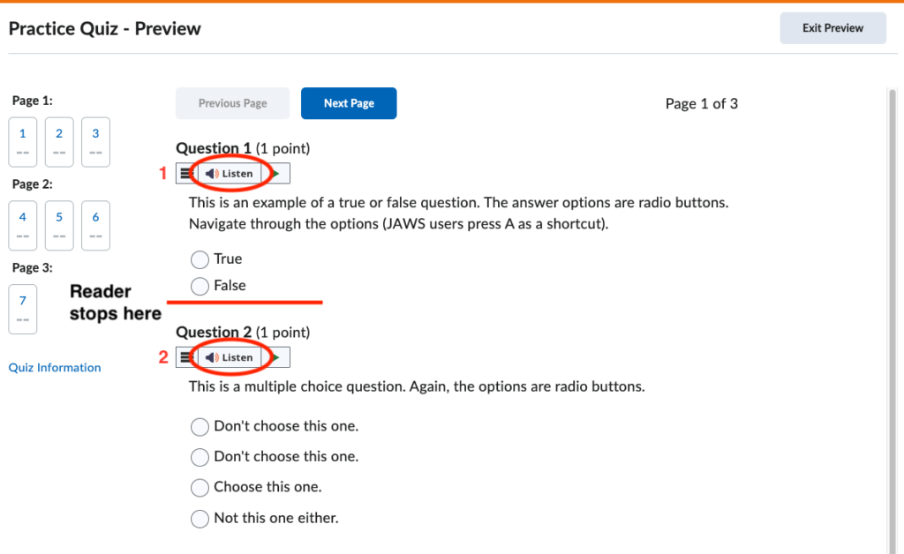 <!-- review-alt -->

The Player has controls for playback, speed, and volume. More settings and tools are in the player menu:
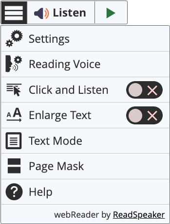 <!-- review-alt -->

Under **Settings** you can customize the appearance, including colours and highlighting.

Choose **Reading Voices** to change voices.

While it reads, a second, smaller toolbar appears at the bottom of the window.
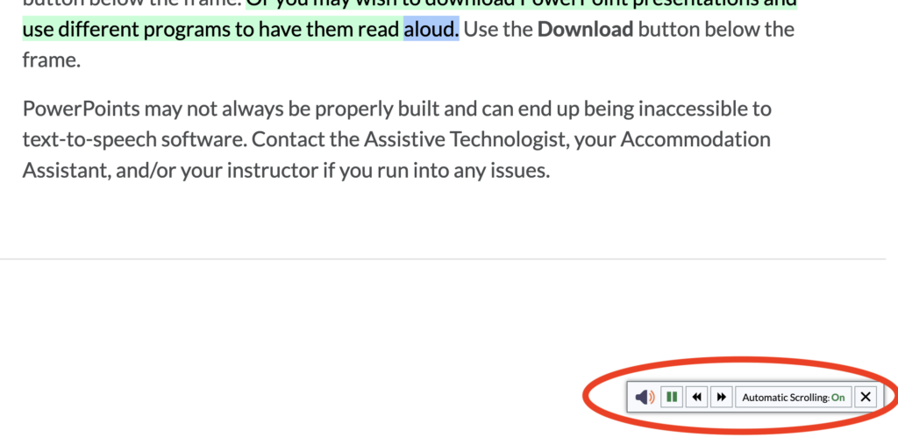 <!-- review-alt -->

### Select Content

When you select text, a **Listen** button appears beside it:
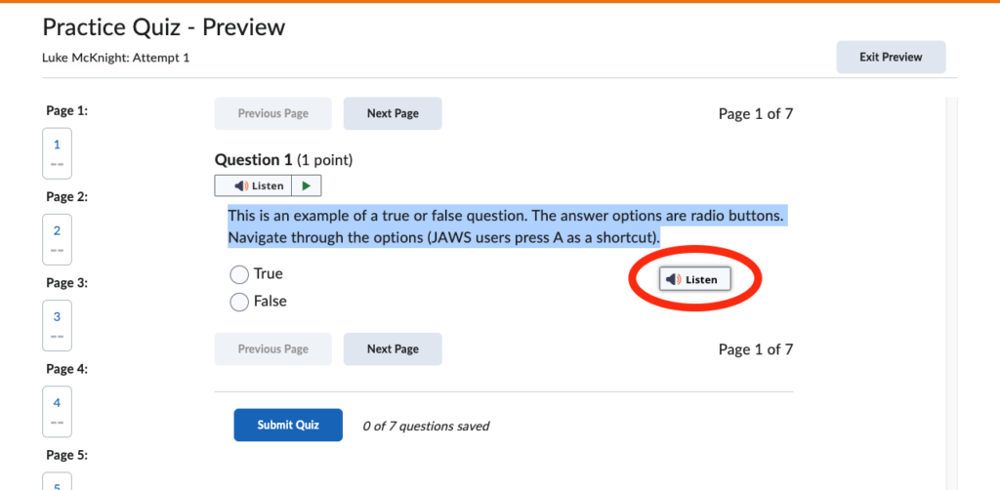 <!-- review-alt -->

Choose **Listen** to hear the selected text.

### Enlarge Text

Enlarge Text opens a panel at the bottom of the screen that shows the text being read in large print. You can change its appearance.

1. Select the player menu button.
2. Toggle **Enlarge Text** to on.
3. Click **Listen**.
   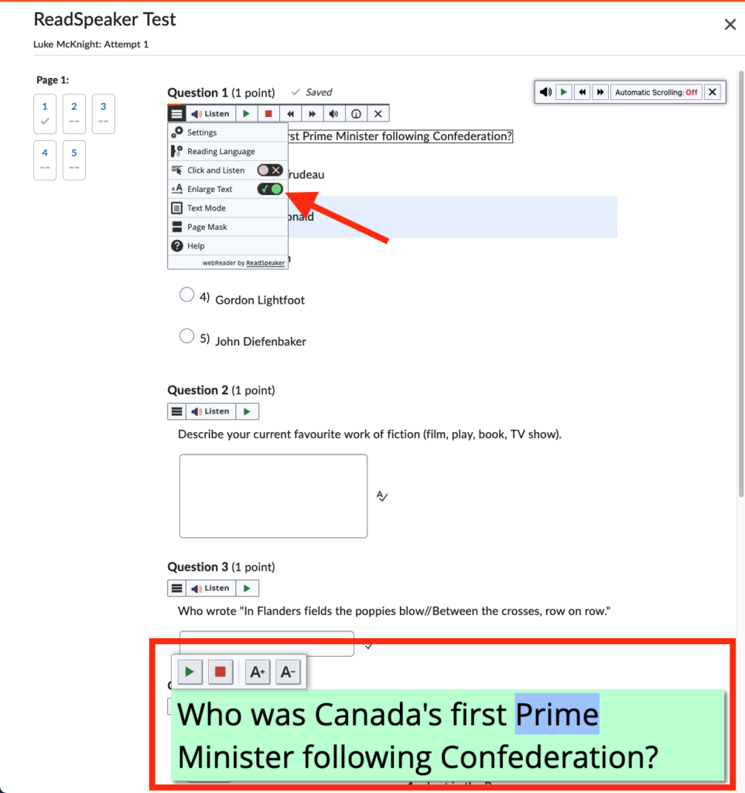 <!-- review-alt -->

### Text Mode

Text Mode shows a simplified, text-only view of the page.

1. Select the player menu button.
2. Choose **Text Mode**.
   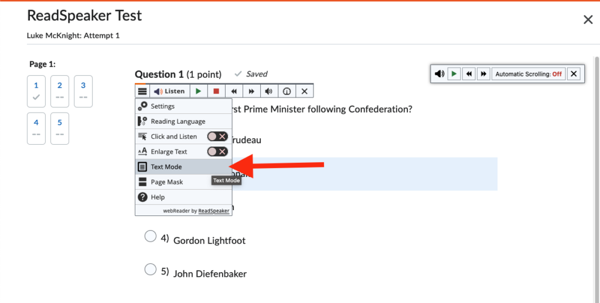 <!-- review-alt -->
3. A new overlay window will open showing the simplified version of the page.
   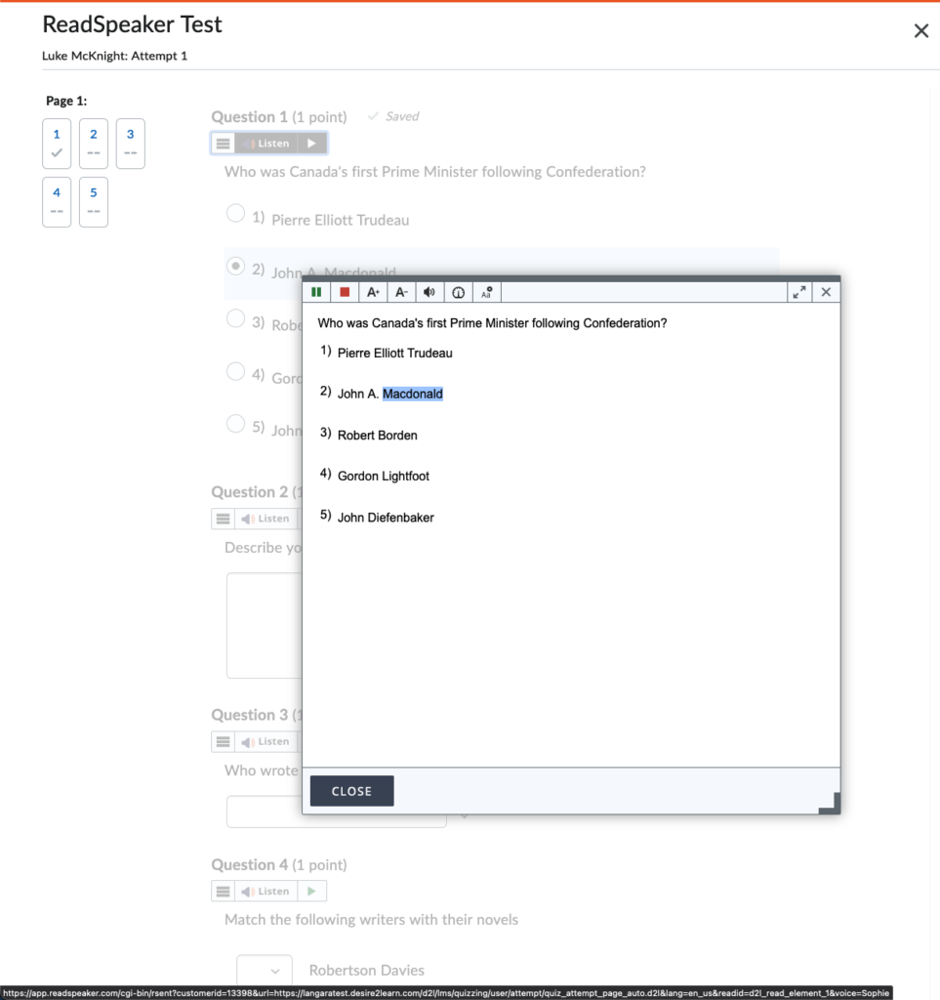 <!-- review-alt -->

### Page Mask

Page Mask dims the page except for a strip around the mouse pointer. This can help you focus on what is being read.

1. Select the player menu button.
2. Choose **Page Mask**.
   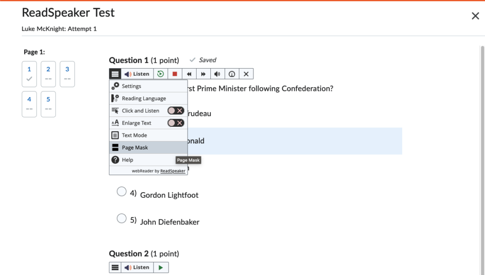 <!-- review-alt -->
3. The screen will dim except for a horizontal line that follows the mouse.
   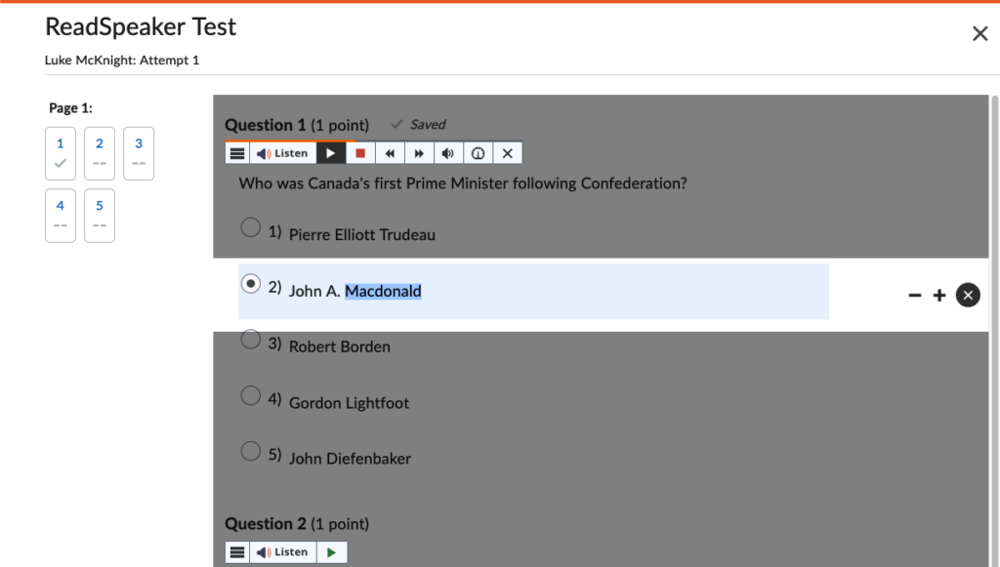 <!-- review-alt -->

Change the size of the strip with the **+** and **–** buttons on its right side.

### Click and Listen

Click and Listen reads aloud whatever text you click. It is turned off in quizzes so that you can't select an answer by accident.

1. Select the player menu button.
2. Toggle **Click and Listen** to on.
   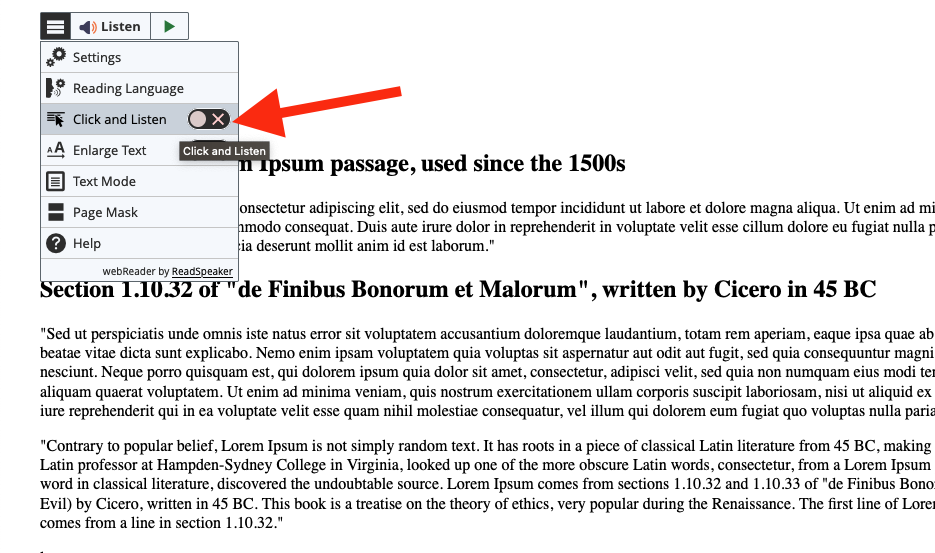 <!-- review-alt -->
3. Click on text on the page. You will see a red outline around what is being read as well as the highlighting of sentences and words.
   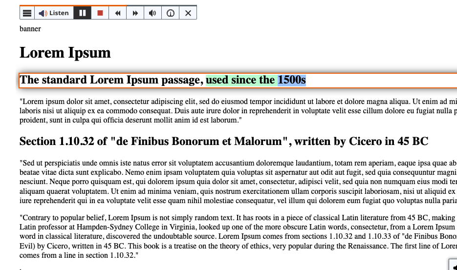 <!-- review-alt -->

### Reading Math

 <!-- review-alt -->

Math written with an equation editor, such as the Brightspace equation editor or [Equatio](equatio-quick-start-guide.md), can be read aloud by the **Listen** tool.

Unlike ordinary text, math is not highlighted as it is read.

docReader

docReader reads PDFs and Word documents in Brightspace aloud. Select **Open with docReader** below the document preview.
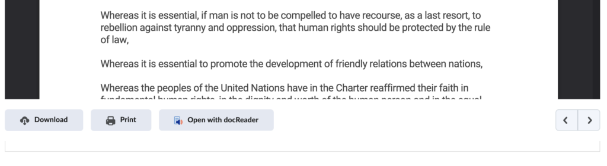 <!-- review-alt -->

Select **Listen**, or highlight text and choose **Listen**, to start reading.
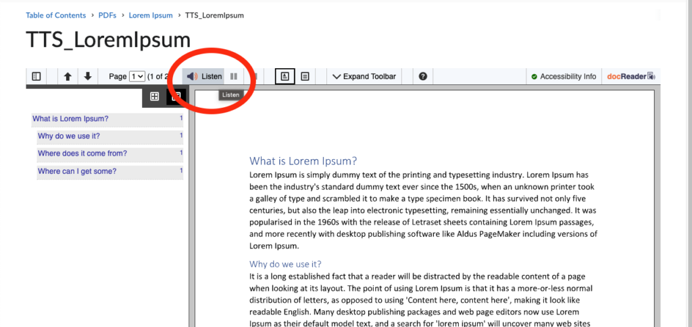 <!-- review-alt -->

Select **Text Mode** to see a simplified version of the document.

Select **Layout Mode** to return to the original view of the document.
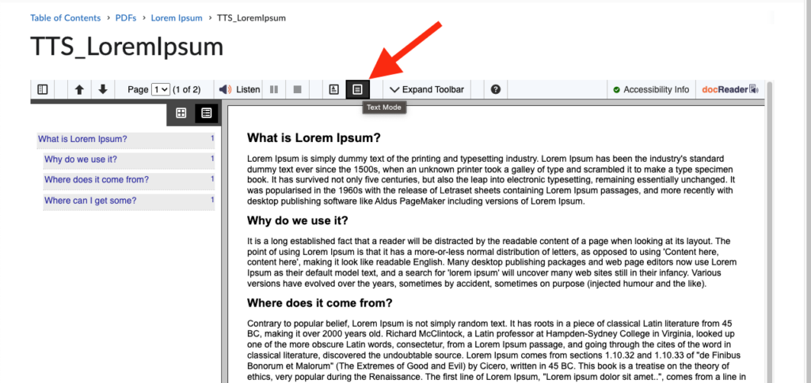 <!-- review-alt -->

Select **Expand Toolbar** for more options, or **Collapse Toolbar** to hide them.
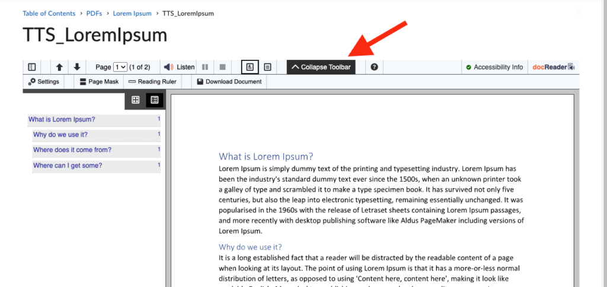 <!-- review-alt -->

**Page Mask** dims the document except for the lines around the mouse pointer.

**Reading Ruler** underlines the line under the mouse pointer as you read.

The **Settings** menu has options for reading speed, colour and highlighting settings, as well as font and spacing options in Text Mode.
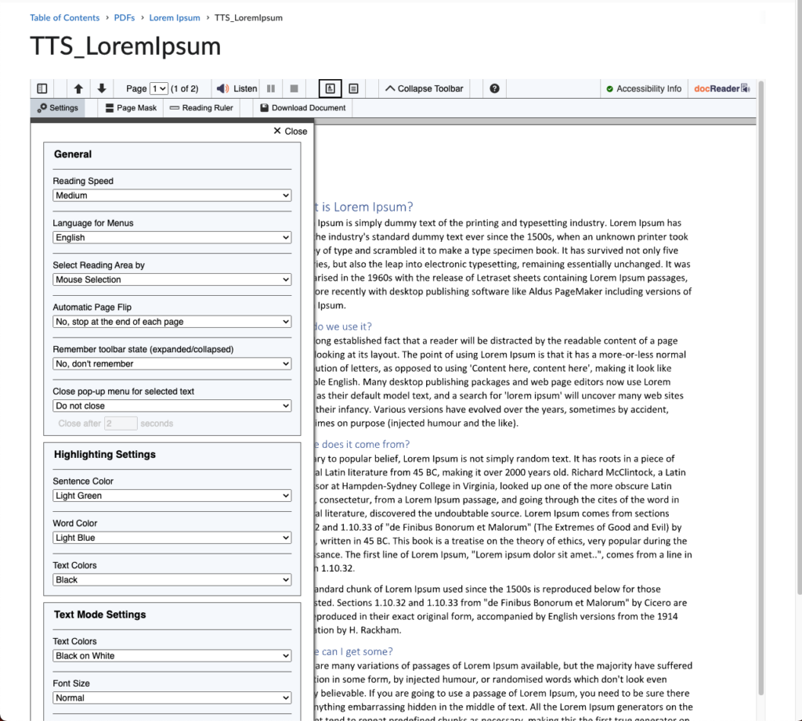 <!-- review-alt -->

TextAid

TextAid works like webReader, but anywhere on the web. It is a web app with a browser extension for [Chrome](https://chromewebstore.google.com/detail/readspeaker-chrome-extens/hjhgdemcnjlhekapcjegdlckfhbmfokc) and [Firefox](https://addons.mozilla.org/en-US/firefox/addon/readspeaker-textaid-add-on).

To get the extension, go to [TextAid](https://ws.readspeaker.com/a/wasp/app/8) and select **Sign in with Office 365**. Log in with your Langara email address and password.

1. Select **Web Reading**.
   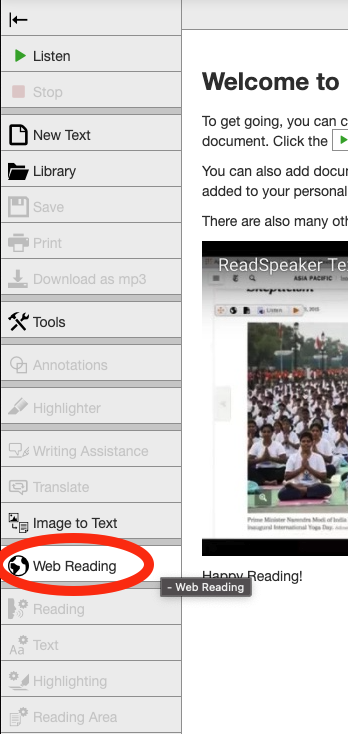 <!-- review-alt -->
2. Select **Computer** or **Mobile**.
   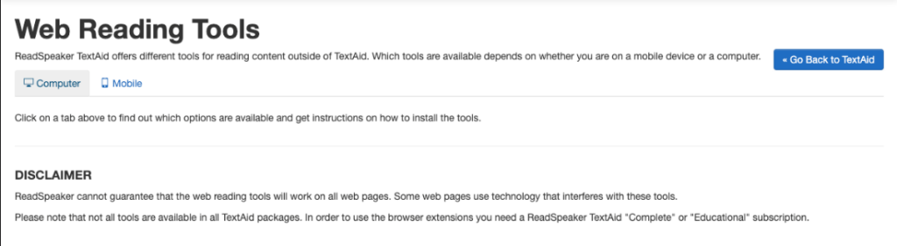 <!-- review-alt -->
3. Choose your preferred browser.
   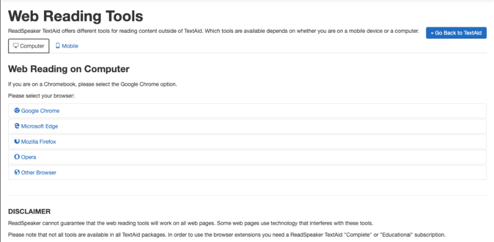 <!-- review-alt -->
4. Each option includes instructions and a link to install the extension.

Once the extension is installed, you can open it straight from the browser without going through TextAid first.

### Using the extension

1. Select the Extensions icon (a puzzle piece in Chrome and Firefox) near the top right of the browser.
2. Choose **ReadSpeaker® TextAid**.
3. The ReadSpeaker tool will open.
   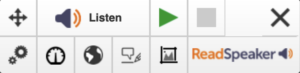 <!-- review-alt -->
   - A pop-up will guide you to log in if you are not currently logged in.
4. Highlight text and select the **Play** button (green arrow).
5. Change highlighting, reading speed, and language on the toolbar using the gear, speedometer, and globe icons.
   - Writing assistance tools are only available in Word or Google Docs.
6. The **Snapshot** tool (frame icon) allows you to extract text from pictures.

### Learn More

- [The Complete Guide to TextAid](https://www.readspeaker.com/blog/textaid-features)
- [ReadSpeaker education resources](https://www.readspeaker.com/resources/education/)

## Word

Microsoft Word has two text to speech tools: **Read Aloud** and **Immersive Reader**.

Read Aloud

Read Aloud is available in the desktop version of Word. Move to the **Review** tab and click **Read Aloud**, or press <kbd>Alt</kbd> + <kbd>Ctrl</kbd> + <kbd>Space</kbd>.
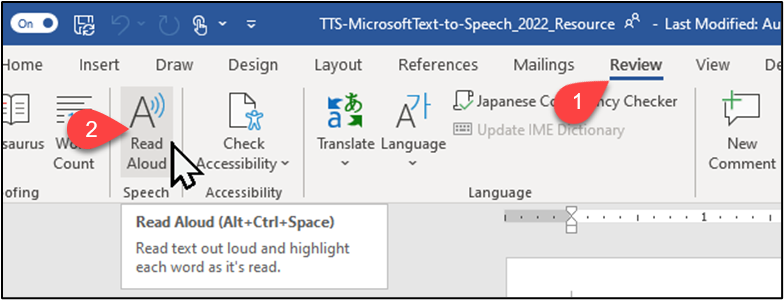 <!-- review-alt -->

A small toolbar appears with controls and voice options.
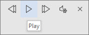 <!-- review-alt -->

Users can have Read Aloud read from their cursor position or select text and have only the selection read.

Immersive Reader

Immersive Reader is available in both desktop and browser versions of Word. Immersive Reader is also available in the browser version of PowerPoint.

To open Immersive Reader, move to the **View** tab and select **Immersive Reader**.
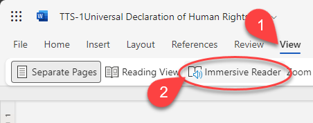 <!-- review-alt -->

The document’s appearance will change. At the bottom of the window, users can access Read Aloud tools.
 <!-- review-alt -->

In Immersive Reader, users can customize text size and spacing, font styles, background colour, and more.
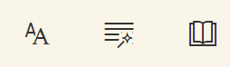 <!-- review-alt -->

For more information, read [Listen to your Word documents – Microsoft Support](https://support.microsoft.com/en-us/office/listen-to-your-word-documents-5a2de7f3-1ef4-4795-b24e-64fc2731b001).

## Device Built-in

Android

1. Download **Android Accessibility Suite** if not already on device.
2. Open **Settings**.
3. Select **Accessibility**.
4. Select **Installed Apps**.
5. Choose **Select to Speak**.
   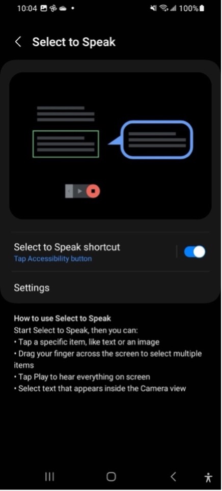 <!-- review-alt -->
6. Follow prompts to set up service.
7. In apps you want read aloud, tap the accessibility icon in the bottom right.
   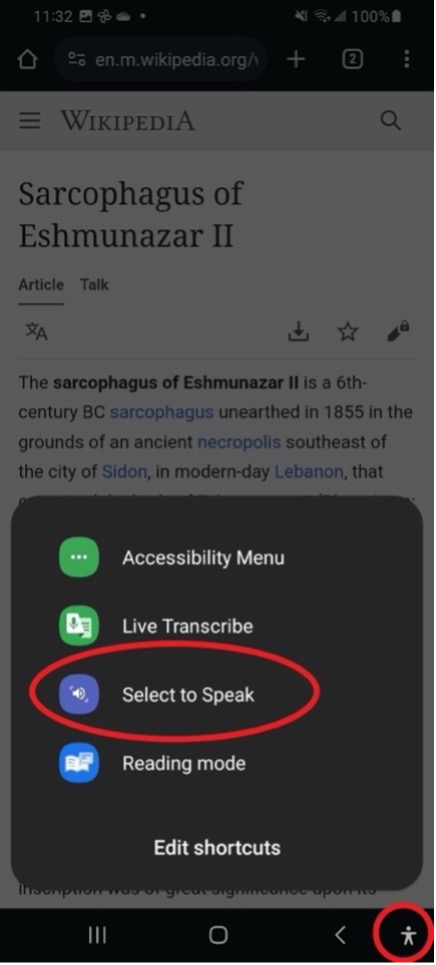 <!-- review-alt -->
8. Tap on text or tap and drag around text you want read aloud.
   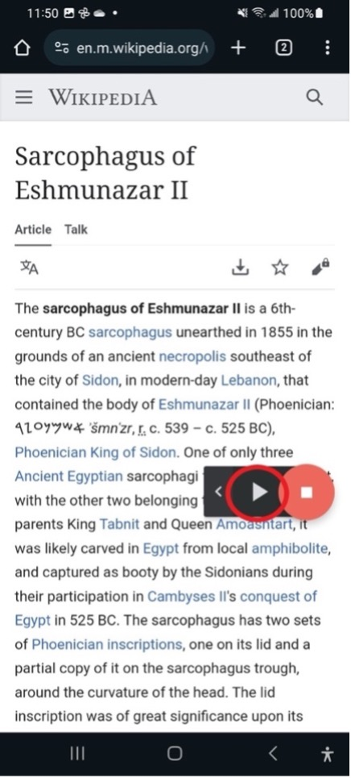 <!-- review-alt -->
   1. Use toolbar to stop, pause, or change settings.

These steps may be slightly different on your phone.

Android also has a **Reading mode** app, which shows the text on screen in a simplified view and can read it aloud.

1. Install the [Reading mode app](https://play.google.com/store/apps/details?id=com.google.android.accessibility.reader) from the Google Play Store and open **Reading mode**.
2. Navigate to **Settings > Accessibility**.
3. Select **Installed apps**.
4. Select **Reading Mode**.
5. Set desired **Reading mode** shortcut.
6. Open the **Accessibility** shortcut and select **Reading Mode**.
   1. **Reading mode** does not work on every page. It works best on documents and text-heavy pages.
7. **Reading mode** changes the appearance of content.
8. Press **Play** to begin reading.
   1. Press **Settings** to change appearance and audio settings.

### Learn More

- [Use Select to Speak – Android Accessibility Help](https://support.google.com/accessibility/android/answer/7349565?hl=en)
- [Use Reading mode – Android Accessibility Help](https://support.google.com/accessibility/android/answer/13026948?hl=en)

ChromeOS

1. Navigate to **Settings > Accessibility > Text-to-speech**.
2. Toggle on **Select to Speak**.
3. Select the **Select to Speak** icon (circle with speaker) on the Shelf and click and drag over content you want read aloud. Or highlight text and press <kbd>Search</kbd> + <kbd>S</kbd>.
4. The **Select to Speak** navigation bar will appear with options to pause, skip, rewind, and change speed.
    <!-- review-alt -->

Additional options for voices and highlighting are available under **Settings > Accessibility > Text-to-Speech > Select to speak settings**.

[Hear text read aloud – Chromebook Help](https://support.google.com/chromebook/answer/9032490?hl=en)

iOS

Use **Read & Speak** (called **Spoken Content** in iOS 18 and earlier) to have text read aloud.

1. Go to **Settings > Accessibility**.
2. Tap **Read & Speak**.
3. Turn on **Speak Selection**.
   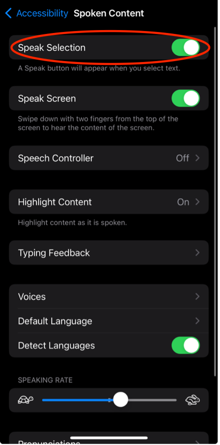 <!-- review-alt -->
4. Highlight text and select **Speak** to hear selected text read aloud.
   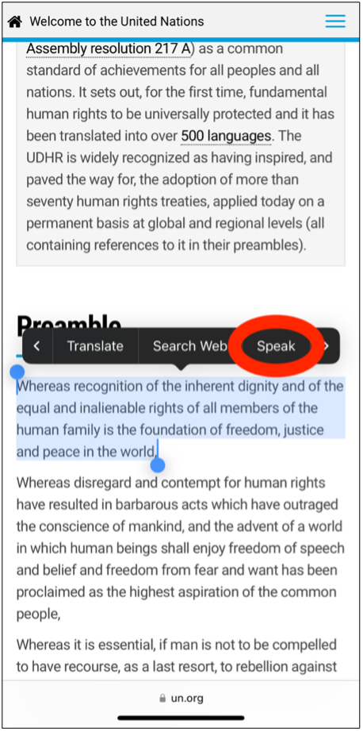 <!-- review-alt -->

To hear everything on screen read aloud:

1. Go to **Settings > Accessibility > Read & Speak**.
2. Turn on **Speak Screen**.
   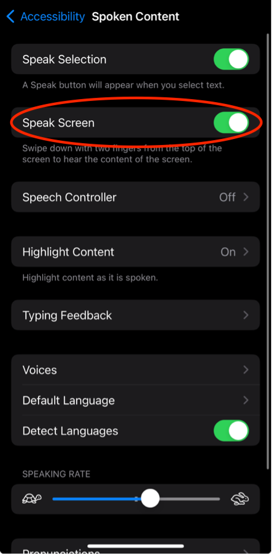 <!-- review-alt -->
3. Swipe down from the top of the screen with two fingers to hear everything on the screen.
4. Use the toolbar to control speech.
   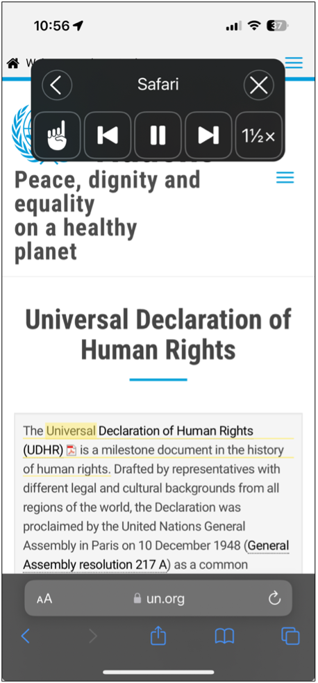 <!-- review-alt -->

In Safari, use **Listen to Page** when available:

1. Select the  <!-- review-alt --> icon in the address bar and choose **Listen to Page**.
   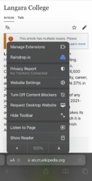 <!-- review-alt -->
2. Control playback by tapping on  <!-- review-alt --> in the address bar.
3. Control reading speed, skip forward and back, pause, or stop listening.
   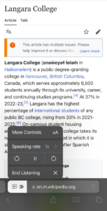 <!-- review-alt -->

### Learn More

- [Hear iPhone speak the screen, selected text, and typing feedback – Apple Support (CA)](https://support.apple.com/en-ca/guide/iphone/iph96b214f0/ios)

macOS

Turn on **Speak selection**:

1. Go to **System Settings > Accessibility > Read & Speak** (called **Spoken Content** in older versions of macOS).
2. Turn on **Speak selection**.
3. Select the **ⓘ** button beside it to change options such as highlighting and the controller.
   1. The default keyboard shortcut for Speak selection is <kbd>Option</kbd> + <kbd>Escape</kbd>.
4. Choose a **System voice** and select **Play Sample** to check the voice and speed.

To hear text, select it and press <kbd>Option</kbd> + <kbd>Escape</kbd>. The speech controller appears with options for controlling speech.

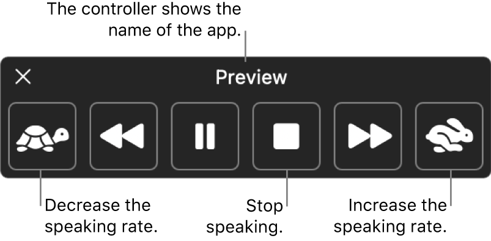 <!-- review-alt -->

 <!-- review-alt -->

In macOS Tahoe 26 and later, [Accessibility Reader](https://support.apple.com/en-ca/guide/mac-help/mchl799f6fb9/mac) shows the text of any app in a full-screen view where you can change the font, colours, and spacing, and have the text read aloud.

### Learn More

- [Have your Mac speak text that’s on the screen – Apple Support (CA)](https://support.apple.com/en-ca/guide/mac-help/mh27448/mac)
- [Change Read & Speak settings for accessibility on Mac – Apple Support (CA)](https://support.apple.com/en-ca/guide/mac-help/spch638/mac)

## Browser tools

Chrome

Chrome’s **Reading mode** shows a simplified version of a page and can read it aloud.

1. Open Reading mode in one of these ways:
   - Right-click on the page and select **Open in reading mode**.
   - Select the **Reading mode** icon in the address bar, when it appears.
   - Open the Chrome menu (three dots) and select **More tools > Reading mode**.
   - Press <kbd>Alt</kbd> + <kbd>Shift</kbd> + <kbd>R</kbd> (Windows and ChromeOS) or <kbd>Command</kbd> + <kbd>Option</kbd> + <kbd>R</kbd> (macOS).
2. Select **Play** to have the page read aloud. Use the controls to pause, skip between sentences, and change the speed.
3. Under **Settings**, choose a voice, the highlighting, and the font, size, spacing, and colours.

Reading mode doesn’t work on every page, for example forms, quizzes, and login pages.

[Use Reading mode in Chrome – Google Chrome Help](https://support.google.com/chrome/answer/14218344)

Edge

Edge has two reading tools: **Read Aloud** and **Immersive Reader**.

There are 3 ways to activate Read Aloud:

1. Press <kbd>Ctrl</kbd> + <kbd>Shift</kbd> + <kbd>U</kbd>.
2. Click the **A** icon in the address bar. Read Aloud will begin reading from the top of the page.
   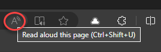 <!-- review-alt -->
3. **Right-click** on text and select **Read Aloud** or **Continue to read aloud from here**. Additionally, users can select text, right-click and click **Read Aloud Selection**.
   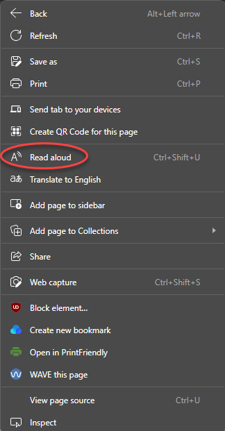 <!-- review-alt -->

To use **Immersive Reader**, press <kbd>F9</kbd> or click the Immersive Reader icon in the address bar (when available).
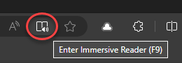 <!-- review-alt -->

Immersive Reader offers a simplified version of webpages with full Read Aloud functions. Additional visual customizations and reading preferences are available.
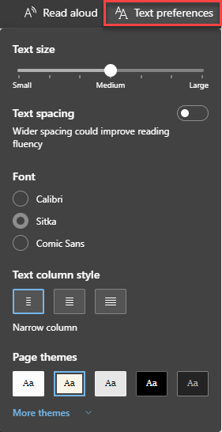 <!-- review-alt -->

- [Read aloud – Microsoft Edge](https://www.microsoft.com/en-us/edge/features/read-aloud)
- [Use Immersive Reader in Microsoft Edge – Microsoft Support](https://support.microsoft.com/en-us/topic/use-immersive-reader-in-microsoft-edge-78a7a17d-52e1-47ee-b0ac-eff8539015e1)

Firefox

Press <kbd>F9</kbd> or <kbd>Ctrl</kbd> + <kbd>Alt</kbd> + <kbd>R</kbd> (Windows) or <kbd>Command</kbd> + <kbd>Option</kbd> + <kbd>R</kbd> (macOS) to open or close Reader View, or click the lined paper icon in the address bar.
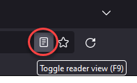 <!-- review-alt -->

Reader View includes built-in text to speech and display customization.
 <!-- review-alt -->

The look of webpages can be customized, including the font as well as line, character, and word spacing.
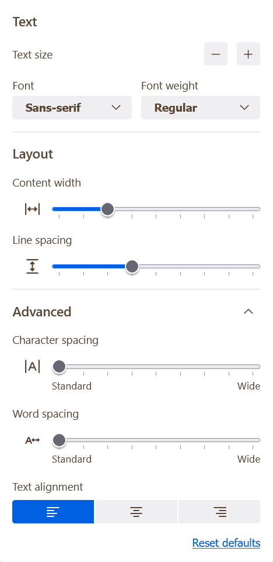 <!-- review-alt -->

The background colour can be changed, as well as the colour of links, font, background, and highlighting under the **Custom** tab.
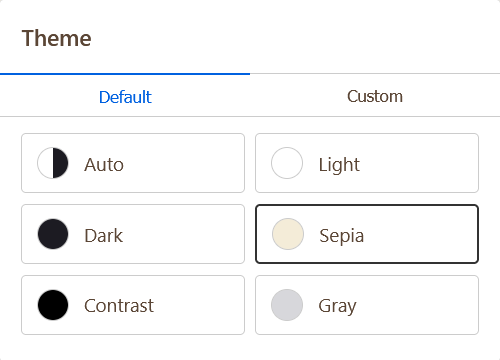 <!-- review-alt -->

The **Read aloud** tool (headphone icon) offers read aloud functions, variable speed, and voice options.
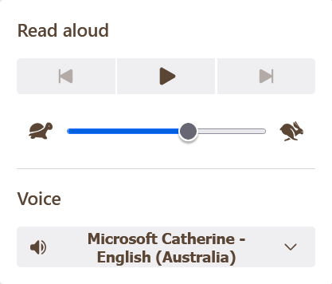 <!-- review-alt -->

Reader View is not available on all webpages.

[Firefox Reader View for clutter-free web pages](https://support.mozilla.org/en-US/kb/firefox-reader-view-clutter-free-web-pages)

Safari

Safari uses the Mac’s built-in speech. Turn on **Speak selection** first (see [macOS](#macos) above), then in Safari:

1. Highlight text.
2. **Right-click**.
3. Select **Speech**.
4. Select **Start Speaking**.
   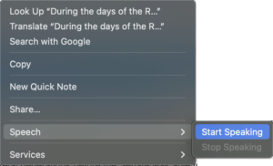 <!-- review-alt -->

Or highlight text, select **Edit** from the menu bar, choose **Speech**, and click **Start Speaking**.

Use the speech controller to control reading and speed.
 <!-- review-alt -->

Safari’s **Reader** shows a simplified version of articles, which may make them easier to read. Click **Show Reader** in the address bar.
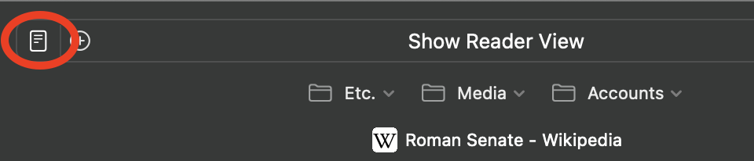 <!-- review-alt -->

You can also press <kbd>Command</kbd> + <kbd>Shift</kbd> + <kbd>R</kbd>, or open the **View** menu and select **Show Reader**. Reader is not available on all websites.

[Hide distractions when reading articles in Safari on Mac – Apple Support (CA)](https://support.apple.com/en-ca/guide/safari/sfri32632/mac)

