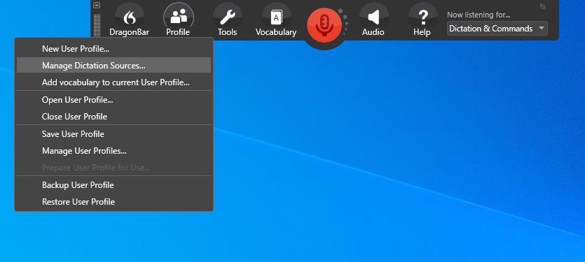
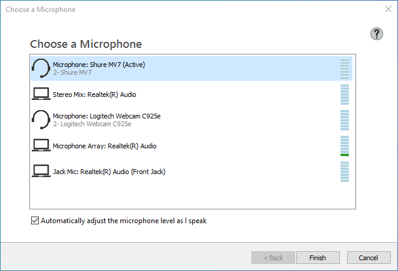
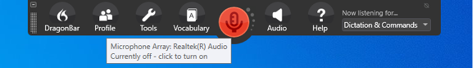
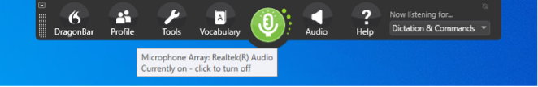
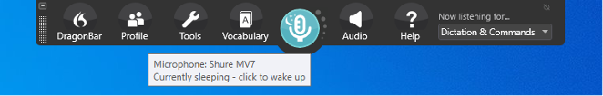
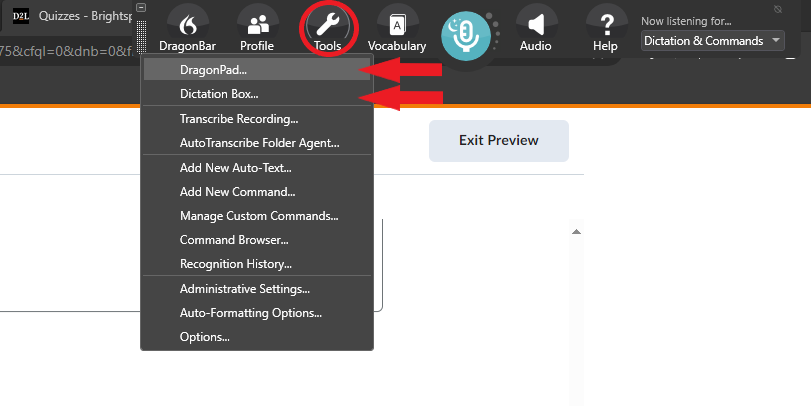
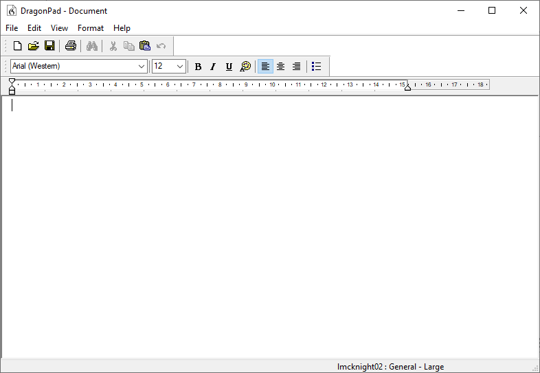
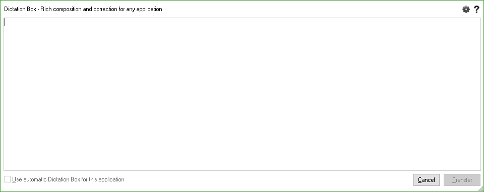
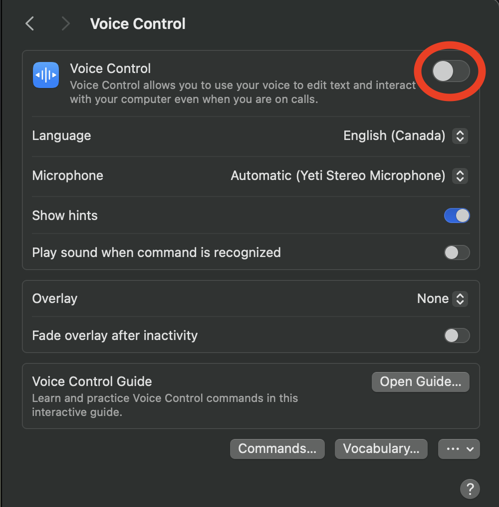

# Voice Control

Voice control lets you operate a computer or phone with your voice: open apps, click buttons and links, and dictate and edit text. For dictation only, see [Speech to Text Tools](speech-to-text-tools.md).

**On this page:**

- [Dragon](#dragon)
- [Windows Voice Access](#windows-voice-access)
- [macOS/iOS Voice Control](#macosios-voice-control)
- [Android](#android)

## Dragon



{: .langara}
Langara has a limited number of Dragon licenses. Contact Accessibility Services for information.

Dragon is Windows software for dictating text and operating a computer with voice commands.

Setup

[Dragon user documentation](https://dragon.nuance.com/en-us/user-documentation) has quick start guides and command cheat sheets.

Use an external microphone (such as a headset) to cut down background noise and get the best accuracy. Plug in the microphone before starting Dragon. To make sure Dragon is using the right microphone:

1. Open the **Profile** menu.
2. Choose **Manage Dictation Sources…**
    <!-- review-alt -->
3. Choose the correct source.
    <!-- review-alt -->
4. Click **Finish**.

To use Dragon on the web (Brightspace, Microsoft 365, Google Docs, and so on), install the [Dragon Web Extension for Chrome](https://chromewebstore.google.com/detail/dragon-web-extension/ddaloccgjfibfpkalenodgehlhkgoahe).

The first time you use Dragon, it walks you through creating a user profile, adjusting the microphone, and tuning Dragon to your voice. It then opens an interactive tutorial on basic features, dictation, correction, and editing. New users should do the tutorial.

Basic Functions

To turn Dragon on or off:

1. When the microphone icon is red, Dragon is not listening. Click the icon to start Dragon.
    <!-- review-alt -->
2. When the microphone icon is green, Dragon is listening and will type what you say.
    <!-- review-alt -->
3. Click the green icon to stop Dragon.
4. Say “go to sleep” and the icon turns blue. Dragon is in sleep mode and won’t type what you say. Say “wake up” or click the icon to continue.
    <!-- review-alt -->
5. On a desktop computer, press the <kbd>+</kbd> key on the number pad to toggle the microphone on and off.

For help, use the **Help** menu, or say “Dragon learning center” or “What can I say?”

Dictation

To dictate text using Dragon, open a word processor, **DragonPad**, or **Dictation Box**.

 <!-- review-alt -->

1. Put the blinking text cursor where you want the text to go.
2. Turn on Dragon’s microphone.
3. Start speaking. Your words are typed into the text field.

Speak naturally, in whole phrases: Dragon is more accurate when you pause less.

To add punctuation, say:

- “Period” or “full stop”
- “Comma,” “exclamation mark,” or “question mark”
- “open paren,” “close paren,” “open quote,” “close quote”
- “at sign,” “plus sign,” “underscore,” “semi colon,” etc.
- After dictating text, say “bullet that,” “bold that,” or “underline that.”
- Say “new line” and “new paragraph” to move to a new line.

To delete transcribed text, say:

- “delete that” or “undo that” to delete what you last dictated.
- “delete last (number) words”, for example “delete last 3 words”.
- “delete last line”.

If Dragon makes a spelling error, say “correct that.” If the correct word appears in the menu, select it to automatically replace the incorrect word with the correct one. If the correct word does not appear in the menu, say “spell that” and spell the word letter by letter.

DragonPad

Open **DragonPad** by saying “Open DragonPad” or by selecting **Tools > DragonPad…**

 <!-- review-alt -->

DragonPad is a basic word processor. You can save your text in common formats, or copy and paste it into other programs.

Dictation Box

Open **Dictation Box** by saying “Open Dictation Box”, by pressing <kbd>Ctrl</kbd> + <kbd>Shift</kbd> + <kbd>D</kbd>, or by selecting **Tools > Dictation Box…**

 <!-- review-alt -->

Before opening **Dictation Box**, put the text cursor in the field where the text should go. Dictate into the box, then select **Transfer** to send the text to that field.

{: .warning }
Occasionally **Transfer** fails and the dictated text is lost. To be safe, copy everything in the Dictation Box (<kbd>Ctrl</kbd> + <kbd>A</kbd>, then <kbd>Ctrl</kbd> + <kbd>C</kbd>) and paste it into the field yourself (<kbd>Ctrl</kbd> + <kbd>V</kbd>).

Vocabulary Editor

The **Vocabulary Editor** lets you look up words and teach Dragon new ones, which improves recognition. Select **Vocabulary** on the DragonBar for tools such as **Learn from**, **Add new word or phrase**, and **Vocabulary editor**. To train Dragon further, go to **Help > Improve my accuracy**.

Voice Commands

Common commands for controlling a device:

- “Open (application)” “Start (application)”
- “Switch to (open application)”
- “Show desktop”
- “Click Start”
- “Close window”
- “Cancel” “Press Escape”
- In browser “search Google for…”
- Select text:
  - “Select all” “Unselect that”
  - “Select (speak words to be selected)”
  - “Select next (number) words”
  - “Select previous paragraph”
  - Note: Caret browsing must be enabled to select text on the web. Press <kbd>F7</kbd> to turn on caret browsing.
  - “Copy that” “Cut that” “Paste that”

[Dragon Professional Individual command cheat sheet (PDF)](https://dragon.nuance.com/shared/user-docs/ct-dragon-professional-individual-en-us.pdf)

Navigating the Internet

To use Dragon on the web, install the [Dragon Web Extension for Chrome](https://chromewebstore.google.com/detail/dragon-web-extension/ddaloccgjfibfpkalenodgehlhkgoahe).

Useful voice commands include:

- “Go to address bar”
- “Click (link name)”
- “Go to next tab” “Go to third tab” etc.
- “Click type text” to see all the places where text can be entered.

If you have trouble selecting something on a web page, say “Show links” or “Show choices”, then “Choose (number)” for the link or field you want. This also works for text fields, radio buttons, and checkboxes.

[Web browser basics – Dragon Help](https://www.nuance.com/products/help/dragon/dragon-for-pc/enx/professionalgroup/main/Content/Web/web_basics.htm)

MouseGrid

MouseGrid lets you move the mouse pointer by voice.

1. Say “MouseGrid”.
2. Say “click (1 to 9)” to select a grid square.
3. Repeat until the cursor is on the item to be clicked.
4. Say “click that”.

### Options and Tools

Migrating User Profile

1. Plug in a USB drive.
2. Launch Dragon.
3. Select **Profile** button > **Manage User Profiles**.
4. Choose a profile.
5. Click **Advanced**.
6. Select **Export**.
   1. Choose location (USB drive).
7. Eject the USB drive and move to the new computer.
8. Launch Dragon.
9. Select **Profile** button > **Manage User Profiles**.
10. Click **Advanced**.
11. Select **Import**.
    1. Choose the folder copied from the other computer.

Recognition History

Dragon keeps a list of the recent things you have said (“recognized utterances”). If you lose dictated work that wasn’t saved, you may be able to get it back from here, although your speech may be split across many lines. Save your work often.

To open Recognition History:

1. On the Dragon toolbar, select **Tools**.
2. Select **Recognition History…**
3. Click **Save…** to save the whole recent history as a plain text file, then copy the lost text from it.
4. Or select individual utterances and copy the text from the **Utterance Selection** window.

Speed vs. Accuracy

Open **Tools > Options > Miscellaneous** and move the **Speed vs. Accuracy** slider. Toward **Accuracy**, Dragon checks more words in its vocabulary for each thing you say: it is more accurate, but needs more computing power and may respond more slowly.

Dictation Box in Unsupported Applications

To stop the Dictation Box opening in programs Dragon doesn’t support (such as LockDown Browser):

1. Navigate to DragonBar, **Tools > Options**.
2. Select the **Miscellaneous** tab.
3. Uncheck the **Use the Dictation Box for unsupported applications** checkbox.
4. Click **OK**.

Links and Further Reading

- [Dragon user documentation](https://dragon.nuance.com/en-us/user-documentation): guides and cheat sheets
- [Dragon support](https://dragon.nuance.com/en-us/dragon-support.html)
- [Dragon videos – Microsoft for Healthcare on YouTube](https://www.youtube.com/@MicrosoftforHealthcare)
- [Using the Dictation Box – Dragon Help](https://www.nuance.com/products/help/dragon/dragon-for-pc/enx/professionalgroup/main/Content/Dictation/using_the_dictation_box.htm)
- [Using Dragon with Microsoft Word (PDF)](https://dragon.nuance.com/shared/user-docs/ct-dragon-for-word-2007-en-us.pdf)
- [Using Dragon with Microsoft Excel (PDF)](https://dragon.nuance.com/shared/user-docs/ct-microsoft-word-dragon-for-excel.doc-en-us.pdf)
- How to [export and import a Dragon profile](https://nuance.custhelp.com/app/answers/detail/a_id/6874/~/how-to-export-and-import-a-user-profile-in-dragon-naturallyspeaking)

## Windows Voice Access



**Voice access** is built into Windows 11 (version 22H2 or later). It lets you control your PC and dictate text with your voice. After setup, it works without an internet connection.

Turn on Voice Access

1. Go to **Settings > Accessibility > Speech** and turn on **Voice access**. Or search Windows for “voice access” and select **Open**.
2. The first time, choose your language and select **Agree and continue** to download the speech files.
3. Check your microphone on the **Setup microphone** screen.
4. Take the guided tour, or close it to start using voice access.

Toggle on Voice Access using <kbd>Control</kbd> <kbd>Win</kbd> <kbd>s</kbd>

When activated, the voice access bar appears at the top of the screen. Some useful commands:

- “Voice access wake up” and “Voice access sleep” to start and pause listening.
- “What can I say?” to see the list of commands.
- “Show numbers” to number the things you can click, then say a number.
- “Show grid” to point at anything on the screen.

### Learn more
- [Set up voice access – Microsoft Support](https://support.microsoft.com/en-us/accessibility/windows/voice-access/set-up-voice-access)
- [Get started with voice access – Microsoft Support](https://support.microsoft.com/en-us/accessibility/windows/voice-access/get-started-with-voice-access)

## macOS/iOS Voice Control



Voice Control lets you navigate and use your Mac with only your voice. 

To turn Voice Control on:

1. Go to **System Settings**.
2. Select **Accessibility**.
3. Choose **Voice Control**.
4. Turn on **Voice Control**.
    <!-- review-alt -->

Select **Commands…** to see the available commands, and **Vocabulary…** to add words so your Mac understands you better.

Click **Open Guide…** to learn how to use Voice Control.

Voice Control is also available on iPhone and iPad:

1. Go to **Settings > Accessibility**.
2. Choose **Voice Control**.
3. Tap **Set Up Voice Control**.
4. Select **Open Voice Control Guide** for help.
5. The **Voice Control** settings have many options to customize it.

### Tips

Say “go to sleep” to pause listening and “wake up” to resume. Say “show names”, “show grid” or “show numbers”.

[Use Voice Control to interact with iPhone – Apple Support (CA)](https://support.apple.com/en-ca/guide/iphone/iph2c21a3c88/ios)

Use natural language, such as “open Mail” or “quit System Settings”.

Say “show numbers” to show a number beside everything you can click. Say “click \[number\]” to select it.

Say “show grid” to point at things that don’t have a number. Say the number of the grid square the item is in, and repeat to narrow it down. Then say “click \[number\]” to click. Say “hide grid” to turn off the grid.

[Use Voice Control commands to interact with your Mac – Apple Support (CA)](https://support.apple.com/en-ca/guide/mac-help/mh40719/mac)

## Android

Android’s **Voice Access** app lets you control your phone with your voice. To set it up:

1. If Voice Access isn’t on your phone, install [Voice Access](https://play.google.com/store/apps/details?id=com.google.android.apps.accessibility.voiceaccess) from Google Play.
2. Go to **Settings > Accessibility**.
3. Select **Voice Access**. On some phones it is under **Installed apps** or **Interaction and dexterity**.
4. Turn on the **Voice Access** shortcut.
5. Turn on **Voice Access**, or start it with the accessibility shortcut.
   1. A blue icon with a sound wave appears on the screen when Voice Access is ready.

[Use Voice Access commands – Android Accessibility Help](https://support.google.com/accessibility/android/answer/6151854)
